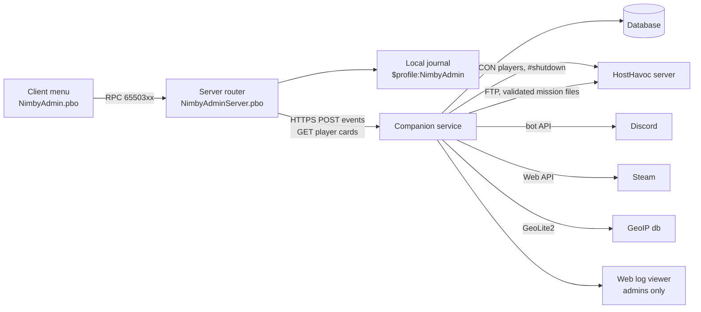

# Central Scrutinizer feasibility addendum - player intelligence, map, spectate, config

Draft v0.3, October 21, 2026. Owner: Jeff Fabish. Status: Jeff ruled on Q1-Q6 on October 16, 2026 (see Decisions); the companion is named Eyes and is planned later as its own mod-board row; its prerequisite is moving the game server from HostHavoc to a VPS Jeff manages (feasibility in `docs/design/vps-move-feasibility.md`). Changes since v0.2: Plan 3 v0.5 (October 21, 2026) adds a Phase 5 (vehicle manager, object tools, admin notes) between release 1 and the map; the landing table below is updated and the vehicle registry built there is the source the Phase 6 map reads. Changes since v0.1: rulings recorded; the companion runs beside the game server, so the RCON, FTP, and public-endpoint notes below describe the HostHavoc-era shape and are superseded by local access on the VPS. Extends `nimby-admin-feasibility.md` and Plan 3 (`docs/plans/2026-10-15-nimby-admin-plan.md`, v0.5). Every API cited was read in `vendor/dayz-1.30-scripts/` (build 1.30.164078.38) on October 16, 2026; `file:line` is relative to `vendor/dayz-1.30-scripts/scripts/` unless stated.

Target: NIMBY | HARDCORE | BADLANDS | 1pp, HostHavoc, DayZ 1.30 / Nasdara.

## Verdict

Eleven of the eighteen requests are feasible inside the game server with vanilla 1.30 script hooks. Five of the rest (IP address, Discord membership, approximate location, Steam-account fingerprinting, the activity log link) are feasible only through a companion service outside the game, because Enforce script cannot see the network layer, call Discord safely, or query a database. One (hardware ID) is not feasible in any form available to a mod; an account-fingerprint score is the honest substitute. Spectate works, but only by moving the admin's hidden body near the target, because DayZ networks entities to a client only inside the server's network range. In-game server configuration is feasible for mission files and should still go through the companion, which has real XML tooling, backups, and diffs.

The one architectural consequence: the companion service and its database become a planned component of Central Scrutinizer. Without it, kill and death counts, first seen, and session history still work (they are server-side journal files), but everything that joins on IP, Discord, Steam, or geography does not.

## What this is not

- Not a plan. Phases and tests follow once Jeff rules on the decisions below.
- Not an anti-cheat. Nothing here detects memory editing or BattlEye evasion; BattlEye keeps that job.
- Not a change to the client-and-server PBO split (shared rules 8.1) or to the observation seams (Plan 3, N9). Every item below lands in one of those seams or in the companion.
- Not retroactive. Counters, first-seen dates, and base associations start when the mod ships; the only backfill is the connection lines in the RPT and `.ADM` logs the mirror already holds (from October 14, 2026).

## Feasibility by request

| # | Request | Verdict | How | Source |
| --- | --- | --- | --- | --- |
| F1 | Current action (walking, climbing, aiming, idle) | Yes, server side | Each refresh the server derives one label per player: `HumanCommandMove.GetCurrentMovementSpeed()` gives 0 idle, 1 walk, 2 run, 3 sprint; `IsClimbing()`, `IsClimbingLadder()`, `IsSwimming()`, `IsFalling()`, `IsRolling()`, `IsFighting()`, `IsUnconscious()`, `IsRestrained()`, `GetCommand_Vehicle()` (driver or passenger), and `HumanInputController.IsWeaponRaised()` for aiming. Sent with the Players feed, 5 s cadence, admin only | `3_Game/DayZ/human.c:468,650,1512`; the same predicate set vanilla uses in `EmoteManager.c:1053`; `DayZPlayerImplement.c:2467` |
| F2 | Kill and death count, ratio | Yes, own counters | Hook `DayZPlayerImplement.EEKilled` on the victim (server side). Vanilla already resolves the killer: `m_KillerData.m_Killer` is the root player of the damage source, `m_MurderWeapon` the item, `m_KillerHiTheBrain` the headshot flag. Record victim, killer (Steam64), weapon class, headshot, position, time. Vanilla's `STAT_PLAYERS_KILLED` is per life and resets on death, so it is not the counter. Ratio is computed in the companion; without the companion the server keeps a journal file and computes totals at boot | `DayZPlayerImplement.c:795,1580-1598`; `KillerData.c:1-6`; `AnalyticsManagerServer.c:3-8` |
| F3 | When joined (this session) | Yes | `MissionServer.OnEvent`: `ClientNewEventTypeID` (connect), `ClientReadyEventTypeID` (in world), `ClientDisconnectedEventTypeID`. Identity from `PlayerIdentity`: `GetName`, `GetPlainName`, `GetId` (BI id), `GetPlainId` (Steam64), `GetPlayerId`. Session rows: start, ready, end, duration | `MissionServer.c:317-395`; `gameplay.c:357-372` |
| F4 | Column customizer | Yes, client only | Column set and order saved per admin in `$profile:NimbyAdmin\client.json` with the same `JsonFileLoader` the server config uses. Pure layout work in the Players page | Plan 3 data formats; `CfgGameplayHandler.c:3` shows the file pattern |
| F5 | IP address | No in script; yes via companion | `PlayerIdentity` exposes names, ids, ping, and throttle, not the address (the whole class is `gameplay.c:357-372`). BattlEye RCON's `players` command lists `ip:port` per connected player; the companion polls it over RCON and joins on the player name and BE GUID to the Steam64 the server reported | `gameplay.c:357-372`; HostHavoc RCON access already used by the restart chain |
| F6 | Activity log per player | Yes via companion | Every server event above (sessions, kills, deaths, admin actions, position samples at a configurable interval, base interactions from F15) is posted to the companion and stored per Steam64. The in-game Players page shows a 20-line summary; the full log is a companion web page. The menu can show the address; whether `GetGame().OpenURL` works on a dedicated-server client is confirmed in Phase 0 | Companion; `RestApi.c` (F13) |
| F7 | Server configuration from in game (loot economy, server cfg) | Partial; do it through the companion | Script can write under `$mission:` (vanilla writes `cfggameplay.json` and reads `db\` from there), so `types.xml`, `globals.xml`, `events.xml`, and `cfggameplay.json` are rewritable and take effect at the next restart. Enforce has no XML parser, so in-script edits would be line rewrites against a known schema, which is the kind of change that corrupts a file nobody validates until boot. `serverDZ.cfg` is outside the mission and HostHavoc regenerates `serverDZ_By_HostHavoc.cfg` from panel settings, so in-game edits to it are overwritten. Recommended shape: the menu submits a change request (type, field, value); the companion edits the file with a real XML library, keeps a backup and a diff, validates against the 1.30 schema, uploads over the HostHavoc FTP account, and the change applies at the next scheduled restart. Server cfg stays in the panel | `CfgGameplayHandler.c:3`; `ObjectSpawner.c:18`; mirror file `serverDZ_By_HostHavoc.cfg` |
| F8 | Force reboot | Yes | Two paths. In script, `GetGame().RequestExit(IDC_MAIN_QUIT)` ends the server process after the mission save; whether HostHavoc starts it again depends on the panel's crash or exit auto-restart setting, which is confirmed in Phase 0. Preferred: the companion runs the same RCON sequence as the scheduled chain (warnings, `#lock`, `#shutdown`) on an admin's `server.restart` command with a countdown the server broadcasts, so a forced restart looks identical to a scheduled one | `DayZGame.c:2376`; `docs/operations/` restart schedule |
| F9 | Is in Discord | Yes via companion and a Discord bot | A bot in the NIMBY Discord resolves membership and roles by Discord user id. Linking Steam64 to a Discord id needs a one-time handshake: the player runs a `/link` command in Discord, gets a six-character code, and types it into an in-game prompt (or the reverse). The game server could call the Discord API itself (`RestContext.GET` plus `SetHeader` for the bot token), but that puts a bot token on the HostHavoc box; the companion holds it instead | `RestApi.c:103,141` |
| F10 | Hardware ID | No | Enforce script has no access to hardware, the OS, or the client machine; BattlEye's GUID is derived from the Steam id, and BattlEye's own HWID bans are not exposed to mods. Substitute: an account fingerprint score in the companion from Steam account age (`GetPlayerSummaries.timecreated`), owned-game count and profile visibility, IP `/24` and ASN overlap with a banned account, name similarity, and first seen within N days of a ban. A score above a threshold sets a "review" flag on the player card; it never bans on its own. A player with a new account, a VPN, and a new name is not caught by this or by anything else a mod can do | Steam Web API; companion |
| F11 | First seen | Yes | First `ClientNewEventTypeID` for a Steam64 writes the row. One-time backfill from the connection lines in the mirror's `.RPT` and `.ADM` files since October 14, 2026 | `MissionServer.c:326`; mirror `HostHavocDayZServer\` |
| F12 | Approximate location (city, state, country) | Yes via companion | GeoIP lookup of F5's address with a local MaxMind GeoLite2 City database (free license, updated weekly) or a lookup API. City accuracy is the ISP's point of presence more often than the player's town; state and country are reliable. See Privacy below | Companion |
| F13 | Data stored in a database | Yes, in the companion | Enforce has no database driver. Vanilla `RestApi` gives async `GET`, `POST`, and `FILE` with callbacks and a header setter; the server posts events to the companion over HTTPS with a shared secret and pulls player cards for the menu. Outage handling: a bounded in-memory queue plus an outbox file in `$profile:NimbyAdmin\outbox\` replayed on reconnect, the same shape as the Discord queue. Companion: one small service (SQLite to start, Postgres if it grows) with the RCON poller, Discord bot, Steam and GeoIP lookups, config editor, and the web log viewer. HostHavoc must allow outbound HTTPS from the game server; the Discord webhook in Plan 3 already assumes it, confirmed in Phase 0 | `RestApi.c:95-161` |
| F14 | Give or drop an item to or at a player | Yes | Give: `player.GetInventory().CreateInInventory(type)`; if it returns null (no room) fall back to drop. Drop: `GetGame().CreateObjectEx(type, pos, ECE_PLACE_ON_SURFACE)` at the target's position. Same catalog, caps, and audit as Plan 3 Phase 2 spawning, plus a target argument | `Inventory.c:876`; `Game.c:703` |
| F15 | Bases and persistent structures a player is associated with | Partial | Vanilla has no ownership. Association is journaled: modded `ActionBuildPart`, dismantle, raise and lower flag, deploy (tents, barrels, fences), and open or close actions record actor Steam64, the entity's persistent id (`EntityAI.GetPersistentID`), class, and position. A player's bases are the structures they built or placed, then the ones they interact with most. Structures built before the mod ships are associated only by later interactions | `UserActionsComponent/Actions/Continuous/ActionBuildPart.c`; `EntityAI.c:3374` |
| F16 | Kill, heal, revive, unstick | Yes | Kill: `SetHealth("", "Health", 0)` (audited, confirm, reason). Heal: Health, Blood, and Shock to max, water and energy stats to full, bleeding sources removed, modifiers cleared. Revive means wake from unconsciousness: restore Shock to max and let the vanilla unconscious update end the state (`m_UnconsciousEndTime`); a dead player cannot be revived, only respawned. Unstick: the existing teleport with a 1 m lift and 2 m forward nudge and a surface check | `PlayerBase.c:182,3915,3947` |
| F17 | Map page showing persistent structures and bases | Yes | Server side: a registry of base-building, tent, barrel, flag, and vehicle entities filled from `EEInit` on modded base classes at load, refreshed by a tile sweep with `GetObjectsAtPosition3D` on a timer; each entry carries class, position, persistent id, and the F15 associations. Client side: vanilla `MapWidget` with `AddUserMark(pos, text, color, texture)` inside a layout copied from `MapMenu`. Player dots come from the same feed. Delivered under the `observe.map` capability and the reserved RPC ids from N9 | `Game.c:930`; `gameplay.c:322-325`; `MapMenu.c:1`; `MapHandler.c:1` |
| F18 | Spectate, first or third person | Partial, both views | Constraint first: a client only receives entities inside the server's `networkRangeNear` and `networkRangeFar` (set in the server cfg), so a far player cannot be watched from where the admin stands. Spectate therefore teleports the admin's body near the target, hides it (invisible, invulnerable, no collision, no footsteps), and drives a `Camera` entity (`SetActive(true)`). Third person: camera at a fixed offset behind the target, smoothed; straightforward. First person: camera at the target's head bone with the target's look direction; the target's animation state is available inside range, so it is feasible but approximate (no head bob, no sway). `FreeDebugCamera` exists in release scripts; whether it activates outside diag builds is a Phase 0 check, else a modded `Camera` subclass. The hidden body is an exploit surface (an invisible admin near a fight), so every spectate is audited and auto-ends after a configurable timeout | `Camera.c:1,45,84-88`; `InventoryItem.c:28` (network range note) |

## Architecture with the companion

| Component | Lives | Holds | Notes |
| --- | --- | --- | --- |
| Server PBO | HostHavoc | Journal of events, outbox, no secrets beyond the companion shared secret | Works alone: counters, sessions, first seen, kill and heal commands, map, spectate |
| Companion (Eyes, `NimbyEyes`) | The same Windows VPS as the game server (Q2) | Database, RCON password, Discord bot token, Steam Web API key | One .NET service; the game server reaches it on localhost, so no public endpoint, no FTP, and mission files and logs are read directly |
| Database | With the companion | Players, sessions, kills, admin actions, positions, base associations, links, fingerprint scores | SQLite first; nightly copy to the mirror folder |
| Web viewer | Companion | Per-player activity pages; owner and admin sign-in | The "link" in F6 |

## Privacy and security

This stores player PII: IP addresses, approximate location, Steam ids, Discord ids, and play history. Concrete consequences and the controls that follow:

- A leaked database doxes every player who ever joined. The companion database is encrypted at rest (SQLCipher for SQLite, or full-disk encryption on the host), the HTTPS endpoint requires the shared secret, and the web viewer requires owner or admin sign-in; the RCON password, bot token, and FTP credentials live in the companion's environment, never in the repository or the game server.
- IP and location age out: keep raw IP and geo rows for a fixed window (proposal 90 days), keep the derived country and the fingerprint score longer. Kill, death, and session rows are gameplay data and keep.
- Players should know: one line in the server rules and the Discord saying the server records IP and approximate location for moderation, which is what most communities disclose.
- The fingerprint score (F10) flags for human review only; a ban is still an admin's audited action.

## Where each item lands

| Target | Items | Why |
| --- | --- | --- |
| Plan 3 Phase 1 and 2 (already planned) | F1, F3, F4, F11 (server side), F14, F16 | Vanilla hooks, no new component; F1 and F3 ride the existing Players feed |
| Plan 3 Phase 3 | F2, F15 journaling, F8 in-script path | Journal files in the profile folder; counters computed at boot until the companion exists |
| Eyes (own mod-board row, order 9, after Sprout; prerequisite: the VPS move) | F5, F6, F9, F10 (score), F12, F13, F11 backfill, F8 preferred path, F7 | One service, one database; the game server gains the outbox |
| Plan 3 Phase 5 - ops pages (added October 21, 2026, N10) | Vehicle and object registry that F17 reads; admin notes (N13), the local half of F6 | After the first live release; no persistence hook |
| New Phase 6 - map | F17 | First use of `observe.map` (N9); player and vehicle dots come from the Phase 5 registry |
| New Phase 7 - spectate | F18 | First use of `observe.spectate` (N9); last of the in-game pages |
| Eyes, after its first release | F7 | Highest blast radius; Eyes edits any file in the mission folder (Q6) with a backup, a diff, schema validation, and a mandatory replica boot before apply |

## Risks

| Risk | Mitigation |
| --- | --- |
| HostHavoc blocks outbound HTTPS or RCON from a second client | Phase 0 confirms both with a one-line `RestContext.GET` and an RCON login from the companion host; without them the companion falls back to pulling the journal files over FTP on a schedule |
| The companion is a second system to keep alive | Server PBO never depends on it to answer a command; feeds degrade to "companion offline" on the player card |
| Spectate's hidden admin body is abused or discovered | Audit, timeout, visible admin indicator to the owner, and the body is placed 30 m from the target, never in the fight |
| In-game config edits brick a restart | Companion validates and diffs; the mission file backup from the nightly panel backup is the rollback; first change is tested on the replica |
| Map sweeps cost server frame time | Tile sweep spread over ticks, cadence configurable, registry preferred over sweeps once base classes are modded |

## Decisions (Jeff, October 16, 2026)

| # | Decision | Ruling |
| --- | --- | --- |
| Q1 | Build the companion | Yes, later, as its own mod-board row (Eyes); Central Scrutinizer ships Phases 1-4 first |
| Q2 | Host | The game server leaves HostHavoc for a Windows VPS Jeff manages, and Eyes runs beside it on that box. The move is a prerequisite project of its own: feasibility now in `docs/design/vps-move-feasibility.md`, plan when Sprout starts |
| Q3 | Name | Eyes; code prefix `NimbyEyes`, service `nimby-eyes`, log prefix `[NIMBY][Eyes]` |
| Q4 | PII retention | 90 days for raw IP and location rows; country and fingerprint score kept longer; gameplay rows kept; database encrypted at rest; one disclosure line in the server rules |
| Q5 | Spectate guard | Audit with reason, 10-minute timeout, 30 m placement, owner notified in Discord on every spectate |
| Q6 | In-game config scope | Everything in the mission folder (`db\`, `globals.xml`, `events.xml`, `cfggameplay.json`, spawn points, economy core); `serverDZ.cfg` stays on the box; a replica boot before apply is mandatory |
| - | Defaults set by Claude | Eyes is a .NET service on SQLite (Postgres if it grows); the Discord link is a `/link` code issued by the bot and typed in game; position samples every 60 s |
