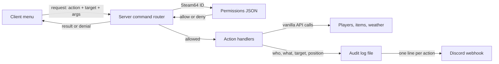

# NimbyAdmin feasibility: an in-house replacement for COT and VPP

Draft v0.1, October 15, 2026. Owner: Jeff Fabish. Status: scope decided by Jeff on October 15, 2026 (see Decisions); awaiting go/no-go on the Phase 0 spike.

> **Superseded in part, October 15, 2026.** Where this study and `docs/plans/2026-10-15-nimby-admin-plan.md` (v0.3) differ, the plan is authoritative. Known differences: the tool is named Central Scrutinizer; server-only code ships in a separate `-servermod` PBO; weather overrides do not persist across restart; heal excludes disease, hunger, thirst, temperature, and equipment; corrupt access files fall back to a last-known-good copy instead of blocking admission.

Building our own admin tool is feasible and costs no extra money. The work is about 5-6 weeks at Jeff's 10+ hours per week, which is about 55-70 hours of Jeff's time; Claude writes the code, tests, and build changes. The tool ships as a new `NimbyAdmin` addon inside the `@NIMBY` pack, depends on nothing but vanilla DayZ, and never writes to world saves, so adding, updating, or removing it cannot repeat the October 15 corruption.

Go/no-go gate: a 3-5 day Phase 0 spike proves the risky plumbing (server-checked commands, permissions, the menu shell, audit log, and one action end to end) before any feature work is committed.

## What this is not

- Not a copy of COT or VPP. It is written from scratch against the vanilla 1.30 scripts. No code is taken from either tool: VPP is closed source, and COT's license was not verified in this study.
- Not an observation tool. Free camera, spectate, ESP, and a live player map are out of scope (Decisions, item 1). They are the most complex and most abusable features in COT and VPP.
- Not a public mod. It ships only inside `@NIMBY` for this server.
- Not a CF replacement. It contains only the small pieces of plumbing it needs (command routing and permissions), not a general framework.
- Not an anticheat.

## Why build it

| Problem with COT/VPP | Effect on NIMBY | How NimbyAdmin avoids it |
| --- | --- | --- |
| Both depend on CF | Removing CF and COT on October 15 (10:31 AM CT) logged 89,618 "Scripted variables corrupted" warnings on the first full boot without them, each one an entity the server reported it would not load correctly | No CF; no changes to entity save or load; admin state lives in the tool's own JSON files |
| Release cadence set by others | COT had no 1.30 release on launch day, and Workshop comments reported crashes; NIMBY ran with no admin tool | We update it the day a DayZ patch lands, in the same pipeline as the rest of `@NIMBY` |
| Large surface | Thousands of lines of features we never use, each a possible break on update | Only the features Jeff and Jay use |
| Extra downloads | Players download CF and COT on top of `@NIMBY` | Rides in the pack players already have |

## Decisions (Jeff, October 15, 2026)

| # | Question | Decision |
| --- | --- | --- |
| 1 | Must-have capabilities | Player management, spawning, world control. Observation tools are out. |
| 2 | Interface | In-game menu from day one. |
| 3 | Save footprint | Hard rule: zero. No CF, no `OnStoreSave`/`OnStoreLoad` changes, no extra data on any entity. |
| 4 | Audit trail | Structured log file in the server profile plus a Discord webhook to a private admin channel. |
| 5 | Jeff's time | 10+ hours per week. |

## Feasibility by area

| Area | Verdict | Basis | Main risk |
| --- | --- | --- | --- |
| Packaging and signing | Proven | `scripts/Build-NimbyPack.ps1` already builds, signs, verifies, and boot-tests two addons (`NimbyAutorun`, `NimbyGiveTake`) | None new |
| Client-server commands | Feasible | Vanilla script RPCs; `NimbyGiveTake` already sends player actions to the server | Every command must be re-checked on the server; the client is untrusted |
| Permissions | Feasible | Server reads a JSON allowlist of Steam64 IDs and roles from the profile folder | A missed server-side check would let any player run admin commands; covered by a test per command |
| Player management | Feasible | Teleport, heal, kill, and kick use vanilla player and game APIs | Bans need our own list checked on connect, or RCON `#exec ban`; to be chosen in Phase 1 |
| Spawning | Feasible | Item list read from the game config at runtime, so new 1.30 items appear without code changes | Vehicles need a parts preset per class (motorbikes, cars, trucks) |
| World control | Feasible | Vanilla weather and time APIs | Sandstorm control on Nasdara is undocumented; may be out of reach |
| In-game menu | Feasible, highest effort | Layout files and widgets; `NimbyGiveTake` already patches vanilla GUI | Layout iteration needs Jeff's screenshots; most of the schedule risk sits here |
| Discord webhook | Feasible | Server-side HTTP through the engine's REST API | Webhook URL is a secret: lives only in the server profile, never in the repo or the pack |
| Zero save footprint | Feasible by construction | Spawned items and vehicles are vanilla classes and persist normally; the tool itself stores nothing on entities | None, if the rule is enforced in review |

**API certainty.** Claude's knowledge of the Enforce script API is broad but not release-exact. Every API call is verified against the unpacked 1.30 `scripts.pbo` before use; nothing is written from memory alone. `DayZExtract` (KuruExtract) or DayZ Tools can unpack it.

## Cost

No new money is required. Jeff's time is the real cost.

| Cost | Amount | What it pays for |
| --- | --- | --- |
| DayZ Tools, Workbench, signing | $0 | Free on Steam; already installed and used by the pack build |
| Build, sign, and boot-check pipeline | $0 | Exists (`Build-NimbyPack.ps1`, `NimbyPbo.psm1`) |
| Local test server | $0 | `Start-NimbyTestServer.ps1` on Jeff's PC |
| Claude | $0 extra on current plans | Code, tests, layouts, docs. Heavy weeks can hit usage limits, which slows the pace rather than adding cost |
| Discord webhook | $0 | Built into Discord |
| Optional staging server | About $18.50/month | A second 20-slot HostHavoc service for a two-client test with Jay before live rollout. Skippable: the local server plus a low-population live window covers most of it |
| Jeff's time, build | About 55-70 hours over 5-6 weeks (10-12 hours a week) | In-game testing, screenshots, decisions, approvals |
| Jay's time | About 3-5 hours | Two-client tests and menu usability feedback |
| Jeff's time, upkeep | About 2-6 hours per DayZ major update | Compatibility check, rebuild, boot test; 2-4 major updates a year |

For comparison: staying on COT costs $0 and no build time, but brings back the CF save coupling and leaves admin access dependent on COT's release schedule.

## Architecture

Design rules:

- The server decides everything. The client only sends requests; every request is checked against permissions on the server, and denials are logged.
- One command per action, each with a test that a non-admin request is refused.
- Config and permissions are JSON in `$profile:NimbyAdmin\`, created with safe defaults on first boot. Nothing is hardcoded but the defaults.
- The webhook URL lives only in the profile config.
- No persistence hooks on any entity class.

## Phase map

Durations assume Jeff's 10+ hours per week. Each phase ends with a build, a local boot check, an in-game test, and Jeff's approval before it reaches the live server at a scheduled restart.

| Phase | Scope | Exit test | Estimate |
| --- | --- | --- | --- |
| 0. Spike (gate) | `NimbyAdmin` addon in `pack.json`; command router; permissions JSON; audit log and webhook; menu shell that opens on a key for admins only; one action end to end (teleport to player) | A non-admin cannot open the menu or run a command; an admin teleport is logged and posted to Discord; 0 `SCRIPT (E)` | 3-5 days |
| 1. Player management | Player list; teleport to and bring; heal; kill; kick; ban and unban; private message | Two-client test with Jay; each action logged | 5-7 days |
| 2. Spawning | Searchable item list from config; spawn in inventory, at feet, or at the cursor; quantity; vehicle spawn with full parts presets | Spawn every vehicle class on Nasdara and drive it; spawned items survive a restart | 7-10 days |
| 3. World control | Weather (overcast, rain, fog, wind); set time of day; server-wide announcement; sandstorm if the API allows | Changes visible to a second client; restored correctly after restart | 3-4 days |
| 4. Hardening and rollout | Abuse tests (forged requests, spam, bad arguments); permission edge cases; docs and an admin quick-reference for Jay; live rollout | Live at a scheduled restart with no `SCRIPT (E)`; Jay signs off | 4-5 days |
| Later (not committed) | Map click-to-teleport; player inventory view; saved teleport points; spawn presets | - | - |

Total: about 22-31 Claude working days, or 5-6 calendar weeks at Jeff's 10-12 hours a week of testing.

## Risks

| Risk | Likelihood | Effect | Mitigation |
| --- | --- | --- | --- |
| Menu layout work runs long | Medium | Phases 0-2 slip by up to a week | Plain, functional layouts first; polish only after Phase 4 |
| A missed server-side permission check | Low | Any player could act as admin | Server-only checks; a refusal test per command; abuse tests in Phase 4 |
| DayZ update breaks a used API | Medium per update | Admin tool down until fixed | Small surface; boot check fails the build; we patch the same day |
| Webhook URL leaks | Low | Spam into the admin channel | Profile-only secret; rotate the webhook if exposed |
| Claude usage limits in heavy weeks | Medium | Slower pace | Phases are small enough to resume across sessions and accounts |
| Sandstorm API not exposed to script | Medium | That one control is missing | Ship weather and time without it |

## Recommendation

Proceed with Phase 0 as a time-boxed spike. If it passes its exit test within 5 days, commit to Phases 1-4. If it fails on the menu or the command plumbing, stop and wait for COT under the re-add criteria Jeff decided on October 15, 2026: COT publishes 1.30 compatibility notes, and a test boot with `-mod=@CF;@Community-Online-Tools` shows 0 `SCRIPT (E)` and no crash in the first hour.
