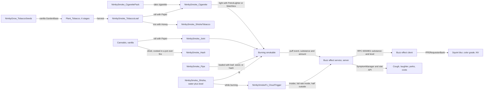

# Puff, Buzz, Sprout, Scrawl, Tack, and Ears feasibility

Draft v0.2, October 15, 2026. Owner: Jeff Fabish. Status: decisions made by Jeff on October 15, 2026 (see Decisions); every vanilla hook below is cited from the shared 1.30 script reference (`vendor/dayz-1.30-scripts/`, build 1.30.164078.38, see `docs/baselines/2026-10-15-dayz-1.30-scripts-reference.md`), and each plan's Phase 0 exercises it in game before code is written.

Changes since v0.1: Puff split into Puff (items) and Buzz (effects) along the "what a Bohemia update breaks" line (D9); Earplugs named Ears (D10); vanilla `Paper` stacks to 5 (D11); note lifetime 30 days with base protection from the flag pole (D12); night vision planned as Buzz Phase 5 (D13); perk class configurable with survival effects as the default (D14); hash by cooking (D15); cloud everywhere, weaker outdoors (D16); implementation order Ears, Scrawl, Puff (D17); wall-pinned notes as a separate addon, Tack, with damage on take-down (D18).

All six are feasible as in-house addons in the `@NIMBY` pack, and vanilla 1.30 already ships more of this than the October 15 candidate-features research assumed. Cannabis seeds, a six-stage cannabis plant, a `Cannabis` crop item, three cigarette-pack brands, a petrol lighter, and a complete write-and-read note system with persistence are all in the vanilla 1.30 scripts and configs. The own build is the smoking items (lighting, puffing, burn timers), the effects (levels, visuals, symptoms, the shisha cloud), the tobacco crop, a paper stack, and a one-key volume toggle. The largest cost is not code but models: shisha, pipe, hash, shisha tobacco, loose cigarette, tobacco leaf, and the tobacco plant stages need a `.p3d` each, and vanilla has none of them.

## What this is not

- Not a drug economy. Nothing sells, trades, or prices; the items are survival-loop content and roleplay props.
- Not a copy of any Workshop smoking or cannabis mod. No code or asset is taken from CannabisPlus, DrugsPLUS, AgricultureCore, or Smoking_A_Cigarette; those mods forbid repacking (see `docs/research/candidate-features.md`).
- Not a change to vanilla cannabis growing. Weed growing is vanilla 1.30; Sprout adds tobacco beside it and changes loot tables, not plant logic.
- Not a replacement for vanilla notes. Writing, reading, and persistence are vanilla; Scrawl adds the paper stack and the despawn policy.
- Not a persistence framework. Items persist the vanilla way; player effect state is never saved (see Save footprint).
- Not a custom-animation mod. Every action reuses a vanilla animation command. Custom animations are the one thing the 1.30 research marks as at risk.
- Not a base-cleanup mod. Jeff's idea of detecting oversized bases and removing low-priority items is recorded in `docs/research/candidate-features.md` as a separate candidate.

## Why build it

Theme drop 1 in `docs/research/candidate-features.md` already concluded that no maintained smoking mod permits repacking and that no DayZ hookah mod exists, so a smoking system is an own build regardless. The same research deferred cannabis growing to IceBlade's three-mod stack; that reasoning is now moot, because 1.30 ships cannabis growing in vanilla. Building the addons in-house keeps the pack at one Workshop item with no third-party dependency and no attribution obligation beyond our own licenses.

## Addon split

Decided by Jeff, October 15, 2026: separate concerns by what a Bohemia update is likely to break. Config-heavy content (items, slots, recipes) survives most updates; script-API-heavy code (post-process requesters, symptom queueing, triggers, input handling) is what 1.30-style updates break. Each addon sits on one side of that line so a break disables one PBO and leaves the rest playable.

| Addon | Display name | Prefix | Holds | Breaks on | Requires |
| --- | --- | --- | --- | --- | --- |
| Puff | Puff | `NimbySmoke` | Items, packs, lighter slot, lighting, puffing, burn timers, recipes | Ignition or action API changes (rare) | - |
| Buzz | Buzz | `NimbySmokeFx` | Effect service, level and decay, PPE client, symptoms, cloud trigger, night vision | PPE, symptom, or trigger API changes (likely) | Puff |
| Sprout | Sprout | `NimbyGrow` | Tobacco seed, plant, drying of the leaf (the leaf item itself is Puff's), hash cooking hook | Gardening or cooking API changes | Puff |
| Scrawl | Scrawl | `NimbyNotes` | Paper quantity, combine rule | Nothing script-heavy; a `Paper` class change | - |
| Tack | Tack | `NimbyTack` | Pin a sheet to a wall with a hammer and nail or with duct tape; take down with damage | Raycast, placement, or physics API changes | Scrawl |
| Ears | Ears | `NimbyEarplugs` | Volume toggle, input | Sound scene or input API changes | - |

Without Buzz loaded, Puff items still light, burn, and get smoked; they report to nobody. That is the degraded mode after an update, and it is a tested configuration (Puff test PF-012).

## Decisions (Jeff, October 15, 2026)

| # | Decision | Choice |
| --- | --- | --- |
| D1 | Deliverable | Feasibility study, then one plan per addon |
| D2 | Models | Claude models them first (headless Blender, delivered as OBJ or FBX plus textures for Jeff to run through Object Builder); if that repeatedly fails for an item, buy a licensed model for that item. Mechanics ship on vanilla placeholder models until the swap |
| D3 | Save rule | Content addons persist like other DayZ items; shared rules section 6 is amended (see Save footprint) |
| D4 | Addon split | Puff, Buzz, Sprout, Scrawl, Tack, Ears (see Addon split) |
| D5 | Names | Puff `NimbySmoke`, Buzz `NimbySmokeFx`, Sprout `NimbyGrow`, Scrawl `NimbyNotes`, Ears `NimbyEarplugs`; Tack `NimbyTack` (confirmed by Jeff, October 16, 2026) |
| D6 | Shisha | Requires water, like a bong |
| D7 | Legs default key | Double-tap Left Shift replaces numpad plus (plan 1, A3) |
| D8 | Ears default key | N (End until October 16, 2026) |
| D9 | Split principle | Separate by what a Bohemia update breaks; effects leave Puff and become Buzz |
| D10 | Earplugs name | Ears |
| D11 | Paper stack | Vanilla `Paper` stacks to 5 (config change on the vanilla class; see Scrawl plan N2) |
| D12 | Note lifetime | 30 days, held in `types.xml` so it can be scaled to 14 or 7 if it degrades the server; notes in a base live as long as the base (vanilla flag pole refresh) |
| D13 | Night vision | Planned as Buzz Phase 5: hash at the top level grants a short night-vision window; the player's eyes glow for others |
| D14 | Perk class | Buzz ships meaningful survival effects by default, with a `perkClass` config switch that targets cosmetic plus a minor nudge, or cosmetic only |
| D15 | Hash | Cook dried weed in a pot or pan over a fire |
| D16 | Cloud scope | Everywhere; full rate inside a building, half rate and a smaller radius outdoors |
| D17 | Order | Ears, Scrawl, Tack, Puff, Buzz, Sprout, with Puff Phase 0 run in parallel with Ears |
| D18 | Wall notes | Separate addon, Tack: pin with a vanilla `Hammer` and one `Nail`, or with vanilla `DuctTape`; pulling a note down damages the sheet |

## Requirements as stated

| Area | Requirement | Owner addon |
| --- | --- | --- |
| Shisha | Portable, 6x3 inventory footprint, needs water, takes shisha tobacco or hash (two separate items), produces a lot of smoke on hash | Puff (item), Buzz (smoke volume) |
| Cloud | Standing in the shisha cloud without smoking has an effect; stronger inside a building | Buzz |
| Cigarette packs | Spawn with cigarettes, a lighter, or both; loose cigarettes never spawn | Puff |
| Pipe | Good-looking old-fashioned pipe; takes tobacco, hash, or weed | Puff |
| Rolling | Tobacco plus paper makes a cigarette; a lighter is required to light anything | Puff |
| Effects | Shisha, hash, and weed differ; nothing extreme; hash and weed squint the vision; repeated use amplifies; effects wear off and carry a perk and a cost; cough; hash burns slower than weed | Buzz (burn rate in Puff) |
| Night vision | Drugs let you see in the dark but your eyes glow | Buzz Phase 5 |
| Weed growing | Seeds, water, fertilizer, growth stages, must be harvested; fertilizer gives a bigger harvest; weed to hash later | Sprout (vanilla covers growing) |
| Tobacco growing | Same logic as weed | Sprout |
| Notes | Paper stacks of 5; paper plus pen makes a note that persists; untouched notes despawn | Scrawl (vanilla covers writing) |
| Wall notes | Notes stick on walls; needs a hammer and nail, or duct tape; taking one down damages it | Tack |
| Earplugs | One key, default N, lowers game volume | Ears |

## Feasibility by area

| Area | Verdict | Basis (1.30 reference, file:line) | Main risk |
| --- | --- | --- | --- |
| Cigarette packs | Proven in vanilla, extended | `CigarettePack_ColorBase` with three brands, model `dz\gear\medical\cigarette_pack.p3d`, quantity 0-20: `DZ/gear/medical/config.cpp:1893-1960`; script has no actions: `scripts/4_World/DayZ/Entities/ItemBase/Gear/Medical/CigarettePack_ColorBase.c:1-4` | Puff defines its own pack classes on the vanilla model so a lighter slot and a take-cigarette action can be added without modifying a vanilla class. The live Nasdara `types.xml` (`server/live/db/types.xml`, read October 16, 2026) has no `CigarettePack_*` row at all, so vanilla packs do not spawn today and Puff adds rows for its own packs rather than zeroing existing ones |
| Lighter | Vanilla | `PetrolLighter`: `DZ/gear/cooking/config.cpp:1349`; `CanIgniteItem`, `OnIgnitedTarget`, `OnIgnitedTargetFailed`: `scripts/4_World/DayZ/Entities/ItemBase/PetrolLighter.c:3-19`; `Matchbox`: `DZ/gear/consumables/config.cpp:871` | None. Zen's Zippo (the Zippo row in `docs/research/candidate-features.md`) is no longer needed |
| Ignition of our items | Feasible on the vanilla ignition contract | `HasFlammableMaterial`, `CanBeIgnitedBy`, `OnIgnitedThis`, `IsThisIgnitionSuccessful` overrides on `Paper`: `scripts/4_World/DayZ/Entities/ItemBase/Paper.c:38-62` | A smokable must refuse ignition unless held or placed correctly; Phase 0 confirms which hand and ground states the ignite action offers |
| Puff action and animation | Feasible | Consume framework `Edible_Base.Consume` and `OnConsume`: `scripts/4_World/DayZ/Entities/ItemBase/Edible_Base.c:95-103`; `ActionConsume`, `ActionEat`, `ActionDrinkCookingPot` (kneel at a ground item): `scripts/4_World/DayZ/Classes/UserActionsComponent/Actions/Continuous/` | The puff action reuses the eat or drink animation command; Phase 0 records which command looks acceptable for a cigarette, a pipe, and a shisha hose |
| Burn timers | Feasible | Vanilla item quantity plus a server-side timer; pattern in `Roadflare`: `scripts/4_World/DayZ/Entities/ItemBase/Roadflare.c:24,190,222` | None |
| Puff without Buzz | Feasible by construction | Puff raises a script event on each puff; Buzz subscribes when present. No class in Puff references a Buzz class (shared rules 8.1 rule applied between client PBOs) | None if the reference rule is enforced in review |
| Visual effects | Feasible, client side | `PPERequesterBank` and the gameplay requesters: `scripts/3_Game/DayZ/PPEManager/`; squint blur already exists as `PPERequester_SquintEffects.SetBlur`/`ClearBlur`: `scripts/3_Game/DayZ/PPEManager/Requesters/PPERSquintEffects.c:4-13`; color grading and saturation `PPEColorGrading.c`, `PPEColors.c`; radial blur `PPERadialBlur.c` | Values need in-game tuning with Jeff; the Buzz plan budgets a tuning session |
| Cough and laughter | Vanilla symptoms | `QueueUpPrimarySymptom(SymptomIDs.SYMPTOM_COUGH)`: `scripts/4_World/DayZ/Classes/PlayerModifiers/Modifiers/conditions/AreaExposure.c:51`; `SYMPTOM_LAUGHTER`: `.../diseases/BrainDisease.c:33` | None |
| Survival perks (D14) | Feasible, API per stat verified in Buzz Phase 0 | `PlayerStats` and `PlayerStat<T>` (`scripts/4_World/DayZ/Classes/PlayerStats/PlayerStats.c:7`, `PlayerStatBase.c:32`), the `PlayerBase` health and shock accessors, and the pain and shock handling in the symptom and modifier files; each call is cited by line in Buzz Phase 0 item 5 before use | Each stat call is cited in the Buzz plan before use; `perkClass` profiles keep the cosmetic fallback one config value away |
| Effect state | Feasible without persistence | Server-side per-player level and decay timers held in memory and synced by RPC; the vanilla `ModifiersManager` is not used because active modifiers with `IsPersistent()` are written to the player save: `scripts/4_World/DayZ/Classes/PlayerModifiers/ModifiersManager.c:237-244` | Effects end on relog and restart; acceptable and documented |
| Shisha cloud | Feasible | `EffectTrigger : CylinderTrigger` with `OnEnterServerEvent`, `OnEnterClientEvent`, `OnLeaveServerEvent`, `OnLeaveClientEvent`: `scripts/4_World/DayZ/Entities/ScriptedEntities/Triggers/EffectTrigger.c:3,117,136,155,170`; `ContaminatedTrigger` is the worked example | Inside test: `Man.IsSoundInsideBuilding()` (`scripts/3_Game/DayZ/Entities/Man.c:37`, used by `SpookyAreaMisc.c:12`) and `Environment.IsUnderRoof()` (`scripts/4_World/DayZ/Classes/Environment/Environment.c:503`); Phase 0 records which one matches "inside a building" in the Nasdara structures |
| Smoke particles | Feasible on vanilla assets | Registered smoke effects: `ParticleList.c:31-60` (`CAMP_SMALL_SMOKE`, `HOUSE_SMALL_SMOKE`, and others); particle definitions `DZ/data/data/ParticleEffects/config.cpp:360` (`DefaultSmoke`) | A hash-sized cloud needs an own particle class in `config.cpp` built on vanilla textures; no new art |
| Shisha water | Feasible | `Bottle_Base` liquid handling and `ActionFillBottleBase`: `scripts/4_World/DayZ/Entities/ItemBase/Edible_Base/Bottle_Base.c:7,79`, `scripts/4_World/DayZ/Classes/UserActionsComponent/Actions/Continuous/ActionFillBottleBase.c:29,53`; `Pot : Bottle_Base` is the ground-fillable precedent: `DZ/gear/cooking/config.cpp:896` | A 6x3 `Bottle_Base` subclass must refuse drinking; Phase 0 confirms the fill action works on a placed item |
| Rolling | Feasible | Vanilla recipe classes: `scripts/4_World/DayZ/Classes/Recipes/Recipes/CutOutSeeds.c:1` and siblings | Whether a recipe consumes one sheet from a `Paper` stack of 5 or the stack is a Puff Phase 0 check once Scrawl's quantity exists |
| Night vision and glowing eyes (D13) | Feasible | `PPERequester_CameraNV` modes: `scripts/3_Game/DayZ/PPEManager/Requesters/PPERCameraNV.c:1-40`; the glow is a scripted light parented to the head, visible to others | Balance; Buzz Phase 5 comes after the Phase 3 playtest |
| Weed growing | Vanilla | `CannabisSeeds : SeedBase` with `PlantType = "Plant_Cannabis"`: `DZ/gear/cultivation/config.cpp:231-245`; `Plant_Cannabis : PlantBase`, 6 growth stages, 7 crops of `Cannabis`: `DZ/gear/cultivation/config.cpp:910-926`; `Cannabis : Edible_Base`, nutrition only: `DZ/gear/food/config.cpp:5725`, `scripts/4_World/DayZ/Entities/ItemBase/Edible_Base/Cannabis.c` | The live Nasdara `types.xml` has no `Cannabis`, `CannabisSeeds`, or `CannabisSeedsPack` row (read October 16, 2026), so nothing cannabis spawns today; Sprout adds seed rows and leaves `Cannabis` without a row so the crop is grow-only. Jeff mirrors the whole server to `D:\HostHavoc\NIMBY Badlands\104.192.227.46_2302\` with WinSCP, and `scripts/Sync-LiveReplica.ps1` copies the loot files to `server/live/` |
| Fertilizer bigger harvest | Vanilla | `m_CropsCount = Ceil(m_CropsCount * fertility * harvesting_efficiency)`: `scripts/4_World/DayZ/Entities/GardenBase/PlantBase.c:124-125`; slot fertility: `Slot.c:30-38,191-211` | None |
| Tobacco growing | Feasible on vanilla gardening | New `SeedBase` and `PlantBase` subclasses plus a `CfgHorticulture Plants` entry for textures: `DZ/gear/cultivation/config.cpp:17-64,84-145` | Plant stage models: placeholder on `pepper_plant.p3d` (`DZ/gear/cultivation/config.cpp:829`) until a tobacco model exists |
| Weed to hash by cooking (D15) | Feasible with a cooking hook | `Cooking.ProcessItemToCook` cooks only items whose `CanBeCooked()` is true: `scripts/4_World/DayZ/Classes/Cooking/Cooking.c:44-47`; vanilla `Cannabis.CanBeCooked()` returns false: `Cannabis.c:3-6`; `Cannabis` carries a dried texture stage: `DZ/gear/food/config.cpp:5765-5770` | Sprout hooks the cooking update for dried `Cannabis` in a pot or pan and swaps in `NimbySmoke_Hash`; a modded `Cooking` class is script, not persistence, so 6.1 allows it. Drying path needs Phase 0 proof |
| Written notes | Vanilla, persisted; unreachable on live today | `Paper` holds `WrittenNoteData`, saved since storage version 108: `scripts/4_World/DayZ/Entities/ItemBase/Paper.c:12-29`; `ActionWritePaper` needs a pen with `writingColor`: `scripts/4_World/DayZ/Classes/UserActionsComponent/Actions/SingleUse/ActionWritePaper.c:57-59`; `NoteMenu`: `scripts/5_Mission/DayZ/GUI/NoteMenu.c:1,39,62`; pens: `Pen_ColorBase.c:1` | The live `types.xml` gives every `Pen_*` nominal 0 with no cargo entry and `Paper` nominal 0 with `lifetime` 7200, spawning only as 50 percent cargo in the three `Bear_*` teddy bears (`server/live/cfgspawnabletypes.xml:478-490`), so nobody can write a note on Nasdara today. Scrawl adds pen rows and a `Paper` nominal; the code is untouched |
| Paper stack (D11) | Feasible on the vanilla class | Vanilla `Paper` has no quantity: `DZ/gear/consumables/config.cpp:19-60`. `ItemBase` writes quantity only when the variables mask carries the quantity bit: `scripts/4_World/DayZ/Entities/ItemBase.c:3011-3014` (load), `:3089` (`OnStoreLoad`), `:3190` (`OnStoreSave`) | Sheets already in `storage_1` have no quantity bit and load unchanged; a written note must refuse to combine. Scrawl Phase 0 proves the round trip |
| Note despawn (D12) | Vanilla CE | `lifetime` in the live `types.xml`; CE lifetime refresh on interaction and the raised-flag territory refresh are engine behavior with no script to cite; the script side is `TerritoryFlag` and its refresher timer, `scripts/4_World/DayZ/Entities/ItemBase/BaseBuildingBase/Totem.c:1,568`. Scrawl Phase 0 item 5 and SC-004 test both | Only ground items despawn by lifetime; a note in a tent or a body inherits the container's lifetime; both behaviors are verified in Scrawl Phase 0, not assumed |
| Wall-pinned notes (D18) | Feasible | `Hammer`: `DZ/gear/tools/config.cpp:1660`; `Nail`: `DZ/gear/consumables/config.cpp:1900-1911`; `DuctTape` (quantity 0-100): `DZ/gear/consumables/config.cpp:136-154`; raycast `RaycastRVParams`, `DayZPhysics.RaycastRVProxy`: `scripts/3_Game/DayZ/Global/DayZPhysics.c:49,78,208`; `Object.SetPosition`, `SetOrientation`, `SetDynamicPhysicsLifeTime`: `scripts/3_Game/DayZ/Entities/Object.c:294,311,458`; `Entity.DisableSimulation`: `Entity.c:3`; `DecreaseHealth`: `Object.c:1115`; a `Paper` subclass inherits the note persistence: `Paper.c:75` | The pinned note is an own `Paper` subclass, so the pinned state is a class and not data on `Paper`; whether a disabled-simulation item stays on the wall across restart is Tack Phase 0's stop condition |
| Earplugs | Feasible, client only | `g_Game.GetSoundScene().SetSoundVolume(volume, fadeSeconds)`: `scripts/5_Mission/DayZ/mission/missionGameplay.c:1690`, `MainMenuVideo.c:32-42`; the saved level is `g_Game.m_volume_sound`: `scripts/3_Game/DayZ/DayZGame.c:1147`; VOIP volume is separate (`:1150`) | `missionGameplay.c:1690` restores the user's volume on its own schedule; Phase 0 records when, and the toggle reapplies after it |
| Key bindings | Verified free | `kEnd` and `kHome` exist only in `bin/constants.xml:578,583`, bound to nothing in `bin/preset_X1MouseKey.xml`; double-tap is `<event name="doubleclick"/>` under a `<btn>` (`UAWalkRunToggle` on `kLControl`, `preset_X1MouseKey.xml:27-31`); `kLShift` is a hold for `UATurbo` (`:21-22`) with no vanilla double-tap | A double tap on a hold key fires two short sprints before the toggle; Legs Phase 0 confirms the toggle still wins |

**API certainty.** Every call above is cited from the unpacked 1.30 scripts, but a declaration is not proof of behavior. Each plan's Phase 0 runs the hook in game on the local test server and records the result before any dependent code is written.

## Models

Seven new meshes are needed; everything else reuses a vanilla model and texture. Jeff is providing reference images for the pipe and the shisha, has DayZ Tools installed, and has Blender on the desktop.

| Item | Vanilla placeholder (`.p3d`) | Final model | Notes |
| --- | --- | --- | --- |
| Cigarette pack (own classes) | `dz\gear\medical\cigarette_pack.p3d` with the vanilla brand textures | none needed | Final |
| Loose cigarette | `dz\gear\consumables\Paper.p3d` | Claude (D2) | Small, low polygon |
| Joint | same as cigarette | Claude (D2) | Variant texture |
| Pipe | `dz\gear\tools\` whetstone or similar hand-sized item | Claude (D2), from Jeff's reference image | Jeff wants this one good-looking; first candidate for purchase if the Blender result disappoints |
| Shisha | `DZ\gear\cooking\` pot | Claude (D2), from Jeff's reference image | 6x3 footprint; the hardest mesh |
| Hash | `dz\gear\food\` lard | Claude (D2) | Small block |
| Shisha tobacco | `dz\gear\food\` honey jar | Claude (D2) | Jar or tin |
| Tobacco leaf | `dz\gear\food\cannabis_seedman.p3d` with an own texture | Claude (D2) | Can stay a retexture if it reads well |
| Tobacco seeds | `dz\gear\cultivation\cannabis_seeds.p3d` | none needed | Retexture |
| Tobacco plant, 6 stages | `DZ\gear\cultivation\pepper_plant.p3d` | Claude (D2) | One model with growth-stage selections, like vanilla plants; the most work after the shisha |

Pipeline for a Claude-made model: headless Blender in the session workspace produces the mesh and a procedural texture, exported as a `.blend` plus OBJ or FBX with a PNG; Jeff opens the `.blend` if he wants to adjust it, imports the export in DayZ Tools Object Builder, adds the LOD, geometry, memory, and view LODs the plan specifies, saves the `.p3d`, converts the PNG with ImageToPAA, and the pack build picks it up. Each model gets one acceptance screenshot from Jeff; a second failed round on the same item triggers the purchase fallback (D2).

## Save footprint

Content addons differ from Legs, Hands, Central Scrutinizer, and Ears: their whole purpose is items that live in `storage_1`. Shared rules section 6 is amended for them (v1.1, see the shared rules file), and the amendment is deliberately narrow:

- Item classes persist the vanilla way. Nothing else is new.
- `OnStoreSave`/`OnStoreLoad` may be overridden only on classes the addon itself defines, never on a vanilla class such as `PlayerBase` or `ItemBase`, and only with a version guard. This is the whole difference from the October 15 corruption class: removing CF left vanilla classes reading fewer bytes than they had written. Removing a content addon removes its classes; the expectation that the engine then drops entities of unknown classes rather than corrupting the file is what the removal boot in the release gate proves (PF-010, SP-005, SC-005, TK-006).
- A config-only change to a vanilla class (Scrawl's `Paper` quantity) is allowed when Phase 0 shows the saved byte layout of existing entities is unchanged; `ItemBase`'s variables mask makes that the case for quantity.
- Player effect state is never persisted. Buzz holds it in memory on the server.
- The release gate gains two boots: a save-reload round trip with the addon, and a boot of that storage without the addon that must show only the addon's own items missing.

## Cost

| Addon | Code (session days) | Models | Tuning | Notes |
| --- | --- | --- | --- | --- |
| Puff | 3-4 | 6 meshes | - | Items, actions, timers, recipes |
| Buzz | 3-4 | none | 1 playtest with Jeff and Jay | Effect service, PPE, symptoms, cloud, night vision |
| Sprout | 1-2 | 1 plant plus 1 retexture | - | Requires Puff for the leaf item; cooking hook for hash |
| Scrawl | 0.5 | none | - | One config change, one combine rule, live `types.xml` rows |
| Tack | 1 | none | - | Requires Scrawl; raycast, placement, two actions |
| Ears | 0.5 | none | - | Client only |

Session days are Claude Code implementation sessions in a worktree, each ending in a passing `Build-NimbyPack.ps1` run. Jeff's time is the Object Builder pass per model, the live `types.xml` edits, and the playtests.

## Architecture

Buzz and Sprout depend on Puff and Tack depends on Scrawl (`requiredAddons`). Scrawl and Ears stand alone. Puff raises its puff event whether or not Buzz is loaded.

## Phase map

| Phase | Puff | Buzz | Sprout | Scrawl | Tack | Ears |
| --- | --- | --- | --- | --- | --- | --- |
| 0 | Prove ignition, consume animation, and fill on the test server | Prove PPE, symptoms, stat API, and the trigger | Prove a modded seed and plant grow; prove the cooking hook | Prove vanilla write, read, reload, and the quantity round trip | Prove a pinned sheet survives restart in place | Prove volume set and restore around menus |
| 1 | Pack, cigarette, lighter slot, light, puff, burn, puff event | Effect service, levels, decay, RPC, tobacco profile | Tobacco seed, plant, leaf, drying | `Paper` quantity 5, combine rule, `types.xml` rows | Pin and take-down actions | Toggle, indicator, restore |
| 2 | Pipe, joint, rolling | Weed and hash profiles, PPE client, symptoms, `perkClass` switch | Seed recipes, loot rows, release | Release | Release | Release |
| 3 | Shisha with water, hash item, shisha tobacco, model swap, release | Cloud trigger and particles; tuning playtest; release | Model | - | - | - |
| 4 | - | - | Hash cooking hook, release | - | - | - |
| 5 | - | Night vision and eye glow | - | - | - | - |

Merge order (D17): Ears, Scrawl, Tack, Puff, Buzz, Sprout, with Puff Phase 0 started in parallel with Ears. Scrawl's loot rows (`Paper` 30, pens 30 across the four colors, decided October 16, 2026) are the first live `types.xml` change, because without them nothing in the notes family spawns. Ears and Scrawl are small enough to exercise the worktree flow and the content-addon release gate before Puff needs them.

## Risks

| Risk | Consequence | Mitigation |
| --- | --- | --- |
| Vanilla has no smoking animation | Puffing looks like eating | Phase 0 compares the eat, drink, and drink-from-pot commands; Jeff picks the least wrong; no custom animation |
| Effect tuning | Too strong breaks hardcore; too weak is pointless | Every number in `$profile:NimbySmokeFx\config.json`, reloadable at restart; `perkClass` profiles; one playtest scheduled |
| Cloud trigger cost | A trigger per burning shisha | Trigger exists only while burning; cap on simultaneous burning shishas in config |
| `IsSoundInsideBuilding` on Nasdara structures | Inside and outside rates swap in some buildings | Phase 0 tests three building types; fallback is `IsUnderRoof` |
| Model pipeline | Object Builder import is manual and Jeff's time | Placeholders ship first; the model swap is its own phase |
| Live `types.xml` edits | A wrong nominal floods or starves loot | Edits land at a restart with the file backed up; Jeff provides the live files before any row is drafted |
| Vanilla `Paper` quantity | A combine of two written notes loses one text | Scrawl's combine rule refuses when either side has text; SC-003 tests it |
| Persisted note text size | Large notes grow `storage_1` | Vanilla caps the note through `NoteMenu`; Scrawl changes nothing there |
| A pinned sheet falls after restart | Tack ships nothing until Phase 0 shows it stays | Tack Phase 0 item 4 is a stop condition; fallback is a static class holding the text |
| Ears fights the menu volume reset | Volume snaps back when a menu closes | Phase 0 records the reset point; the toggle hooks it |
| Bohemia update breaks PPE or triggers | Buzz fails to load | Puff still lights and burns (PF-012); Buzz is disabled in `pack.json` until fixed |

## Recommendation

Build all six in the order Ears, Scrawl, Tack, Puff, Buzz, Sprout, with Puff's Phase 0 started beside Ears because it carries the only real engineering uncertainty (animation and ignition states). Treat the model work as its own track that never blocks a mechanic. Keep Buzz's survival perks behind the `perkClass` switch so a balance problem on the live server is a config change, not a rebuild.
