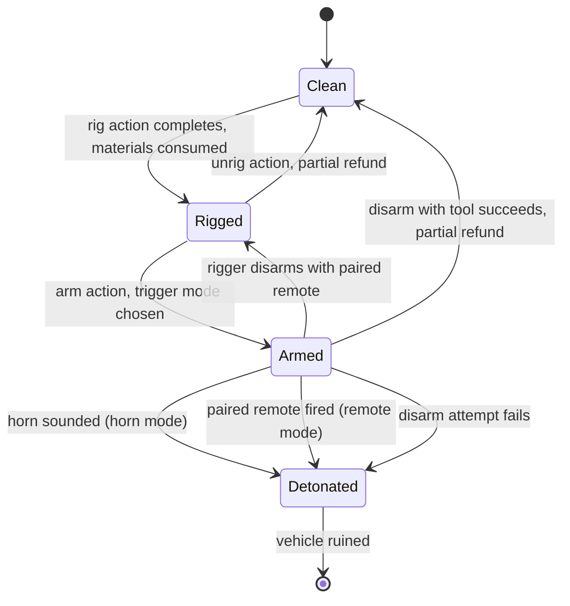

# Rigged ADA feasibility

Draft v0.1, October 14, 2026. Roadmap phase 4. Owner: Jeff Fabish. Status: for Jeff's review; nothing here is decided until Jeff agrees.

The rigged ADA is feasible as a small client-and-server mod built entirely on vanilla hooks: a player wires plastic explosive into an ADA 4x4, the vehicle's display name changes while the rig is armed, and the charge goes off when the horn sounds or when a paired remote detonator fires. Every hook this design depends on exists in the vanilla 1.29 scripts (Scripts Rev. 125372, August 12, 2026). Badlands ships as 1.30, so each hook gets re-checked against the 1.30 scripts before code is written.

## What this is not

- Not a new explosive. The blast reuses the vanilla `Plastic_Explosive_Ammo` ammo type, so damage, range, and base-damage behavior match what players already know.
- Not a rule. The server has no PvP or PvE zones; the mechanic is balanced by cost, noise, time, and counterplay, never by a rule that Jay has to enforce.
- Not an admin tool. Admins get logs, not a remote kill switch.
- Not limited to one name. The armed-state display name is Jeff's string, held in one constant. This document never writes it.
- Not a vehicle-wide rewrite. Only vehicle classes on a configured allowlist can be rigged; the default list holds the ADA alone.

## How it plays

1. **Rig.** A player crouches at an unoccupied, stationary ADA with the materials in inventory and runs a long, noisy, full-body action. The materials are consumed and the car records a payload count.
2. **Arm.** The rigger chooses the trigger at arming time: horn, remote, or both. Arming plays the vanilla explosive arming sound, audible nearby. From this moment the car's display name is the armed-state name.
3. **Trigger.** The next driver who sounds the horn detonates it (horn mode), or the rigger fires the paired remote detonator within its range (remote mode).
4. **Counter.** Anyone who opens the car's inventory sees the armed-state name. A player with a disarm tool can attempt a disarm; failure detonates the charge. The rigger can disarm safely with the paired remote.

## Vanilla hooks it depends on

Each row was read in the vanilla script source. Re-verify every row on 1.30.

| Need | Vanilla hook | Where | Verified on 1.29 |
| --- | --- | --- | --- |
| Rename an instance | `bool NameOverride(out string output)`, which `Object.GetDisplayName()` calls before the config name | `scripts/3_game/entities/object.c` | Yes |
| Sync the armed flag to clients | `RegisterNetSyncVariableBool` plus `SetSynchDirty()`; `ExplosivesBase` syncs `m_Armed` the same way | `scripts/4_world/entities/explosivesbase.c` | Yes |
| Detect the horn on the server | `CarScript.SetCarHornState(int pState)`, called from the horn actions' `OnStartServer` | `carscript.c`, `actioncarhorn.c` | Yes |
| Horn preconditions | Horn requires the player in the driver seat and a working battery | `ActionCarHornBase.ActionCondition` | Yes |
| Produce the blast | `Object.Explode(int damageType, string ammoType)` with `Plastic_Explosive_Ammo` | `object.c`, `plastic_explosive.c` | Yes |
| Remote pairing | `RemotelyActivatedItemBehaviour` and `OnActivatedByItem` | `remotelyactivateditembehaviour.c`, `plastic_explosive.c` | Yes |
| Disarm odds | `ToolBase.GetDisarmRate()`, default 60; vanilla `ActionDisarmExplosive` sets health to 0 on failure | `toolbase.c`, `actiondisarmexplosive.c` | Yes |
| ADA class | `OffroadHatchback extends CarScript` | `offroadhatchback.c` | Yes |
| ADA spawns on Nasdara | Badlands vehicle list | 1.30 `types.xml` | **No - verify on October 15** |

## Instance rename

The rename overrides `NameOverride`, not `GetDisplayName`. Vanilla `GetDisplayName()` already calls `NameOverride()` first and falls back to the config name, so the override changes only the armed instance and leaves every other ADA alone.

- A `modded class CarScript` registers one synced bool, `m_NimbyRigArmed`, in its constructor. One bool per car is negligible network cost.
- `NameOverride` returns `true` with `output = NimbyRigConstants.ARMED_DISPLAY_NAME` when the flag is set and the class is on the allowlist; otherwise it defers to `super`.
- `NimbyRigConstants.ARMED_DISPLAY_NAME` lives alone in `mods/own/nimby-rigged-vehicles/scripts/3_game/NimbyRigConstants.c`. Jeff writes its value. A unit check fails the build if the constant is empty.
- `GetDisplayName()` passes the result through `Widget.TranslateString`. A plain string passes through unchanged; a string starting with `#` is looked up in the stringtable.

The name shows wherever the game shows the vehicle's name, chiefly the vicinity inventory when a player opens the car. That is the intended tell.

## Trigger modes

| Mode | Fires when | Who it targets | Server hook |
| --- | --- | --- | --- |
| Horn | Any driver sounds the horn, short or long | Whoever drives next: a trap | Override `SetCarHornState` on the server; if armed in horn mode and `pState != ECarHornState.OFF`, detonate |
| Remote | The paired remote detonator is fired in range | Whoever is near the car when the rigger chooses | Vanilla pairing; the car receives `OnActivatedByItem` from its paired trigger |
| Both | Either of the above | Either | Both hooks |

Because the horn needs a driver and a vital battery, a car with a dead or missing battery cannot be horn-detonated. That is a free piece of counterplay: pulling the battery defangs horn mode.

## Cost and scaling

Cost scales with payload: more charges mean a bigger blast, more wiring, and a longer, louder action. Every number below is a starting value in a server config file, `$profile:NimbyRiggedVehicles/config.json`, not in code, so balance changes need no rebuild.

| Payload | Plastic explosive | Wiring | Rig action | Blast |
| --- | --- | --- | --- | --- |
| 1 | 1 `Plastic_Explosive` | 1 metal wire, 1 duct tape | 30 seconds | 1 x `Plastic_Explosive_Ammo` |
| 2 | 2 `Plastic_Explosive` | 2 metal wire, 2 duct tape, 1 9V battery | 45 seconds | 2 x `Plastic_Explosive_Ammo` |

Remote mode also consumes a Remote Detonator kit and leaves the rigger holding the paired trigger, as the vanilla plastic explosive does. Class names other than `Plastic_Explosive` and the remote detonator classes are unverified until checked against the 1.30 config.

Rarity is the main governor. `Plastic_Explosive` nominal and min in `types.xml` decide how often rigs appear at all.

## Counterplay

| Counter | How | Cost to the defender |
| --- | --- | --- |
| Inspect | Open the car's inventory; the armed-state name is visible | A few seconds near the car |
| Hear it | The rig and arm actions are long and play the vanilla arming sound | Being nearby |
| Pull the battery | No vital battery, no horn | Losing the battery while the car sits |
| Disarm with a tool | Timed crouch action; success chance is the tool's disarm rate; failure detonates | Risk of death |
| Kill the rigger | Remote mode needs the rigger alive and in range | A fight |
| Don't drive strange cars | Social, not mechanical | Nothing |

## Abuse prevention

| Risk | Mitigation |
| --- | --- |
| Rigging every car on the map | Material cost plus a per-player limit on concurrently armed rigs (config, default 1), keyed by the player's BI identity and persisted |
| Rigging an occupied or moving car | Rig and arm actions require no occupants and near-zero speed |
| Duplicating explosives through persistence | Ingredients are deleted when rigging completes; the car stores an integer payload, not entity attachments. Version-gated `OnStoreSave` / `OnStoreLoad` |
| Refund farming | Unrig and successful disarm refund less than the cost (config, default: wire and tape lost) |
| Detonating across the map | Remote mode keeps the vanilla remote detonator range |
| Investigations | Every rig, arm, disarm attempt, disarm result, and detonation writes one log line: event, player name and BI identity, car network ID, position, trigger mode, payload. Logs stay on the server for Jay |
| Persistence across restarts | An armed rig survives restarts, matching vanilla plastic explosive. See open decision 3 |

## Open decisions for Jeff

1. **Trigger modes.** Recommended: offer horn, remote, and both, chosen at arming. Flip to horn-only if remote car bombs feel too much like a weapon rather than a trap.
2. **Who sees the name.** Recommended: anyone who opens the car's inventory. Flip to "only after a timed inspect action" if the tell proves too strong and rigs never land.
3. **Persistence.** Recommended: armed rigs persist across restarts. Flip to "rigs disarm on restart" if abandoned traps pile up.
4. **Vehicle scope.** Recommended: the ADA only, through the allowlist. Widening it is a config change.
5. **Visible charge model.** Recommended: no model in v1; the name is the tell. A visible charge under the chassis needs modeled assets and is a v2 candidate.

## Risks to verify

| Risk | Check | When |
| --- | --- | --- |
| ADA is absent from Nasdara | Search the 1.30 Nasdara `types.xml` for `OffroadHatchback` | October 15 |
| A hook changed in 1.30 | Diff the files in the hooks table between the 1.29 and 1.30 scripts | When 1.30 scripts publish |
| Another mod overrides `NameOverride` or `SetCarHornState` on cars | Grep the final client mod list for both | When the mod list is final |
| Explosion damage to occupants is lower than expected | Test on the private instance with a dummy player in the car | Before release |

## Build outline

The mod lives in `mods/own/nimby-rigged-vehicles/`: `3_game` for the constants and config class, `4_world` for the modded `CarScript` and the rig, arm, unrig, and disarm actions. It ships as one client-and-server PBO signed with Jeff's key. The order is: hooks re-verified on 1.30, constants and config, rename and synced flag (testable alone), horn trigger, remote trigger, actions, logging, then a test plan covering each row of the abuse table on the private instance.
