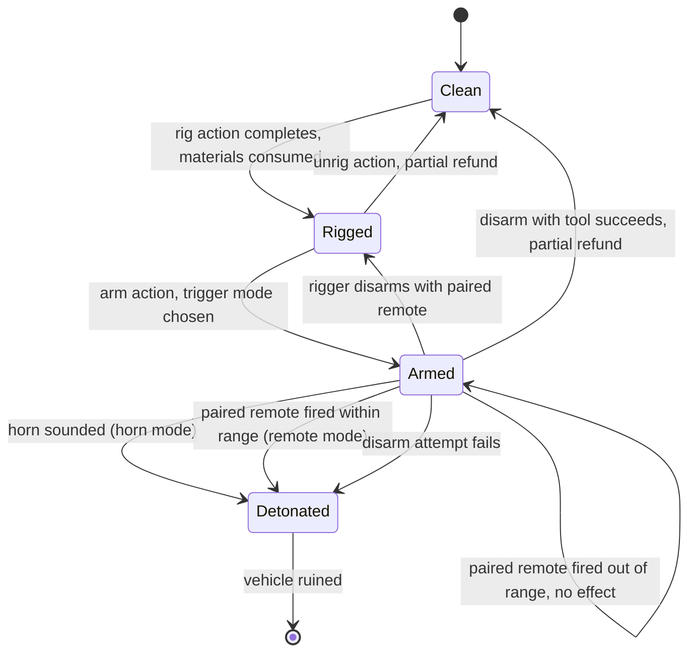

# Rigged ADA feasibility

Draft v0.4, October 14, 2026. Roadmap phase 4. Owner: Jeff Fabish. Status: design decisions made by Jeff on October 14, 2026 (see Decisions); hooks still to be re-verified on 1.30.

The rigged ADA is feasible as a small client-and-server mod built entirely on vanilla hooks: a player wires plastic explosive into an ADA 4x4 or any other base-game car, the vehicle's display name changes while the rig is armed, and the charge goes off when the horn sounds or when a paired remote detonator fires. Every hook this design depends on exists in the vanilla 1.29 scripts (Scripts Rev. 125372, August 12, 2026). Badlands ships as 1.30, so each hook gets re-checked against the 1.30 scripts before code is written.

## What this is not

- Not a new explosive. The blast reuses the vanilla `Plastic_Explosive_Ammo` ammo type, so damage, range, and base-damage behavior match what players already know.
- Not a rule. The server has no PvP or PvE zones; the mechanic is balanced by cost, noise, time, and counterplay, never by a rule that Jay has to enforce.
- Not an admin tool. Admins get logs, not a remote kill switch.
- Not limited to one name. The armed-state display name is Jeff's string, held in one constant. This document never writes it.
- Not open to every vehicle. Only classes on a configured allowlist can be rigged. The default list holds every base-game car and the 1.30 motorbikes; modded vehicles, such as a future helicopter mod, are excluded until added. The ADA keeps the name as the signature, not as a limit.

## How it plays

1. **Rig.** A player crouches at an unoccupied, stationary car on the allowlist with the materials in inventory and runs a long, noisy, full-body action. The materials are consumed and the car records a payload count.
2. **Arm.** The rigger chooses the trigger at arming time: horn, remote, or both. Arming plays the vanilla explosive arming sound, audible nearby. From this moment the car's display name is the armed-state name.
3. **Trigger.** The next driver who sounds the horn detonates it (horn mode), or the rigger fires the paired remote detonator from within the maximum radio range (remote mode). Out of range, the trigger does nothing.
4. **Counter.** Anyone who opens the car's inventory sees the armed-state name. A player with a disarm tool can attempt a disarm; failure detonates the charge. The rigger can disarm safely with the paired remote.

## Vanilla hooks it depends on

Each row was read in the vanilla script source. Re-verify every row on 1.30.

| Need | Vanilla hook | Where | Verified on 1.29 |
| --- | --- | --- | --- |
| Rename an instance | `bool NameOverride(out string output)`, which `Object.GetDisplayName()` calls before the config name | `scripts/3_game/entities/object.c` | Yes |
| Sync the armed flag to clients | `RegisterNetSyncVariableBool` plus `SetSynchDirty()`; `ExplosivesBase` syncs `m_Armed` the same way | `scripts/4_world/entities/explosivesbase.c` | Yes |
| Detect the horn on the server | `CarScript.SetCarHornState(int pState)`, called from the horn actions' `OnStartServer` | `carscript.c`, `actioncarhorn.c` | Yes |
| Horn preconditions | Horn requires the player in the driver seat and a working battery | `ActionCarHornBase.ActionCondition` | Yes |
| Produce the blast | `Object.Explode(int damageType, string ammoType)` with `Plastic_Explosive_Ammo` | `object.c`, `plastic_explosive.c` | Yes |
| Remote pairing | `RemotelyActivatedItemBehaviour` and `OnActivatedByItem` | `remotelyactivateditembehaviour.c`, `plastic_explosive.c` | Yes |
| Vanilla remote range | `UAMaxDistances.EXPLOSIVE_REMOTE_ACTIVATION = 100.0` meters, checked server-side in `RemoteDetonatorTrigger.OnActivatedByItem` and client-side in `ActionTriggerRemotely.ActionCondition` | `actionconstants.c`, `remotedetonator.c`, `actiontriggerremotely.c` | Yes |
| Vanilla trigger and disarm actions only accept explosives | `ActionTriggerRemotely` and the disarm actions cast their target to `ExplosivesBase`; a car fails that cast, so the mod needs its own trigger and disarm actions | `actiontriggerremotely.c`, `actiondisarmexplosive.c` | Yes |
| Disarm odds | `ToolBase.GetDisarmRate()`, default 60; vanilla `ActionDisarmExplosive` sets health to 0 on failure | `toolbase.c`, `actiondisarmexplosive.c` | Yes |
| ADA class | `OffroadHatchback extends CarScript` | `offroadhatchback.c` | Yes |
| Base-game car classes | `CivilianSedan`, `Hatchback_02`, `Offroad_02`, `OffroadHatchback`, `Sedan_02`, `Truck_01_Base` family, `Truck_02`, `Van_01` | `scripts/4_world/entities/vehicles/inheritedcars/` | Yes |
| Attach the charge model to the car | `IEntity.AddChild(child, pivot, positionOnly)` | `scripts/1_core/proto/enentity.c` | Exists; client-side behavior **not verified** |
| Which cars spawn on Nasdara | Badlands vehicle list | 1.30 `types.xml` | **No - verify on October 15** |

## Instance rename

The rename overrides `NameOverride`, not `GetDisplayName`. Vanilla `GetDisplayName()` already calls `NameOverride()` first and falls back to the config name, so the override changes only the armed instance and leaves every other ADA alone.

- A `modded class CarScript` registers one synced bool, `m_NimbyRigArmed`, in its constructor. One bool per car is negligible network cost.
- `NameOverride` returns `true` with `output = NimbyRigConstants.ARMED_DISPLAY_NAME` when the flag is set and the class is on the allowlist (matched with `IsKindOf`, so color variants inherit); otherwise it defers to `super`.
- `NimbyRigConstants.ARMED_DISPLAY_NAME` lives alone in `mods/own/nimby-rigged-vehicles/scripts/3_game/NimbyRigConstants.c`. Jeff writes its value. A unit check fails the build if the constant is empty.
- `GetDisplayName()` passes the result through `Widget.TranslateString`. A plain string passes through unchanged; a string starting with `#` is looked up in the stringtable.

The name shows wherever the game shows the vehicle's name, chiefly the vicinity inventory when a player opens the car. Decision: anyone who opens the inventory sees it. That is the intended tell.

## Trigger modes

| Mode | Fires when | Who it targets | Server hook |
| --- | --- | --- | --- |
| Horn | Any driver sounds the horn, short or long | Whoever drives next: a trap | Override `SetCarHornState` on the server; if armed in horn mode and `pState != ECarHornState.OFF`, detonate |
| Remote | The paired remote detonator is fired within the maximum radio range | Whoever is near the car when the rigger chooses | Vanilla pairing plus a mod trigger action; see Detonator range |
| Both | Either of the above | Either | Both hooks |

Decision: the rig supports all three modes, chosen at arming.

Because the horn needs a driver and a vital battery, a car with a dead or missing battery cannot be horn-detonated. That is a free piece of counterplay: pulling the battery defangs horn mode.

## Visible charge

Decision: v1 shows a generic charge model on every rigged car. It appears when the rig completes, before arming, so a careful player who looks under a car can spot a rig even before it is armed.

- **Model.** A display-only class, `NimbyRigChargeVisual`, reuses the vanilla plastic explosive model through config, so v1 needs no new modeling. It is not takeable, not persisted, and has no inventory.
- **Placement.** The server spawns the visual and attaches it with `IEntity.AddChild` at a per-class offset and orientation read from the config file. A class with no entry uses a default offset under the chassis center and writes one warning line to the log, so a car added to the allowlist works before it is tuned.
- **Lifecycle.** The visual is recreated from the car's rig state on load and deleted on unrig, successful disarm, or detonation. Because it never persists on its own, it cannot become a duplicate source.
- **Unverified.** Whether a child attached on the server replicates to clients, or must be attached on each client in `OnVariablesSynchronized`, is the first thing to prove on the private instance. The fallback is a client-side attach driven by the synced rig state.

Per-class offsets start empty and get tuned in one placement pass per base-game car on the private instance, cars that spawn on Nasdara first.

## Detonator range

A remote trigger fires the rig only when the trigger is within the maximum radio range of the car at the moment it fires. The server enforces the range; the client check only drives the detonator's LED.

- **Value.** `remoteRangeMeters` in the config file, default 100, which matches the vanilla plastic explosive. Changing it needs no rebuild.
- **Server check.** The mod's trigger action computes `vector.DistanceSq(trigger.GetPosition(), car.GetPosition())` on the server at execution and compares it to the squared range, the same pattern vanilla uses. Out of range, nothing happens and one log line records the attempt with the distance.
- **Client feedback.** The action's client-side condition uses the same check to light the detonator's LED, so the rigger can see whether the car is in range before pressing. The LED is a convenience; the server check is the authority, so a modified client cannot extend the range.
- **Why the mod needs its own action.** The vanilla trigger action casts its paired device to `ExplosivesBase`. A car fails that cast, so the vanilla action never lights or fires for a car.
- **Option for later, not in v1.** Radio attenuation: shorten the effective range when terrain or buildings block the line between trigger and car, using a raycast at fire time. It is more realistic and more expensive to tune; v1 uses a flat radius.

## Disarm

A rig can be disarmed three ways. All three are contact actions at the car, and none of them needs the car's battery.

| Who | Needs | Action | Result on success | Result on failure |
| --- | --- | --- | --- | --- |
| The rigger | The paired remote trigger | Timed disarm with the remote | Back to rigged-but-unarmed; remote unpaired. Always succeeds | Not applicable |
| Anyone | A disarm-capable tool | Timed crouching, full-body disarm; duration scales with payload | Rig removed; plastic explosive returned, wiring lost, receiver ruined, matching vanilla tool disarm | The charge detonates |
| Anyone, rig not yet armed | Nothing | Timed unrig | Rig removed with the partial refund | Not applicable |

- **Odds.** Tool disarm succeeds with the tool's `GetDisarmRate()` (vanilla default 60), times `disarmRateMultiplier` from the config file (default 1.0). The tool takes the same damage vanilla applies for defusing.
- **Tools.** The same tools vanilla lets disarm explosives. The list is read from the 1.30 `SetActions` overrides before build, not assumed.
- **Interruptions.** Cancelling a disarm partway changes nothing, as with any vanilla continuous action.
- **Charge model.** A successful tool disarm or unrig removes the visible charge; a disarm with the remote leaves it, because the rig is still in place.
- **Logging.** Every attempt logs the player, the tool, the roll, and the result.

## Cost and scaling

Cost scales with payload: more charges mean a bigger blast, more wiring, and a longer, louder action. Every number below is a starting value in a server config file, `$profile:NimbyRiggedVehicles/config.json`, not in code, so balance changes need no rebuild.

| Payload | Plastic explosive | Wiring | Rig action | Blast |
| --- | --- | --- | --- | --- |
| 1 | 1 `Plastic_Explosive` | 1 metal wire, 1 duct tape | 30 seconds | 1 x `Plastic_Explosive_Ammo` |
| 2 | 2 `Plastic_Explosive` | 2 metal wire, 2 duct tape, 1 9V battery | 45 seconds | 2 x `Plastic_Explosive_Ammo` |

Remote mode also consumes a Remote Detonator kit and leaves the rigger holding the paired trigger, as the vanilla plastic explosive does. Class names other than `Plastic_Explosive` and the remote detonator classes are unverified until checked against the 1.30 config.

Rarity is the main governor. `Plastic_Explosive` nominal and min in `types.xml` decide how often rigs appear at all.

## Counterplay

| Counter | How | Cost to the defender |
| --- | --- | --- |
| Inspect | Open the car's inventory; the armed-state name is visible | A few seconds near the car |
| Look under the car | The charge model shows on any rigged car, armed or not | Crouching beside it |
| Hear it | The rig and arm actions are long and play the vanilla arming sound | Being nearby |
| Pull the battery | No vital battery, no horn | Losing the battery while the car sits |
| Disarm with a tool | Timed crouch action; success chance is the tool's disarm rate; failure detonates. See Disarm | Risk of death |
| Stay out of range | A remote rig is harmless while the rigger is farther than the maximum radio range | Watching the surroundings |
| Kill the rigger | Remote mode needs the rigger alive and in range | A fight |
| Don't drive strange cars | Social, not mechanical | Nothing |

## Abuse prevention

| Risk | Mitigation |
| --- | --- |
| Rigging every car on the map | Material cost plus a per-player limit on concurrently armed rigs (config, default 1), keyed by the player's BI identity and persisted |
| Rigging an occupied or moving car | Rig and arm actions require no occupants and near-zero speed |
| Duplicating explosives through persistence | Ingredients are deleted when rigging completes; the car stores an integer payload, not entity attachments. Version-gated `OnStoreSave` / `OnStoreLoad` |
| Refund farming | Unrig and successful disarm refund less than the cost (config, default: wire and tape lost) |
| Detonating across the map | Server-enforced maximum radio range, default 100 meters (vanilla parity). See Detonator range |
| Investigations | Every rig, arm, disarm attempt, disarm result, and detonation writes one log line: event, player name and BI identity, car network ID, position, trigger mode, payload. Logs stay on the server for Jay |
| Persistence across restarts | Decision: an armed rig survives restarts, matching vanilla plastic explosive. The per-player limit keeps abandoned traps in check |

## Decisions

Made by Jeff on October 14, 2026.

| Decision | Choice | Revisit if |
| --- | --- | --- |
| Trigger modes | Horn, remote, or both, chosen at arming | Remote car bombs play as a weapon rather than a trap |
| Who sees the name | Anyone who opens the car's inventory | The tell proves too strong and rigs never land |
| Persistence | Armed rigs persist across restarts | Abandoned traps pile up |
| Vehicle scope | Every base-game car plus the 1.30 motorbikes (Jana 50, Bitrak 682), through the config allowlist | A class behaves badly when rigged; remove it from the list |
| Visible charge | Generic charge model in v1, reusing the vanilla plastic explosive model, per-class offsets in config | Placement cost outweighs the counterplay value |
| Disarm | Three paths: rigger with the paired remote, anyone with a tool, anyone before arming. See Disarm | Tool disarm is too safe or too deadly; tune `disarmRateMultiplier` |
| Remote range | Server-enforced flat radius, `remoteRangeMeters` default 100 | Remote rigs feel too safe for the rigger; shrink it, or add radio attenuation |

## Risks to verify

| Risk | Check | When |
| --- | --- | --- |
| Which base-game cars spawn on Nasdara | Search the 1.30 Nasdara `types.xml` for each class in the hooks table; tune their offsets first | October 15 |
| The 1.30 motorbikes do not derive from `CarScript`, or have no horn | Read the 1.30 bike classes. If they are not `CarScript`, the rename and synced flag move to a shared base the bikes do inherit; if they have no horn, horn mode is unavailable on bikes and only remote mode is offered there | When 1.30 scripts publish |
| Server-attached charge model does not show on clients | Rig a car on the private instance and look from a second client | First build |
| A hook changed in 1.30 | Diff the files in the hooks table between the 1.29 and 1.30 scripts | When 1.30 scripts publish |
| Another mod overrides `NameOverride` or `SetCarHornState` on cars | Grep the final client mod list for both | When the mod list is final |
| Explosion damage to occupants is lower than expected | Test on the private instance with a dummy player in the car | Before release |

## Build outline

The mod lives in `mods/own/nimby-rigged-vehicles/`: `3_game` for the constants and config class, `4_world` for the modded `CarScript`, the charge visual, and the rig, arm, unrig, and disarm actions. It ships as one client-and-server PBO signed with Jeff's key. The order is: hooks re-verified on 1.30, constants and config, rename and synced flag (testable alone), charge visual and its client-replication check, horn trigger, remote trigger with the range check, disarm actions, rig and unrig actions, logging, offset placement pass, then a test plan covering each row of the abuse table on the private instance.
