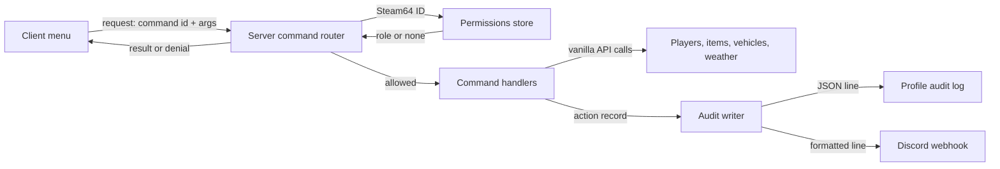

# Plan: NimbyAdmin (working name)

Draft v0.1, October 15, 2026. Owner: Jeff Fabish. Implementer: a Claude Code session, coordinated by the orchestrator session. Status: for Jeff's review.

NimbyAdmin is an in-house admin tool that replaces COT for Jeff and Jay: player management, spawning, and world control from an in-game menu, with every action logged and posted to Discord. It is built from scratch on vanilla DayZ 1.30, ships as an addon in `@NIMBY`, and never writes to world saves. The feasibility study (`docs/design/nimby-admin-feasibility.md`) holds the reasoning, cost, and risks; this plan is the build order.

## What this is not

- Not a copy of COT or VPP. No code is taken from either.
- Not an observation tool: no free camera, spectate, ESP, or live player map (decided October 15, 2026).
- Not a framework. It contains only the command routing and permissions it needs.
- Not an anticheat.
- Not public. It ships only inside `@NIMBY`.

## Decisions already made (Jeff, October 15, 2026)

| Topic | Decision |
| --- | --- |
| Capabilities | Player management, spawning, world control |
| Interface | In-game menu from day one |
| Save footprint | Zero: no CF, no `OnStoreSave`/`OnStoreLoad`, nothing stored on entities |
| Audit | Structured log file in the server profile plus a Discord webhook to a private admin channel |
| Jeff's time | 10+ hours per week |

## Decisions Jeff owes

| # | Decision | Options | Recommendation |
| --- | --- | --- | --- |
| N1 | Final name | Keep `NimbyAdmin`; or a short name | Keep `NimbyAdmin` as the code prefix whatever the display name is. |
| N2 | Menu key | `Home`; `End`; `F` keys | `Home`, if the 1.30 vanilla bindings leave it free (checked in Phase 0). Only admins can open it either way. |
| N3 | Roles | One admin role; or owner plus admin | Two roles: `owner` (Jeff: everything, including permissions) and `admin` (Jay: everything except editing permissions). |
| N4 | Bans | Own ban list checked on connect; or write to `ban.txt` through BattlEye | Own list in the profile folder (Steam64 ID, reason, by, date, optional expiry), checked on connect. It is logged, reversible from the menu, and does not depend on RCON. |
| N5 | Discord channel | New private `#admin-log`; or an existing channel | New private channel, admins only; the webhook URL lives only in the server profile. |
| N6 | Spawn limits | None; or caps per action | Cap quantity per spawn (default 50) and log everything; no item denylist. |

## Architecture

| Component | Side | Responsibility |
| --- | --- | --- |
| Command router | Server | Receives one RPC id per command group, reads arguments, checks permission, rate-limits, dispatches, returns a result |
| Permissions store | Server | Loads `$profile:NimbyAdmin\permissions.json`; creates it with no admins on first boot |
| Command handlers | Server | One class per command; validates arguments; calls vanilla APIs |
| Audit writer | Server | Appends one JSON line per action to `$profile:NimbyAdmin\audit-<date>.log`; posts to the webhook asynchronously; a webhook failure never blocks the action |
| Config | Server | `$profile:NimbyAdmin\config.json`: webhook URL, spawn cap, rate limits, log retention; safe defaults on first boot |
| Admin state sync | Server to client | Tells a client whether it is an admin and its role, at connect and on change; the client hides the menu otherwise |
| Menu | Client | Layouts and widgets; sends requests; never decides anything |
| Item catalog | Client and server | Built at runtime from the game config (spawnable items and vehicles), so new 1.30 items appear without code changes |

### Data formats

`permissions.json`:

| Field | Type | Required | Description |
| --- | --- | --- | --- |
| `version` | `integer` | Yes | Schema version, starting at 1 |
| `admins` | array of `Admin` | Yes | Empty on first boot |

`Admin`:

| Field | Type | Required | Description |
| --- | --- | --- | --- |
| `steam64` | `string` | Yes | 17-digit Steam64 ID; validated on load; invalid rows are skipped and logged |
| `name` | `string` | No | Label for logs only; never used for authorization |
| `role` | `string` | Yes | `owner` or `admin` (decision N3) |

Audit line (one JSON object per line):

| Field | Type | Required | Description |
| --- | --- | --- | --- |
| `ts` | `string` | Yes | Server time, ISO 8601 |
| `actor` | `string` | Yes | Admin Steam64 ID and name |
| `command` | `string` | Yes | For example `player.teleportTo`, `spawn.item` |
| `target` | `string` | No | Target player or item class |
| `args` | `object` | No | Validated arguments |
| `pos` | `string` | No | Actor and target positions |
| `result` | `string` | Yes | `ok`, `denied`, `invalid`, or `failed` with a reason |

## Work breakdown

Every phase ends with `scripts/Build-NimbyPack.ps1` passing (build, sign, verify, boot check on 1.30 Nasdara), its in-game exit test passing with Jeff, and Jeff's approval.

### Phase 0: spike and gate (3-5 days)

1. Verify in the shared 1.30 script reference every API the spike uses: RPC send and receive on server and client, `PlayerIdentity` Steam64 access, profile-folder file read and write, JSON load and save, the REST API for the webhook, menu creation and input focus, the `Home` key (decision N2), and player position set. Record file:line for each.
2. Ask the orchestrator to add `NimbyAdmin` to `pack.json`.
3. Build the router, permissions store, audit writer (file and webhook), config with first-boot defaults, admin state sync, the menu shell (opens for admins only, a tab bar with empty tabs), and one command: teleport to player.
4. Exit test, on the local test server with two clients if Jay is available, otherwise one client plus a non-admin second instance:

| Case | Expected |
| --- | --- |
| Non-admin presses the menu key | Nothing opens; no request reaches the router |
| Non-admin sends a forged teleport request (test hook in a dev build only, removed before release) | Router denies; `denied` line logged |
| Admin opens the menu and teleports to a player | Moves; one audit line in the file and one Discord message |
| Webhook URL wrong or Discord down | Action still succeeds; failure logged once |
| Restart | Permissions and config persist; no entity data written |

Go/no-go: if this phase overruns 5 days, or the menu or RPC plumbing proves unworkable, stop and fall back to COT under the October 15 re-add criteria.

### Phase 1: player management (5-7 days)

Player list (name, Steam64, distance, alive or dead); teleport to; bring to me; heal (health, blood, shock, and status to full); kill; kick with reason; ban and unban per decision N4 (the ban check runs on connect); private message. Exit test: each command with two clients; each audited; non-admin refusal for each.

### Phase 2: spawning (7-10 days)

Searchable item list from config; spawn into inventory, at feet, or at a set distance in front of the admin; quantity with the N6 cap; vehicle spawn with a complete parts preset per class (cars, trucks, the 1.30 motorbikes, boats), stored as JSON in the profile so presets can change without a rebuild. Exit test: spawn every vehicle class on Nasdara and drive it; spawned items survive a restart (they are vanilla entities); quantity cap enforced.

### Phase 3: world control (3-4 days)

Weather (overcast, rain, fog, wind) with a duration; set time of day; server-wide announcement; sandstorm control only if Phase 0 or this phase finds a script API for it. Exit test: changes visible to a second client; behavior after restart documented.

### Phase 4: hardening and rollout (4-5 days)

Abuse tests (forged commands for every id, malformed and out-of-range arguments, spam past the rate limit); permission edge cases (removed admin mid-session, invalid Steam64 rows); remove all dev-only hooks; write `docs/operations/nimby-admin.md` (setup, permissions file, webhook, recovery) and a one-page quick reference for Jay; live rollout with the rest of `@NIMBY`.

## Acceptance criteria

- Builds, signs, and boot-checks on 1.30 Nasdara with 0 `SCRIPT (E)`.
- Every command refuses non-admins on the server, with a test per command.
- Every action writes exactly one audit line; webhook failures never block an action.
- No save footprint: no `OnStoreSave`/`OnStoreLoad` overrides; booting against a copy of live `storage_1` with and without the addon shows 0 "Scripted variables corrupted".
- No secret in the repo or the pack: the webhook URL exists only in the server profile.
- Jay signs off on the menu.

## Estimate

About 22-31 implementation days over 5-6 calendar weeks at Jeff's 10-12 hours a week of testing. Highest effort and highest schedule risk of the three plans, concentrated in the menu.

## Risks

| Risk | Effect | Mitigation |
| --- | --- | --- |
| Menu layout iteration runs long | Phases 0-2 slip | Functional layouts first; polish after Phase 4; screenshots from Jeff drive each pass |
| A missed server-side permission check | Any player acts as admin | Server-only checks; refusal test per command; Phase 4 forged-command sweep |
| REST API unavailable or limited in 1.30 | No Discord posts | File log still records everything; webhook becomes a later item |
| Sandstorm not scriptable | One control missing | Ship without it |
| DayZ update breaks a used API | Admin tool down | Small surface; boot check fails the build; patch the same day |

## Shared rules (same in all three plans)

1. **Branches and worktrees.** Each mod works on its own branch in its own git worktree: `feat/autorun`, `feat/gimme`, `feat/nimby-admin`, in `D:\GitHub\nimby-badlands-server-wt\<branch-name>`. Jeff runs merges to `main`; whether Claude Code sessions may commit on their own feature branch is the orchestrator's first question to Jeff.
2. **One 1.30 script reference.** Before any session writes code, the orchestrator unpacks the 1.30 `scripts.pbo` (DayZ Tools or `D:\GitHub\DayZExtract`) to one read-only folder that all three sessions grep. No vanilla API is used without a file:line from that folder.
3. **Shared files are orchestrator-owned.** Only the orchestrator edits `mods/own/nimby-pack/pack.json`, `scripts/Build-NimbyPack.ps1`, `scripts/modules/`, and `scripts/Start-NimbyTestServer.ps1`. A session that needs a change there asks the orchestrator.
4. **Identifiers.** RPC ids by block: Autorun `65501xx` (existing `6550101`), Gimme `65502xx`, NimbyAdmin `65503xx`. Log prefixes `[NIMBY][Autorun]`, `[NIMBY][Gimme]`, `[NIMBY][Admin]`. Class prefixes `NimbyAutorun`, `NimbyGimme`, `NimbyAdmin`.
5. **Key bindings registry.** Autorun: numpad plus. Gimme: `O`, Left Shift + `O`. NimbyAdmin: to be decided (see that plan). No two mods share a default binding, and none shadows a vanilla default.
6. **Zero save footprint.** No `OnStoreSave`/`OnStoreLoad` overrides and no data added to any saved entity, in any of the three mods. Net-synced variables are allowed; they are not persisted.
7. **Quality gate.** A change is done only when `Build-NimbyPack.ps1` exits 0 (build, sign, verify, boot check) and its in-game cases pass.
8. **Live rollout.** All three ship together as one `@NIMBY` release at a scheduled restart, after a local boot against a copy of the live `storage_1` shows 0 "Scripted variables corrupted". The launch line change restarts the server, so it lands in the restart window.
