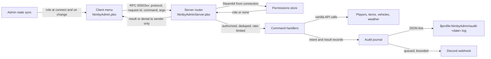

# Plan 3 - Central Scrutinizer (`NimbyAdmin`)

Draft v0.4, October 16, 2026. Owner: Jeff Fabish. Implementer: a Claude Code session in worktree `feat/nimby-admin`, coordinated by the orchestrator. Status: ready for Phase 0 once Plan 0 (shared tooling) is on `main`.

Target: NIMBY | HARDCORE | BADLANDS | 1pp, HostHavoc, DayZ 1.30.164078 / Nasdara.
Release: independent, gated (see [shared rules, 9.2](2026-10-15-shared-rules.md)).

Central Scrutinizer is the in-house admin tool for every server admin (today Jeff and Jay; roles per N3): player management, spawning, and world control from an in-game menu, every action audited locally and posted to Discord. It is written from scratch against vanilla DayZ 1.30 with no CF dependency and zero save footprint. The feasibility study (`docs/design/nimby-admin-feasibility.md`) holds the reasoning and cost; where the two differ, this plan is authoritative. The October 16, 2026 addendum (`docs/design/central-scrutinizer-feasibility-addendum.md`, v0.1) assesses player intelligence, the companion service, the map, spectate, and in-game configuration; none of it is planned until Jeff rules on its decisions Q1-Q6.

Changes since v0.3: display name Central Scrutinizer (Jeff, October 16, 2026; was Golden God); the tool serves every admin, not one person; observation features (live player map, spectate) stay out of scope but the architecture carries the seams for them (N9); key bindings are player-configurable per shared rules 5.

Changes since v0.2: display name Golden God (N1); client and server PBO split (N7); ban and permission files fail to last-known-good, not closed (N8); spawn cap 50 items and one vehicle (N6); decisions and data-format tables restored; Discord retry downgraded to fixed backoff on `429`; audit-failure tests scoped to what runs locally; every test row names its evidence; Phase 0 time box restored at 5 days.

## What this is not

- Not a copy of COT or VPP. No code is taken from either.
- Not an observation tool yet. No spectate, free camera, or live player map ships in this plan, and ESP never does. Jeff decided on October 16, 2026 that a map-based player view and spectating come later, so the architecture carries the seams for them (N9) without implementing them.
- Not a framework and not an anticheat.
- Not arbitrary script execution.
- Not a persistence change: no custom entity serialization, no mod-dependent persistent entity classes, no `OnStoreSave`/`OnStoreLoad`.

## Decisions

| # | Decision | Choice | Status |
| --- | --- | --- | --- |
| N1 | Display name | Central Scrutinizer. Code prefix `NimbyAdmin`, log prefix `[NIMBY][Admin]`, RPC block `65503xx` unchanged | Decided by Jeff, October 16, 2026 (Golden God on October 15) |
| N2 | Menu key | Home, then F10; the first verified free in the 1.30 `bin/preset_X1MouseKey.xml` wins (there is no `inputs.xml` in 1.30, shared rules 7); otherwise unbound with setup instructions. End left the list on October 15, 2026 when Jeff gave it to Ears (D8); Home is free and F10 is bound in vanilla, so Home is expected | Decided; revised October 15, 2026 |
| N3 | Roles | `owner` (manage permissions and everything else) and `admin` (operational commands) | Decided |
| N4 | Bans | Own list in the profile folder, checked against the authenticated identity at connection | Decided |
| N5 | Discord channel | New private admin channel; webhook URL only in `$profile:NimbyAdmin\config.json` | Decided |
| N6 | Spawn limits | 50 items and one vehicle per request, plus server-side request limits; all values in `config.json` | Decided October 15, 2026 |
| N7 | PBO layout | Client PBO `NimbyAdmin` (menu, request sender, admin-state receiver) plus server-only PBO `NimbyAdminServer` loaded with `-servermod=` (router, permissions, bans, audit, webhook, handlers). See shared rules 8.1 | Decided October 15, 2026 |
| N9 | Observation seams | Built now, used later: (a) the server-to-client channel is a typed push envelope (`NimbyAdminPush`: kind, sequence, payload), with `role` the only kind in this plan, so a position feed or spectate stream is a new kind, not a new channel; (b) permissions are capability strings on roles (`player.kick`, `spawn.item`, `world.weather`, and reserved `observe.map`, `observe.spectate`), so observation gets its own capabilities with no schema change; (c) the client menu is a page registry (`NimbyAdminPage` subclasses register at init); a Map or Spectate page registers like any other; (d) RPC ids `6550350`-`6550399` are reserved for observation feeds; (e) a streaming handler variant (server-paced, rate-limited, per-subscriber) is specified when the first feed is built, not now. The self-test registers one fake page, one fake push kind, and one fake capability to prove the seams exist | Decided by Jeff, October 16, 2026 (build for later map and spectator views); seam design is Claude's |
| N8 | Access-file failure | Permissions and bans are written atomically with a `.lkg` copy. On a corrupt load the server uses `.lkg`, logs, posts to Discord, and refuses further edits to that file until repaired. Admission is denied only when no `.lkg` exists | Decided October 15, 2026 |

## Architecture

| Component | PBO | Responsibility |
| --- | --- | --- |
| Menu | Client | Layouts and widgets; sends requests; never decides anything; hidden unless the admin state sync says the player has a role |
| Admin state sync | Both | Server tells a client its role at connect and on change through the `NimbyAdminPush` envelope (N9); the client only renders |
| Command router | Server | Reads protocol version, request id, command, args; derives the actor from the connection; authorizes; dedupes; rate-limits; dispatches; returns the result to the sender only |
| Permissions store | Server | `$profile:NimbyAdmin\permissions.json` with `.lkg`; first-owner bootstrap |
| Ban store | Server | `$profile:NimbyAdmin\bans.json` with `.lkg`; checked at connection |
| Command handlers | Server | One class per command; validates arguments through engine-free validators; calls vanilla APIs |
| Audit journal | Server | Appends intent and terminal result records; a failed append blocks the state change |
| Discord delivery | Server | Bounded queue, fixed backoff on `429`, never blocks a command |
| Item catalog | Both | Built from game config at runtime; the server validates every class independently before spawning |

## Data formats

`permissions.json`:

| Field | Type | Required | Description |
| --- | --- | --- | --- |
| `version` | `integer` | Yes | Schema version, starting at 1 |
| `admins` | array of `Admin` | Yes | Empty on first boot; the first owner comes from `config.json` `bootstrapOwnerSteam64` |

`Admin`:

| Field | Type | Required | Description |
| --- | --- | --- | --- |
| `steam64` | `string` | Yes | 17-digit Steam64 id; validated on load; an invalid row is skipped and logged, never granted |
| `name` | `string` | No | Label for logs only; never used for authorization |
| `role` | `string` | Yes | `owner` or `admin`; any other value grants nothing |

`bans.json` entry:

| Field | Type | Required | Description |
| --- | --- | --- | --- |
| `steam64` | `string` | Yes | Banned identity |
| `reason` | `string` | Yes | Escaped free text, maximum 200 characters |
| `actor` | `string` | Yes | Steam64 of the admin who created the ban |
| `createdUtc` | `string` | Yes | ISO 8601 UTC |
| `expiresUtc` | `string` | No | ISO 8601 UTC; absent means permanent |

`config.json`:

| Field | Type | Required | Default | Description |
| --- | --- | --- | --- | --- |
| `version` | `integer` | Yes | 1 | Schema version |
| `bootstrapOwnerSteam64` | `string` | No | none | Granted `owner` on boot when `permissions.json` has no owner |
| `webhookUrl` | `string` | No | none | Discord webhook; never logged or synced to clients |
| `spawnMaxItems` | `integer` | No | 50 | Items per request (N6) |
| `spawnMaxVehicles` | `integer` | No | 1 | Vehicles per request (N6) |
| `requestsPerSecond` | `integer` | No | 5 | Per-sender request limit |
| `discordQueueMax` | `integer` | No | 200 | Queued messages before overflow is reported |
| `auditRetentionDays` | `integer` | No | 90 | Audit files older than this are rotated out |

Audit record (one JSON object per line; two per command, `intent` then `result`):

| Field | Type | Required | Description |
| --- | --- | --- | --- |
| `id` | `string` | Yes | Request id from the client, unique per actor |
| `phase` | `string` | Yes | `intent` or `result` |
| `ts` | `string` | Yes | ISO 8601 with explicit offset |
| `actor` | `object` | Yes | `steam64`, `biId`, `name` |
| `command` | `string` | Yes | For example `player.teleportTo`, `spawn.item` |
| `target` | `object` | No | Player identity or item class, with positions where relevant |
| `args` | `object` | No | Validated arguments |
| `result` | `string` | Yes on `result` | `ok`, `partial`, `denied`, `invalid`, or `failed` |
| `effects` | `object` | No | Actual created quantities, entities removed, values applied |
| `reason` | `string` | No | Failure or denial reason |

## Phase 0 - feasibility and security gate (5-day time box)

Depends on Plan 0 (shared tooling), including the server-mod build output.

### Build and environment

1. Record engine versions, source revision, and the shared 1.30 reference hashes in `docs/baselines/`.
2. Verify against the shared reference and record file:line: RPC send and receive on both sides, `PlayerIdentity` Steam64 access, profile-folder file read and write, JSON load and save, `RestApi`/`RestContext`/`RestCallback`, menu creation and input focus, `.layout` loading from a signed PBO, the N2 key candidates in `inputs.xml`, and player position set.
3. Confirm with the orchestrator that `pack.json` carries both `NimbyAdmin` rows and `*.layout` in `includePatterns`.
4. Verify HostHavoc supports `-servermod=` from the panel and that outbound HTTPS to Discord works from the host, before any server-only code or webhook work.
5. Build, sign, and boot both PBOs on Nasdara; verify a menu `.layout` loads from the signed client PBO on a real client.

### Minimum vertical slice

Menu shell with player selection; authenticated router; permission loading and first-owner bootstrap; audit journal; asynchronous Discord delivery; one command: teleport to player.

### Security contract

Every request carries a supported protocol version, a request id, a known command, and bounded arguments. The server:

- derives the actor from the authenticated connection and resolves identity by Steam64, never from a client-supplied id or name;
- authorizes every command and sensitive query;
- resolves targets against current sessions, so a selection does not silently retarget after reconnect;
- rejects stale, malformed, unknown, unauthorized, and duplicate requests;
- applies per-sender and aggregate limits before expensive processing;
- returns results only to the sender.

Permission updates take effect on the next request. Unknown roles and invalid entries grant nothing. A malformed file never replaces a working configuration with an empty one (N8).

### Gate tests

| Scenario | Required result | Evidence |
| --- | --- | --- |
| Non-admin presses the menu key | Nothing opens; no request sent | No `[NIMBY][Admin]` request line for that player |
| Non-admin forges a teleport (dev harness) | Denied | Audit `result=denied`; no position change |
| Admin teleports to a player | Moves | Audit `intent` then `result=ok` with the same `id`; one Discord message |
| Duplicate request id | Second ignored | One `intent`, one `result`; `[NIMBY][Admin] duplicate id=` line |
| Permission revoked mid-session | Next request denied | `result=denied reason=no role` |
| Malformed payload | Rejected | `result=invalid` |
| Disconnect and reconnect | Role re-synced; menu state correct | Admin state sync line at connect |
| Restart | Permissions and config persist; no entity data written | Files unchanged; `storage_1` copy boot clean |
| Audit file locked or read-only (local) | Command blocked | `result=failed reason=audit unavailable`; no state change |
| Webhook wrong or Discord down | Command succeeds | `result=ok`; one `[NIMBY][Admin] discord failed` line, not one per retry |
| Self-test | Validators pass | `[NIMBY][Admin][SelfTest] PASS` for every case |

Go/no-go: continue only when the slice passes and remaining uncertainties are written down. If the time box is exceeded or the menu or RPC plumbing proves unworkable, stop; Jay keeps the HostHavoc panel. Reintroducing CF/COT needs its own compatibility decision and persistence test.

## Phase 1 - permissions, player management, and recovery

### Permissions

- Owner-managed role changes from the menu; the last owner cannot be removed or demoted.
- Validate the whole proposed configuration before replacing the active one; write atomically with `.lkg` (N8).
- Audit permission changes and denied attempts.
- Document offline recovery: which file to restore, from where, and how to verify.

### Player commands

Player list, teleport to, bring, heal, kill, kick, ban, unban, private message.

- Teleport and bring reject unsafe player states and invalid destinations; avoid occupied geometry, unsuitable terrain, and placement near vehicles.
- Kill and ban require explicit confirmation in the menu.
- Heal restores health, blood, and shock, stops bleeding, and repairs fractures. Disease, hunger, thirst, temperature, and equipment stay separate.
- A ban on an online player also ends that session. Ban and permission changes persist before success is reported.
- Removing or disabling Central Scrutinizer removes connection-time ban enforcement; the ops doc says so.

Exit: every command passes authorized, unauthorized, stale-target, and restart tests with Jeff and Jay, each with an audit `intent` and `result` pair.

## Phase 2 - controlled spawning

- Build the catalog from game configuration; the server validates each class independently. Not every config entry is safe to spawn.
- Destinations: inventory, feet, or validated nearby ground.
- Limits per N6; the limit is a maximum, not a promise. Report actual created quantities and partial failures as `result=partial` with `effects`.
- Never silently move a failed inventory spawn to the ground.
- Track entities created by the current request so incomplete construction is cleaned up before success is reported. A crash mid-request leaves an unresolved `intent`; do not claim exactly-once.
- Vehicle presets live in `$profile:NimbyAdmin\vehicles.json` for explicitly supported classes; validate parts, fluids, placement, and operability individually. Reject unvalidated presets.

| Scenario | Required result | Evidence |
| --- | --- | --- |
| Spawn 50 items to inventory with room | All created | `result=ok effects.created=50` |
| Spawn with partial room | Some created, rest reported | `result=partial effects.created=<n>`; nothing on the ground |
| Invalid class | Refused | `result=invalid` |
| Duplicate request id | Second ignored | One `result` |
| Vehicle preset for each supported class | Drivable after spawn and after restart | Manual drive; audit `result=ok`; vehicle present after RCON `#shutdown` restart |
| Unvalidated vehicle preset | Refused | `result=invalid reason=preset not validated` |

## Phase 3 - world controls and audit delivery

### World controls

Overcast, rain, fog, wind, time of day, and server-wide announcements. Bound every value and validate finite numeric input. Weather overrides last for the requested duration, then return control to the normal system; a newer override replaces the previous one; overrides do not persist across restart in v1. Time is set immediately and then progresses by server settings. Sandstorm control is out of v1 unless separately specified and verified.

### Local audit

Records per the audit table above. Test locked files, rotation, and recovery locally; HostHavoc disk exhaustion is recorded as untestable. Keep denial logging rate-limited so a hostile client cannot exhaust storage.

### Discord

- Webhook URL only in `config.json`; never in logs, client sync, or the repo.
- Escaped text, mentions disabled, payload limits enforced.
- Bounded queue (`discordQueueMax`); on `429`, back off on a fixed schedule (1 s, 5 s, 30 s) and then drop with one local line. `RestCallback` exposes status and body, not reliable headers, so retry-after values are not assumed.
- Distinguish retryable failures from configuration failures; surface overflow and permanent failure locally and in the admin menu.
- Never repeat a game command because its notification failed.

Exit: local records remain useful during HTTP failures; delivery failures cannot stall gameplay or create unbounded work.

## Phase 4 - hardening and release

- Command-by-command authorization and malformed-input matrix from the dev harness.
- Permission changes during active sessions and across restart.
- Duplicate requests, invalid targets, concurrent admins, sustained bursts.
- Every destructive command's failure and partial-success behavior.
- Install, update, and removal checks on disposable copies of representative world and character storage, compared against the same-build control.
- Stale-client behavior and packaged menu resources verified from a normal Workshop install.
- Write `docs/operations/central-scrutinizer.md` (setup, permissions, bans, audit failures, backup and restore, rollback, server-mod upload) and a one-page quick reference for Jay.
- Jay's menu usability sign-off; Jeff's release approval; deploy per shared rules 9.

Back up mission storage and `$profile:NimbyAdmin` together. Code rollback does not reverse spawned objects or player changes; world restoration is a separate decision because it discards later progress.

## Acceptance criteria

- Server-authoritative authorization for every command and sensitive query, with a dev-harness denial test per command.
- No unexplained script errors; the `storage_1`-copy boot shows 0 "Scripted variables corrupted".
- Audit `intent` written before every state change; `result` written after.
- Bounded, non-blocking Discord delivery.
- Multiplayer, restart, removal, and rollback tests passed against the exact artifact.
- Client PBO in the Workshop item; server PBO on the host only; no secret in either.
- Jay signs off on the menu.

## Estimate

Re-estimate after Phase 0 in engineering effort and tester hours. Treat five to six weeks as an initial hypothesis. No promise of same-day compatibility with future DayZ updates.

## Risks

| Risk | Effect | Mitigation |
| --- | --- | --- |
| Menu layout iteration runs long | Phases 0-2 slip | Functional layouts first, vanilla widgets and `set:dayz_gui` images only; polish after Phase 4 |
| A missed server-side check | Any player acts as admin | Server-only checks in the server PBO; denial test per command; Phase 4 sweep |
| HostHavoc lacks `-servermod=` or outbound HTTPS | N7 layout or Discord blocked | Phase 0 item 4 before any dependent code |
| `RestApi` limited in 1.30 | No Discord posts | Local audit is authoritative; webhook becomes a later item |
| Sandstorm not scriptable | One control missing | Out of v1 |
| DayZ update breaks a used API | Admin tool down | Small surface; boot check fails the build |
