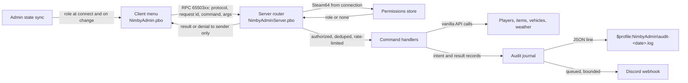

# Plan 3 - Central Scrutinizer (`NimbyAdmin`)

Draft v0.6, October 21, 2026 (evening). Owner: Jeff Fabish. Implementer: a Claude Code session in worktree `feat/nimby-admin`, coordinated by the orchestrator. Status: ready for Phase 0 once Plan 0 (shared tooling) is on `main`.

Target: NIMBY | HARDCORE | BADLANDS | 1pp, HostHavoc, DayZ 1.30.164078 / Nasdara.
Release: independent, gated (see [shared rules, 9.2](2026-10-15-shared-rules.md)).

Central Scrutinizer is the in-house admin tool for every server admin (today Jeff and Jay; roles per N3): player management, spawning, and world control from an in-game menu, every action audited locally and posted to Discord. It is written from scratch against vanilla DayZ 1.30 with no CF dependency and zero save footprint. The feasibility study (`docs/design/nimby-admin-feasibility.md`) holds the reasoning and cost; where the two differ, this plan is authoritative. The October 16, 2026 addendum (`docs/design/central-scrutinizer-feasibility-addendum.md`, v0.1) assesses player intelligence, the companion service, the map, spectate, and in-game configuration; none of it is planned until Jeff rules on its decisions Q1-Q6.

Changes since v0.5 (Jeff's rulings, October 21, 2026, evening): persistent-loot density added (N15): a server-side tile counter, a Density page, and per-tile Discord alerts in Phase 5, with per-player alerts once the F15 journal has data; the heatmap overlay joins Phase 6. Sandstorm control promoted into Phase 3 now that `SandstormController.Start`/`Stop` are verified (`3_Game/DayZ/Sandstorm.c:20,27`, Tweaker study T1a). New `config.json` fields `densityTileMeters`, `densityAlertObjects`, `densityPlayerAlertObjects`, `densityRefreshSeconds`.

Changes since v0.4 (Jeff's rulings, October 21, 2026, after the gap analysis against COT and VPP): eight capabilities added. Per-stat editor, cure, and restraint join Phase 1; weather presets join Phase 3; vehicle manager, object tools, and admin notes form a new Phase 5 after the first live release (N10). Restraint mechanism (N11), object-tool scope (N12), and the notes store (N13) decided. The capabilities surfaced by the same analysis and not adopted are recorded under Later (not committed) (N14). New `config.json` field `restrainTimeoutMinutes`; new `notes.json` data format.

Changes since v0.3: display name Central Scrutinizer (Jeff, October 16, 2026; was Golden God); the tool serves every admin, not one person; observation features (live player map, spectate) stay out of scope but the architecture carries the seams for them (N9); key bindings are player-configurable per shared rules 5.

Changes since v0.2: display name Golden God (N1); client and server PBO split (N7); ban and permission files fail to last-known-good, not closed (N8); spawn cap 50 items and one vehicle (N6); decisions and data-format tables restored; Discord retry downgraded to fixed backoff on `429`; audit-failure tests scoped to what runs locally; every test row names its evidence; Phase 0 time box restored at 5 days.

## What this is not

- Not a copy of COT or VPP. No code is taken from either.
- Not an observation tool yet. No spectate, free camera, or live player map ships in this plan, and ESP never does. Jeff decided on October 16, 2026 that a map-based player view and spectating come later, so the architecture carries the seams for them (N9) without implementing them.
- Not a framework and not an anticheat.
- Not arbitrary script execution.
- Not a persistence change: no custom entity serialization, no mod-dependent persistent entity classes, no `OnStoreSave`/`OnStoreLoad`.

## Decisions

| # | Decision | Choice | Status |
| --- | --- | --- | --- |
| N1 | Display name | Central Scrutinizer. Code prefix `NimbyAdmin`, log prefix `[NIMBY][Admin]`, RPC block `65503xx` unchanged | Decided by Jeff, October 16, 2026 (Golden God on October 15) |
| N2 | Menu key | Home, then F10; the first verified free in the 1.30 `bin/preset_X1MouseKey.xml` wins (there is no `inputs.xml` in 1.30, shared rules 7); otherwise unbound with setup instructions. End left the list on October 15, 2026 when Jeff gave it to Ears (D8); Home is free and F10 is bound in vanilla, so Home is expected | Decided; revised October 15, 2026 |
| N3 | Roles | `owner` (manage permissions and everything else) and `admin` (operational commands) | Decided |
| N4 | Bans | Own list in the profile folder, checked against the authenticated identity at connection | Decided |
| N5 | Discord channel | New private admin channel; webhook URL only in `$profile:NimbyAdmin\config.json` | Decided |
| N6 | Spawn limits | 50 items and one vehicle per request, plus server-side request limits; all values in `config.json` | Decided October 15, 2026 |
| N7 | PBO layout | Client PBO `NimbyAdmin` (menu, request sender, admin-state receiver) plus server-only PBO `NimbyAdminServer` loaded with `-servermod=` (router, permissions, bans, audit, webhook, handlers). See shared rules 8.1 | Decided October 15, 2026 |
| N9 | Observation seams | Built now, used later: (a) the server-to-client channel is a typed push envelope (`NimbyAdminPush`: kind, sequence, payload), with `role` the only kind in this plan, so a position feed or spectate stream is a new kind, not a new channel; (b) permissions are capability strings on roles (`player.kick`, `spawn.item`, `world.weather`, and reserved `observe.map`, `observe.spectate`), so observation gets its own capabilities with no schema change; (c) the client menu is a page registry (`NimbyAdminPage` subclasses register at init); a Map or Spectate page registers like any other; (d) RPC ids `6550350`-`6550399` are reserved for observation feeds; (e) a streaming handler variant (server-paced, rate-limited, per-subscriber) is specified when the first feed is built, not now. The self-test registers one fake page, one fake push kind, and one fake capability to prove the seams exist | Decided by Jeff, October 16, 2026 (build for later map and spectator views); seam design is Claude's |
| N8 | Access-file failure | Permissions and bans are written atomically with a `.lkg` copy. On a corrupt load the server uses `.lkg`, logs, posts to Discord, and refuses further edits to that file until repaired. Admission is denied only when no `.lkg` exists | Decided October 15, 2026 |
| N10 | Placement of the October 21 additions | Player verbs (per-stat editor, cure, restrain and release) ship in release 1 inside Phase 1; weather presets inside Phase 3; vehicle manager, object tools, and admin notes form Phase 5, which starts only after the first live release. Release 1 slips about a week; Phase 5 never blocks it | Decided by Jeff, October 21, 2026 |
| N11 | Restraint mechanism | Both: the vanilla restrained state (`PlayerBase.SetRestrained`, `PlayerBase.c:2206`; handcuffed animation, visible to bystanders) and an invisible freeze (`HumanInputController.OverrideMovementSpeed`, `human.c:253`). The admin picks per use. Either form MAY send the target a toast saying an admin has restrained them; the admin chooses whether to send it. Both end on `restrainTimeoutMinutes` (default 10) or explicit release; apply and release are audited; the owner is notified in Discord on every hold, as for spectate (addendum Q5) | Decided by Jeff, October 21, 2026 |
| N12 | Object-tool scope | Dynamic objects only: ground items, vehicles, base-building parts, tents, barrels, fences, flags, and dead bodies (anything with a persistent id or an inventory). Map statics (`House`, `Building`, terrain objects) are selectable for inspection and never deleted or moved, because the change does not persist and desyncs later joiners | Decided by Jeff, October 21, 2026 |
| N13 | Admin notes store | `$profile:NimbyAdmin\notes.json` from Phase 5, same atomic write and `.lkg` as N8; Eyes imports the file when it ships and becomes the viewer, and the server keeps writing locally so an Eyes outage never loses a note | Decided by Jeff, October 21, 2026 |
| N14 | Capabilities not adopted | Recorded under Later (not committed) with their one-line verdicts; nothing scheduled or estimated | Decided by Jeff, October 21, 2026 |
| N15 | Persistent-loot density | Purpose: answer "why does this area have low performance" and catch a player or area hoarding. Phase 5: the registry counts persistent objects per map tile (`densityTileMeters`, default 200) by class group (base parts, tents, containers and barrels, underground stashes, loose ground items, vehicles; infected and animals excluded), a Density page lists the top tiles with counts and a best-guess owner, and a Discord alert fires when a tile passes `densityAlertObjects` (default 400), once per tile per restart. Per-player alerts (`densityPlayerAlertObjects`) use the F15 association journal and switch on when it has data; until then the owner column is marked best-guess. Phase 6 paints the tiles as a heat overlay on the map. Thresholds are starting values, tuned on live data | Decided by Jeff, October 21, 2026 (placement and alert unit); counting rules and defaults are Claude's |

## Architecture

| Component | PBO | Responsibility |
| --- | --- | --- |
| Menu | Client | Layouts and widgets; sends requests; never decides anything; hidden unless the admin state sync says the player has a role |
| Admin state sync | Both | Server tells a client its role at connect and on change through the `NimbyAdminPush` envelope (N9); the client only renders |
| Command router | Server | Reads protocol version, request id, command, args; derives the actor from the connection; authorizes; dedupes; rate-limits; dispatches; returns the result to the sender only |
| Permissions store | Server | `$profile:NimbyAdmin\permissions.json` with `.lkg`; first-owner bootstrap |
| Ban store | Server | `$profile:NimbyAdmin\bans.json` with `.lkg`; checked at connection |
| Command handlers | Server | One class per command; validates arguments through engine-free validators; calls vanilla APIs |
| Audit journal | Server | Appends intent and terminal result records; a failed append blocks the state change |
| Discord delivery | Server | Bounded queue, fixed backoff on `429`, never blocks a command |
| Item catalog | Both | Built from game config at runtime; the server validates every class independently before spawning |

## Data formats

`permissions.json`:

| Field | Type | Required | Description |
| --- | --- | --- | --- |
| `version` | `integer` | Yes | Schema version, starting at 1 |
| `admins` | array of `Admin` | Yes | Empty on first boot; the first owner comes from `config.json` `bootstrapOwnerSteam64` |

`Admin`:

| Field | Type | Required | Description |
| --- | --- | --- | --- |
| `steam64` | `string` | Yes | 17-digit Steam64 id; validated on load; an invalid row is skipped and logged, never granted |
| `name` | `string` | No | Label for logs only; never used for authorization |
| `role` | `string` | Yes | `owner` or `admin`; any other value grants nothing |

`bans.json` entry:

| Field | Type | Required | Description |
| --- | --- | --- | --- |
| `steam64` | `string` | Yes | Banned identity |
| `reason` | `string` | Yes | Escaped free text, maximum 200 characters |
| `actor` | `string` | Yes | Steam64 of the admin who created the ban |
| `createdUtc` | `string` | Yes | ISO 8601 UTC |
| `expiresUtc` | `string` | No | ISO 8601 UTC; absent means permanent |

`config.json`:

| Field | Type | Required | Default | Description |
| --- | --- | --- | --- | --- |
| `version` | `integer` | Yes | 1 | Schema version |
| `bootstrapOwnerSteam64` | `string` | No | none | Granted `owner` on boot when `permissions.json` has no owner |
| `webhookUrl` | `string` | No | none | Discord webhook; never logged or synced to clients |
| `spawnMaxItems` | `integer` | No | 50 | Items per request (N6) |
| `spawnMaxVehicles` | `integer` | No | 1 | Vehicles per request (N6) |
| `requestsPerSecond` | `integer` | No | 5 | Per-sender request limit |
| `discordQueueMax` | `integer` | No | 200 | Queued messages before overflow is reported |
| `auditRetentionDays` | `integer` | No | 90 | Audit files older than this are rotated out |
| `restrainTimeoutMinutes` | `integer` | No | 10 | A hold (N11) ends on its own after this many minutes |
| `vehicleRegistryRefreshSeconds` | `integer` | No | 60 | Cadence of the vehicle and object registry sweep (Phase 5) |
| `densityTileMeters` | `integer` | No | 200 | Edge of a density tile (N15) |
| `densityRefreshSeconds` | `integer` | No | 300 | Cadence of the density recount; the sweep is spread over ticks |
| `densityAlertObjects` | `integer` | No | 400 | Persistent objects in one tile that trigger a Discord alert |
| `densityPlayerAlertObjects` | `integer` | No | 400 | Objects attributed to one player that trigger an alert, once F15 has data |

`notes.json` (N13) entry:

| Field | Type | Required | Description |
| --- | --- | --- | --- |
| `id` | `string` | Yes | Unique per note; the request id that created it |
| `steam64` | `string` | Yes | The player the note is about |
| `author` | `string` | Yes | Steam64 of the admin who wrote it |
| `createdUtc` | `string` | Yes | ISO 8601 UTC |
| `text` | `string` | Yes | Escaped free text, maximum 500 characters |

Audit record (one JSON object per line; two per command, `intent` then `result`):

| Field | Type | Required | Description |
| --- | --- | --- | --- |
| `id` | `string` | Yes | Request id from the client, unique per actor |
| `phase` | `string` | Yes | `intent` or `result` |
| `ts` | `string` | Yes | ISO 8601 with explicit offset |
| `actor` | `object` | Yes | `steam64`, `biId`, `name` |
| `command` | `string` | Yes | For example `player.teleportTo`, `spawn.item` |
| `target` | `object` | No | Player identity or item class, with positions where relevant |
| `args` | `object` | No | Validated arguments |
| `result` | `string` | Yes on `result` | `ok`, `partial`, `denied`, `invalid`, or `failed` |
| `effects` | `object` | No | Actual created quantities, entities removed, values applied |
| `reason` | `string` | No | Failure or denial reason |

## Phase 0 - feasibility and security gate (5-day time box)

Depends on Plan 0 (shared tooling), including the server-mod build output.

### Build and environment

1. Record engine versions, source revision, and the shared 1.30 reference hashes in `docs/baselines/`.
2. Verify against the shared reference and record file:line: RPC send and receive on both sides, `PlayerIdentity` Steam64 access, profile-folder file read and write, JSON load and save, `RestApi`/`RestContext`/`RestCallback`, menu creation and input focus, `.layout` loading from a signed PBO, the N2 key candidates in `inputs.xml`, and player position set.
3. Confirm with the orchestrator that `pack.json` carries both `NimbyAdmin` rows and `*.layout` in `includePatterns`.
4. Verify HostHavoc supports `-servermod=` from the panel and that outbound HTTPS to Discord works from the host, before any server-only code or webhook work.
5. Build, sign, and boot both PBOs on Nasdara; verify a menu `.layout` loads from the signed client PBO on a real client.

### Minimum vertical slice

Menu shell with player selection; authenticated router; permission loading and first-owner bootstrap; audit journal; asynchronous Discord delivery; one command: teleport to player.

### Security contract

Every request carries a supported protocol version, a request id, a known command, and bounded arguments. The server:

- derives the actor from the authenticated connection and resolves identity by Steam64, never from a client-supplied id or name;
- authorizes every command and sensitive query;
- resolves targets against current sessions, so a selection does not silently retarget after reconnect;
- rejects stale, malformed, unknown, unauthorized, and duplicate requests;
- applies per-sender and aggregate limits before expensive processing;
- returns results only to the sender.

Permission updates take effect on the next request. Unknown roles and invalid entries grant nothing. A malformed file never replaces a working configuration with an empty one (N8).

### Gate tests

| Scenario | Required result | Evidence |
| --- | --- | --- |
| Non-admin presses the menu key | Nothing opens; no request sent | No `[NIMBY][Admin]` request line for that player |
| Non-admin forges a teleport (dev harness) | Denied | Audit `result=denied`; no position change |
| Admin teleports to a player | Moves | Audit `intent` then `result=ok` with the same `id`; one Discord message |
| Duplicate request id | Second ignored | One `intent`, one `result`; `[NIMBY][Admin] duplicate id=` line |
| Permission revoked mid-session | Next request denied | `result=denied reason=no role` |
| Malformed payload | Rejected | `result=invalid` |
| Disconnect and reconnect | Role re-synced; menu state correct | Admin state sync line at connect |
| Restart | Permissions and config persist; no entity data written | Files unchanged; `storage_1` copy boot clean |
| Audit file locked or read-only (local) | Command blocked | `result=failed reason=audit unavailable`; no state change |
| Webhook wrong or Discord down | Command succeeds | `result=ok`; one `[NIMBY][Admin] discord failed` line, not one per retry |
| Self-test | Validators pass | `[NIMBY][Admin][SelfTest] PASS` for every case |

Go/no-go: continue only when the slice passes and remaining uncertainties are written down. If the time box is exceeded or the menu or RPC plumbing proves unworkable, stop; Jay keeps the HostHavoc panel. Reintroducing CF/COT needs its own compatibility decision and persistence test.

## Phase 1 - permissions, player management, and recovery

### Permissions

- Owner-managed role changes from the menu; the last owner cannot be removed or demoted.
- Validate the whole proposed configuration before replacing the active one; write atomically with `.lkg` (N8).
- Audit permission changes and denied attempts.
- Document offline recovery: which file to restore, from where, and how to verify.

### Player commands

Player list, teleport to, bring, heal, cure, per-stat editor, kill, kick, ban, unban, private message, unstick, restrain and release.

- Teleport and bring reject unsafe player states and invalid destinations; avoid occupied geometry, unsuitable terrain, and placement near vehicles.
- Kill and ban require explicit confirmation in the menu.
- Heal restores health, blood, and shock, stops bleeding, and repairs fractures. Disease, hunger, thirst, temperature, and equipment stay separate.
- Cure is its own verb: clears every agent (`PlayerAgentPool.RemoveAllAgents`, `PlayerAgentPool.c:218`) and resets disease-related modifiers; it touches no other stat.
- Per-stat editor: Health, Blood, Shock, Energy, Water, Heat comfort, and Stamina, each set to an explicit value bounded to the vanilla range for that stat (`SetHealth`, `GetStatEnergy`/`GetStatWater`/`GetStatHeatComfort`, `StaminaHandler.SetStamina` at `StaminaHandler.c:1075`). Lowering a stat ("hurt") is the same command with a lower value; a value that would kill requires the same confirmation as kill. Stamina is not persisted and the edit is advisory until the next stamina tick.
- Unstick: teleport with a 1 m lift, a 2 m forward nudge, and a surface check (addendum F16).
- Restrain and release per N11. The server re-applies the hold if the target struggles free; a disconnect ends the hold; the timeout is enforced server side and does not depend on the admin staying online.
- A ban on an online player also ends that session. Ban and permission changes persist before success is reported.
- Removing or disabling Central Scrutinizer removes connection-time ban enforcement; the ops doc says so.

Exit: every command passes authorized, unauthorized, stale-target, and restart tests with Jeff and Jay, each with an audit `intent` and `result` pair.

## Phase 2 - controlled spawning

- Build the catalog from game configuration; the server validates each class independently. Not every config entry is safe to spawn.
- Destinations: inventory, feet, or validated nearby ground.
- Limits per N6; the limit is a maximum, not a promise. Report actual created quantities and partial failures as `result=partial` with `effects`.
- Never silently move a failed inventory spawn to the ground.
- Track entities created by the current request so incomplete construction is cleaned up before success is reported. A crash mid-request leaves an unresolved `intent`; do not claim exactly-once.
- Vehicle presets live in `$profile:NimbyAdmin\vehicles.json` for explicitly supported classes; validate parts, fluids, placement, and operability individually. Reject unvalidated presets.

| Scenario | Required result | Evidence |
| --- | --- | --- |
| Spawn 50 items to inventory with room | All created | `result=ok effects.created=50` |
| Spawn with partial room | Some created, rest reported | `result=partial effects.created=<n>`; nothing on the ground |
| Invalid class | Refused | `result=invalid` |
| Duplicate request id | Second ignored | One `result` |
| Vehicle preset for each supported class | Drivable after spawn and after restart | Manual drive; audit `result=ok`; vehicle present after RCON `#shutdown` restart |
| Unvalidated vehicle preset | Refused | `result=invalid reason=preset not validated` |

## Phase 3 - world controls and audit delivery

### World controls

Overcast, rain, fog, wind, time of day, and server-wide announcements. Named presets are saved in `$profile:NimbyAdmin\weather.json` (name, the five values, duration) and applied as one override; the file is validated on load and an invalid preset is skipped and logged, never applied. Bound every value and validate finite numeric input. Weather overrides last for the requested duration, then return control to the normal system; a newer override replaces the previous one; overrides do not persist across restart in v1. Time is set immediately and then progresses by server settings. Sandstorm: start and stop with a duration through `SandstormController.Start(duration, calledByWeather)` and `Stop(duration, calledByWeather)` (`3_Game/DayZ/Sandstorm.c:20,27`, verified October 21, 2026 in the Tweaker study); the controller's position, direction, and intensity are read-only to the menu. Phase 0 of this plan confirms `Start` takes effect on a dedicated server, since the script declaration is not proof of behavior (shared rules 7).

### Local audit

Records per the audit table above. Test locked files, rotation, and recovery locally; HostHavoc disk exhaustion is recorded as untestable. Keep denial logging rate-limited so a hostile client cannot exhaust storage.

### Discord

- Webhook URL only in `config.json`; never in logs, client sync, or the repo.
- Escaped text, mentions disabled, payload limits enforced.
- Bounded queue (`discordQueueMax`); on `429`, back off on a fixed schedule (1 s, 5 s, 30 s) and then drop with one local line. `RestCallback` exposes status and body, not reliable headers, so retry-after values are not assumed.
- Distinguish retryable failures from configuration failures; surface overflow and permanent failure locally and in the admin menu.
- Never repeat a game command because its notification failed.

Exit: local records remain useful during HTTP failures; delivery failures cannot stall gameplay or create unbounded work.

## Phase 4 - hardening and release

- Command-by-command authorization and malformed-input matrix from the dev harness.
- Permission changes during active sessions and across restart.
- Duplicate requests, invalid targets, concurrent admins, sustained bursts.
- Every destructive command's failure and partial-success behavior.
- Install, update, and removal checks on disposable copies of representative world and character storage, compared against the same-build control.
- Stale-client behavior and packaged menu resources verified from a normal Workshop install.
- Write `docs/operations/central-scrutinizer.md` (setup, permissions, bans, audit failures, backup and restore, rollback, server-mod upload) and a one-page quick reference for Jay.
- Jay's menu usability sign-off; Jeff's release approval; deploy per shared rules 9.

Back up mission storage and `$profile:NimbyAdmin` together. Code rollback does not reverse spawned objects or player changes; world restoration is a separate decision because it discards later progress.

## Phase 5 - ops pages (after the first live release, N10)

Three new menu pages over the Phase 1-3 plumbing. None adds a persistence hook; the registry below is rebuilt at boot and refreshed on a timer, never saved.

### Vehicle manager

- Server-side registry of every `CarScript` and `BoatScript` entity (class, position, persistent id, last-seen time), filled at load and refreshed every `vehicleRegistryRefreshSeconds`; the same registry the Phase 6 map draws from (addendum F17).
- Per vehicle: teleport to, delete (confirmation required), unstick (1 m lift, surface check, 2 m nudge), refuel (every fluid to capacity), repair (every part and the hull to full health). Map markers for all vehicles ship with Phase 6 and read this registry.

### Object tools

- Select: the object under the admin's look direction, or a pick from a nearby list (radius in the menu). Scope per N12; a map static shows its class and position and offers no verb.
- Delete: confirmation required; the audit `target` carries class, persistent id, and position so the record is enough to respawn a wrongly deleted item by hand.
- Move: set position and yaw; the server re-places with the surface check from teleport and refuses a position inside geometry or more than a bounded distance from the original.

### Density (N15)

- The registry sweep also bins every persistent object into `densityTileMeters` tiles with a count per class group; the recount runs every `densityRefreshSeconds`, spread over ticks so no single frame pays for it.
- Density page: top tiles by total, each with its counts per group, the nearest named location, a best-guess owner from F15 (marked best-guess until the journal is older than the oldest structure in the tile), and a "teleport to" button that reuses the Phase 1 teleport.
- Alerts: one Discord message per tile per restart when the total passes `densityAlertObjects`, naming the tile, the counts, and the best-guess owner; per-player alerts on `densityPlayerAlertObjects` once F15 has data. Alerts are audited like commands (actor `system`).
- Counting is the reporting tool only; nothing is removed automatically. Removal stays an admin's audited object-tool action (N12), and the base-size governor idea recorded October 15, 2026 stays unplanned.

### Admin notes

- Per player (N13): add, list (newest first, 20 lines in game), and delete your own note; an `owner` deletes any. Notes appear on the player card next to first seen and session rows.

| Scenario | Required result | Evidence |
| --- | --- | --- |
| Delete a vehicle | Gone now and after restart | Audit `result=ok`; absent from the registry after RCON `#shutdown` restart |
| Delete a map static | Refused | `result=invalid reason=static object` |
| Move a tent 3 m | Tent at the new position after restart, collision intact | Manual check; audit `effects.position` |
| Restrain, then admin disconnects | Hold ends at timeout | One `result=ok` for apply, one `[NIMBY][Admin] hold expired` line, owner Discord message |
| Note by `admin`, delete by another `admin` | Refused | `result=denied` |
| Corrupt `notes.json` | `.lkg` used, edits refused | Same lines as N8 |
| Tile with 450 persistent objects on the replica (spawned with the dev harness) | One alert, then silence until restart | One Discord message; `[NIMBY][Admin] density alert tile=<x>/<y> total=450` once |
| Recount cost at 40 players and a full replica world | No frame spike | Server FPS log before and after the recount within 5 percent |

## Later (not committed, N14)

Surfaced by the October 21, 2026 gap analysis against COT and VPP and not adopted. A future revision promotes or drops each with the reasoning in view.

| Capability | Verdict |
| --- | --- |
| Automatic removal of over-limit loot (the base-size governor idea, October 15, 2026) | Not adopted: N15 reports and alerts; removal stays a human, audited action |
| Invisible and god mode as standalone toggles on self | Feasible (`Entity.SetInvisible`, `Object.SetAllowDamage`); spectate already uses both on the admin's hidden body. Would need Q5-style guards; no roleplay use identified for applying either to another player |
| Map click-to-teleport (self and target) and click-to-drop | Same code paths as teleport and addendum F14 with a position argument; natural Phase 6 extension |
| Saved loadouts applied to a player | Catalog plus a JSON file; useful for events |
| Player inventory view and clear inventory | The most common dispute ask on roleplay servers |
| Ban list page: view, edit duration, ban or unban an offline player | A page over the existing ban store |
| Kick all | One loop over sessions; pairs with a restart countdown |
| Saved teleport points and teleport to coordinates | Cheap once Phase 6 exists |
| In-game log viewer | Eyes' web page is the planned viewer; an in-game last-N-lines audit page is widget work |
| RCON console | Not feasible in script (BattlEye RCON is UDP; Enforce has HTTP only); lives in Eyes. No script API for `#lock`/`#unlock` was found in 1.30 |
| Free camera, ESP, chat commands, password layer, item stats editor, static-object spawner with persistence | Rejected: observation tools stay out, ESP never, and the rest add a second auth or persistence surface for little use |

## Acceptance criteria

- Server-authoritative authorization for every command and sensitive query, with a dev-harness denial test per command.
- No unexplained script errors; the `storage_1`-copy boot shows 0 "Scripted variables corrupted".
- Audit `intent` written before every state change; `result` written after.
- Bounded, non-blocking Discord delivery.
- Every hold or override on a player (restraint, and spectate when it ships) ends on a server-enforced timeout, is audited on apply and release, and notifies the owner.
- Multiplayer, restart, removal, and rollback tests passed against the exact artifact.
- Client PBO in the Workshop item; server PBO on the host only; no secret in either.
- Jay signs off on the menu.

## Estimate

Re-estimate after Phase 0 in engineering effort and tester hours. Treat five to six weeks as an initial hypothesis. No promise of same-day compatibility with future DayZ updates.

## Risks

| Risk | Effect | Mitigation |
| --- | --- | --- |
| Menu layout iteration runs long | Phases 0-2 slip | Functional layouts first, vanilla widgets and `set:dayz_gui` images only; polish after Phase 4 |
| A missed server-side check | Any player acts as admin | Server-only checks in the server PBO; denial test per command; Phase 4 sweep |
| HostHavoc lacks `-servermod=` or outbound HTTPS | N7 layout or Discord blocked | Phase 0 item 4 before any dependent code |
| `RestApi` limited in 1.30 | No Discord posts | Local audit is authoritative; webhook becomes a later item |
| Sandstorm not scriptable | One control missing | Out of v1 |
| DayZ update breaks a used API | Admin tool down | Small surface; boot check fails the build |
| Object delete is irreversible | A wrong click removes a player's base part | Confirmation plus a full audit `target`; restoring is a manual respawn from the record, never a world rollback |
| Restraint abused or forgotten | A player held with no admin present | Server-side timeout, owner notified in Discord, both forms audited; the toast tells the target it is an admin action |
