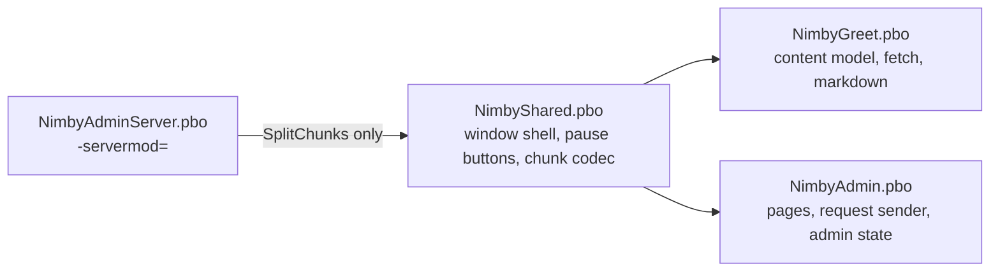

# Plan 11 - NimbyShared (`NimbyShared`)

Draft v0.1, October 31, 2026. Owner: Jeff Fabish. Implementer: a Claude Code session in worktree `D:\GitHub\nimby-badlands-server-wt\nimby-shared` (branch `feat/nimby-shared`, cut from `origin/main` at `3e1af5d` on October 31, 2026), coordinated by the orchestrator. Status: ready for Phase 0; the stub addon and the `pack.json` row land on `main` with the kickoff pull request (`docs/cs-kickoff-2026-10-31`).

Target: NIMBY | HARDCORE | BADLANDS | 1pp, HostHavoc, DayZ 1.30.164200 / Nasdara (release 1 was qualified on 1.30.164078; the live binary moved to 164200 on October 22, 2026).
Release: own pull request to `main`, then with the next live patch (patch 1 if Hands clears first, otherwise its own), gated (see [shared rules, 9.2](2026-10-15-shared-rules.md)). NimbyShared persists nothing on any entity, so the content-addon boots in 6.1 do not apply.
Origin: Jeff's ruling of October 31, 2026, during the Central Scrutinizer kickoff: the Central Scrutinizer menu reuses the Greet window, through a shared addon rather than a copy or a direct dependency on `NimbyGreet`.

NimbyShared is a client PBO that holds the two generic pieces Greet built and Central Scrutinizer needs: the window shell (layout, section column, open and close with the input exclude and zeroing guard, keyboard and controller navigation, focus painting, text-size cycle, pause-menu buttons) and the chunked server-to-client JSON codec (`CHUNK_BYTES` 1,000, chunk-by-index reassembly, hash check). Greet is refactored onto it with no visible change; Central Scrutinizer (Plan 3, v0.7) builds its menu on it.

## What this is not

- Not a framework. Two pieces move; the per-addon pieces stay where they are: each addon keeps its own log prefix and `$profile:<Prefix>\debug` flag (shared rules 4.3), its own 4_World deferred hook (7.1), its own RPC ids (4.1), its own content model, and its own self-test for its own rules.
- Not a Greet feature. Greet after the refactor renders the same window, pixel for pixel and key for key; a Greet change rides on its own plan.
- Not a server-side library. Nothing in NimbyShared runs only on the server; the server-only PBO of Central Scrutinizer (`NimbyAdminServer`) MAY call the codec's split function because the codec is engine-free 3_Game code that both sides load.
- Not CF. No code is taken from Community Framework, COT, or VPP.

## Decisions

| # | Decision | Choice | Status |
| --- | --- | --- | --- |
| C1 | Name and identifiers | NimbyShared. PBO `NimbyShared`, code prefix `NimbyShared`, log prefix `[NIMBY][Shared]`, no RPC block (the codec takes ids as parameters; the registry row in shared rules 4.1 says "none") | Decided by Jeff, October 31, 2026: NimbyCommon first, renamed NimbyShared the same evening because `scripts/modules/NimbyCommon.psm1` already carries that name; identifiers assigned by the orchestrator |
| C2 | Scope | The window shell and the chunk codec. Not the log helper, not the deferred hook, not the JSON profile helpers | Decided by Jeff, October 31, 2026 |
| C3 | Dependency rule | A client PBO MAY reference `NimbyShared` classes and lists `NimbyShared` in its `requiredAddons[]`; `NimbyShared` references no addon and requires only `DZ_Data`. Every other cross-addon reference stays forbidden (shared rules 8.1, amended in v1.7). A consumer branch MUST NOT modify `NimbyShared`; a change to it lands through its own `feat/nimby-shared-*` branch and pull request, because every consumer re-tests against it | Decided by Jeff (shared addon), October 31, 2026; rule text is the orchestrator's |
| C4 | Parity | The refactored Greet is behavior-identical: same layout file contents under the new path, same colors, same key handling, same log lines except the prefix of the lines that move. The Greet regression is the subset of Phase 0 and Phase 1 rows named in the Tests table, rerun on the replica from the exact build | Decided by Jeff (own PR, ships with the next patch), October 31, 2026 |
| C5 | Shell shape | `NimbySharedWindow extends UIScriptedMenu`, a base class a consumer subclasses. The base owns the layout, the chrome, the input handling, the section column, and the body scroll container; the subclass supplies the menu id, the section list, the body of a section, the footer buttons, and the close callback through overridable methods. Pages are the subclass's business: Greet fills the body with its markdown blocks; Central Scrutinizer fills it with a page widget from its page registry (Plan 3, N9c) | Claude's design; the seat MAY refine the method set after recon and records the final set here |
| C6 | Pause-menu buttons | One modded `InGameMenu` in NimbyShared renders the buttons that addons register at init (`NimbySharedPauseButtons.Register(id, labelKey, fallback, handler)`), in registration order, each from the Greet pause-button layout. Greet registers "Server welcome"; Central Scrutinizer registers its entry and shows it only when the admin state sync says the player has a role. Two addons each modding `InGameMenu.Init` and appending a button would also work, so this is a convenience, not a correctness need | Claude's design |
| C7 | Codec shape | 3_Game, engine-free except `string.Hash`: `NimbySharedChunks` (`ChunkEnd`, `SplitChunks`, `ChunkCount`, `MaxChunkCount(maxPayloadBytes)`), `NimbySharedChunkReceiver` (the Greet `NimbyGreetFetch` generalized: request id, chunk acceptance rules, done acceptance, assemble, verify; caps passed at construction), and `NimbySharedChunkSender` (server side: given a `PlayerIdentity`, the chunk and done RPC ids, the payload, and an opaque done JSON string, sends the chunk RPCs then the done RPC with `Param3<int, int, string>`). The done record stays the consumer's type; the codec carries it as a string. `CHUNK_BYTES` stays 1,000 (NIMBY-T-037) | Claude's design |
| C8 | Self-test | NimbyShared has its own `$profile:NimbyShared\selftest` flag and `[NIMBY][Shared][SelfTest]` lines: the chunk cases move here from the Greet self-test (split, boundary, count, receiver drop rules, hash mismatch, over-cap refusal), plus one case per shell registry (a fake pause button registers and is listed). Greet keeps the cases about its own rules and content | Claude's design; per shared rules 8 |
| C9 | Load order | `NimbyShared` is the first row in `pack.json` `addons` and the first PBO the boot check and the test server load; consumers name it in `requiredAddons[]` so the engine orders them after it regardless of the `-mod=` list | Orchestrator; `pack.json` is orchestrator-owned (shared rules 3) and the row lands with this plan's docs pull request |

## Architecture

| Piece | Module | From Greet | Stays in Greet |
| --- | --- | --- | --- |
| `NimbySharedWindow` | 5_Mission | `NimbyGreetMenu` lines for `Init` (layout load and widget lookup), `OnShow`, `OnHide`, `~`, `SetZeroingDisabled`, `Update` (back, tab left and right, page up and down), `BuildChrome` footer slots, `SelectSection`, `PaintSectionButton`, `Highlight`, `PaintButtonNormal`, `SetButtonLabel`, `Tr`, `Scaled`, `ApplyScale`, `CycleTextSize`, `Pressed`, `OnMouseEnter`, `OnMouseLeave`, `OnFocus`, `OnFocusLost`, the color and size constants | `NimbyGreetMenu` keeps `Setup`, `SetContent`, `BuildBody`, every block and table and media and link method, `CycleLanguage`, the never-again control, the close reason |
| `nimbycommon_window.layout`, `nimbycommon_section_button.layout`, `nimbycommon_pause_button.layout` | GUI | `nimbygreet_window.layout`, `nimbygreet_section_button.layout`, `nimbygreet_pause_button.layout` moved; the footer becomes a `WrapSpacer` the subclass fills from `nimbycommon_footer_button.layout` | The block, rule, heading, media, table-row, and link-row layouts |
| `NimbySharedPauseButtons` plus `modded class InGameMenu` | 5_Mission | `nimbygreet_ingamemenu.c` | Greet's handler body (continue the game, send a manual request) |
| `NimbySharedChunks`, `NimbySharedChunkReceiver` | 3_Game | `NimbyGreetRules.ChunkEnd`, `SplitChunks`, `ChunkCount`, `MaxChunkCount`; `NimbyGreetFetch` | `NimbyGreetDone`, `NimbyGreetRules` caps and ids |
| `NimbySharedChunkSender` | 3_Game | The send loop in `nimbygreet_missionserver.c` around line 491 | The payload choice (language pick, cooldown, dismissal) |
| `NimbySharedLog` | 3_Game | A copy of the Greet log helper shape with prefix `[NIMBY][Shared]` and flag `$profile:NimbyShared\debug` | `NimbyGreetLog` unchanged |
| `NimbySharedSelfTest` | 3_Game | The chunk cases of `nimbygreet_selftest.c` | Every other Greet case |

The deferred-call hook (`NimbyGreetDeferred`, 4_World) does not move (C2). `NimbySharedWindow` lives in 5_Mission and is bound by shared rules 7.1: it queues no `CallLater` of its own; a subclass that needs a timer queues it through its own 4_World hook, as Greet does.

## Phase 0 - recon and the method set (half a day)

1. Read `mods/own/nimby-pack/NimbyGreet/` whole, the Greet plan v0.4 sections G5, G7, G13, G16, and the Greet Phase 0 and Phase 1 records in `docs/testing/`.
2. Produce the move list: every method, constant, layout, and string-table row that moves, with its destination, and the Greet lines that change to call it. Name the overridable methods of `NimbySharedWindow` and the constructor parameters of `NimbySharedChunkReceiver`.
3. Report to the orchestrator and wait for the go. No code before the go.

## Phase 1 - the addon and the Greet refactor

1. Fill the stub that the kickoff pull request put on `main` (`mods/own/nimby-pack/NimbyShared/`: `config.cpp` with `CfgPatches NimbyShared`, `requiredAddons[] = { "DZ_Data" }`, 3_Game and 5_Mission modules; `NimbySharedRules` with `CHUNK_BYTES` and the flag paths; a three-case self-test and its `MissionBase` hook; `NOTICE`). Add `GUI/` and `stringtable.csv`.
2. Move the pieces per the table. Greet's `config.cpp` gains `"NimbyShared"` in `requiredAddons[]`. Nothing in Greet keeps a copy of a moved function.
3. Self-tests per C8; `scripts/Build-NimbyPack.ps1` with the boot check green (`[NIMBY][Shared][SelfTest] PASS` and `[NIMBY][Greet][SelfTest] PASS` for every case, 0 `SCRIPT (E)`).
4. Greet regression on the replica from the exact build, rows in the Tests table; the seat drives the build and the server, Jeff runs the client steps and pastes the lines.
5. Update the Greet plan (v0.5: a one-paragraph note that the shell and codec live in NimbyShared, no decision reopened), this plan (v0.2 with the final method set), and `docs/testing/2026-11-xx-nimby-shared-phase1.md`.

Exit: every Tests row green; the Greet window indistinguishable from the release-1 build in the side-by-side screenshots Jeff takes at 1920x1080.

## Phase 2 - pull request and release

- Pull request `feat/nimby-shared` to `main` with the four `static-gate` checks green; Jeff reviews and merges (shared rules 2.2).
- Ships with the next live patch per shared rules 9.2; the release gate gains a NimbyShared column (self-test PASS, Greet rows green, `.bisign` for the new PBO beside the others, `pack.json` row present). Stale clients: a client with the release-1 `@NIMBY` lacks `NimbyShared.pbo` and is refused at join like any pack update; the launcher offers the updated item when the server lists it with its real id (9.2 step 6, the NIMBY-T-061 check), so that check runs again after this restart.

## Tests

| Id | Scenario | Required result | Evidence |
| --- | --- | --- | --- |
| SH-01 | Self-test | Every NimbyShared and Greet case passes | `[NIMBY][Shared][SelfTest] PASS`, `[NIMBY][Greet][SelfTest] PASS`, boot check green |
| SH-02 | Window opens after spawn | As release 1 (Greet G-P1 open rows) | `[NIMBY][Greet] open source=spawn` line; screenshot matches the release-1 one |
| SH-03 | Insert hotkey reopens | Opens once per press (NIMBY-T-046) | One open line per press; no double open |
| SH-04 | Pause-menu button | "Server welcome" present under the vanilla column, click continues and opens | Screenshot; open line `source=menu` |
| SH-05 | Movement stops while open | Player does not move with WASD (NIMBY-T-039) | `input exclude added: menu` and `removed` lines; manual check |
| SH-06 | Zeroing guard | Zeroing disabled while open, restored on close and on a menu destroyed without `OnHide` (NIMBY-T-058) | `zeroing disabled=true` then `false`; mouse wheel zeroes after close |
| SH-07 | Section switching | Mouse click, Tab-left and Tab-right, controller shoulder buttons select sections | Section highlight moves; `section=` in the log |
| SH-08 | Body paging | PageUp and PageDown and `UANimbyGreetPageUp/Down` page the body | Manual check |
| SH-09 | Text size cycle | Three sizes cycle and persist across a reopen | Label changes; `prefs` line |
| SH-10 | Close with Esc | Closes, close reason `player` | `closed reason=player` line |
| SH-11 | Chunking, long payload | The 40,359-character Russian payload arrives intact (G-P0-31) | `chunks=74 hash ok` line, window renders the Russian text |
| SH-12 | Chunking, race | Chunks of an earlier request id are dropped (G-P0-32) | `dropped: other requestId` debug line, one window |
| SH-13 | Removal | A build without `NimbyShared.pbo` but with the refactored Greet fails the boot check loudly | Boot check FAIL with an `Unknown type` or `Can't compile` line naming a `NimbyShared` class |
| SH-14 | Restart | Nothing written to `storage_999` by either addon | Storage folder hashes unchanged across the boot |

## Risks

| Risk | Effect | Mitigation |
| --- | --- | --- |
| The refactor changes Greet behavior in a way the rows do not cover | A release-1 regression on live | The move list in Phase 0 is reviewed before code; the screenshots are side by side; Jeff's sign-off on the window |
| `requiredAddons` ordering ignored by a launcher | Class not found at compile on a client | The Workshop item is one folder, so the pack always carries both; the boot check loads the pack as the launcher does |
| Central Scrutinizer needs a shell method Greet never had | A NimbyShared change mid-Plan 3 | Allowed through C3's own-branch rule; Plan 3 Phase 0 lists its shell needs so the seat adds them in this plan's Phase 1 where cheap (a right detail pane slot and a footer status line are already expected) |
| Two seats in the tree | Build or test-server port collision with the Hands session | `AGENTS.md` shared-machine rule: check for a running `DayZServer_x64` before any boot |
