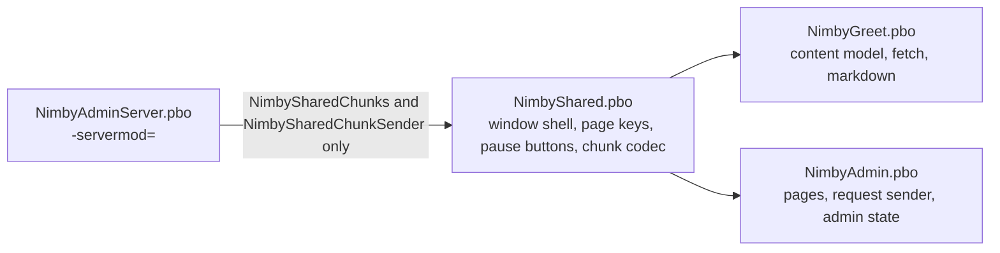

# Plan 11 - NimbyShared (`NimbyShared`)

Draft v0.3, October 31, 2026 (late evening; v0.2 the same day). Changes since v0.2 (orchestrator, from the Phase 1 record): SH-14 evidence reworded (the engine rewrites the world files on every boot, so a hash comparison cannot pass; the row now checks the file set, the absence of `OnStoreSave` and `OnStoreLoad`, and the addons' profile folders); SH-13's engine line recorded for `bootCheck.failurePatterns`; Phase 1 exit met on `build\@NIMBY-20261031-210953` (SH-01 to SH-16 PASS). Owner: Jeff Fabish. Implementer: a Claude Code session in worktree `D:\GitHub\nimby-badlands-server-wt\nimby-shared` (branch `feat/nimby-shared`, cut from `origin/main` at `3e1af5d` on October 31, 2026), coordinated by the orchestrator. Status: Phase 1 built on `feat/nimby-shared`; regression rows SH-01 to SH-16 in progress (`docs/testing/2026-10-31-nimby-shared-phase1.md`).

Changes since v0.1 (Phase 0 recon `2026-10-31-nimby-shared-recon.md`, accepted by the orchestrator October 31, 2026, with Jeff's rulings on its three questions): C5 to C8 record the shape as built, including refinements R1 (a panel-sized content slot instead of a WrapSpacer footer), R2 (the pause registry takes entry objects), and R3 (the receiver takes one cap); the page keys move to NimbyShared (question 1); the moved shell lines end in `menu=<id>` (question 2); SH-12's evidence is the moved receiver cases plus one recorded live attempt (question 3); the layout names, the diagram, the Phase 1 step 1 file list, and the SH-05, SH-06, SH-11, SH-12 evidence text are corrected; SH-15 and SH-16 are added. Shared rules v1.8 (sections 5 and 8.1) is the text this plan is written against.

Target: NIMBY | HARDCORE | BADLANDS | 1pp, HostHavoc, DayZ 1.30.164200 / Nasdara (release 1 was qualified on 1.30.164078; the live binary moved to 164200 on October 22, 2026).
Release: own pull request to `main`, then with the next live patch (patch 1 if Hands clears first, otherwise its own), gated (see [shared rules, 9.2](2026-10-15-shared-rules.md)). NimbyShared persists nothing on any entity, so the content-addon boots in 6.1 do not apply.
Origin: Jeff's ruling of October 31, 2026, during the Central Scrutinizer kickoff: the Central Scrutinizer menu reuses the Greet window, through a shared addon rather than a copy or a direct dependency on `NimbyGreet`.

NimbyShared is a client PBO that holds the generic pieces Greet built and Central Scrutinizer needs: the window shell (layout, section column, open and close with the input exclude and zeroing guard, keyboard and controller navigation, the page keys, focus painting, text-size cycle, pause-menu buttons) and the chunked server-to-client JSON codec (`CHUNK_BYTES` 1,000, chunk-by-index reassembly, hash check). Greet is refactored onto it with no visible change; Central Scrutinizer (Plan 3, v0.7) builds its menu on it.

## What this is not

- Not a framework. Two pieces move; the per-addon pieces stay where they are: each addon keeps its own log prefix and `$profile:<Prefix>\debug` flag (shared rules 4.3), its own 4_World deferred hook (7.1), its own RPC ids (4.1), its own content model, and its own self-test for its own rules.
- Not a Greet feature. Greet after the refactor renders the same window, pixel for pixel and key for key; a Greet change rides on its own plan.
- Not a server-side library. Nothing in NimbyShared runs only on the server. A server-only PBO (Central Scrutinizer's `NimbyAdminServer`) MAY use `NimbySharedChunks` and `NimbySharedChunkSender` and MUST NOT reference the shell or the pause registry (shared rules 8.1, v1.8).
- Not CF. No code is taken from Community Framework, COT, or VPP.

## Decisions

| # | Decision | Choice | Status |
| --- | --- | --- | --- |
| C1 | Name and identifiers | NimbyShared. PBO `NimbyShared`, code prefix `NimbyShared`, log prefix `[NIMBY][Shared]`, no RPC block (the codec takes ids as parameters; the registry row in shared rules 4.1 says "none") | Decided by Jeff, October 31, 2026: NimbyCommon first, renamed NimbyShared the same evening because `scripts/modules/NimbyCommon.psm1` already carries that name; identifiers assigned by the orchestrator |
| C2 | Scope | The window shell and the chunk codec. Not the log helper, not the deferred hook, not the JSON profile helpers | Decided by Jeff, October 31, 2026 |
| C3 | Dependency rule | A client PBO MAY reference `NimbyShared` classes and lists `NimbyShared` in its `requiredAddons[]`; `NimbyShared` references no addon and requires only `DZ_Data`. Every other cross-addon reference stays forbidden (shared rules 8.1). A consumer branch MUST NOT modify `NimbyShared`; a change to it lands through its own `feat/nimby-shared-*` branch and pull request, because every consumer re-tests against it | Decided by Jeff (shared addon), October 31, 2026; rule text is the orchestrator's |
| C4 | Parity | The refactored Greet is behavior-identical: same layout contents under the new paths, same colors, same key handling, same log lines except the prefix of the lines that move and the `menu=<id>` suffix on the moved shell lines (question 2). The Greet regression is the Tests table, rerun on the replica from the exact build | Decided by Jeff (own PR, ships with the next patch), October 31, 2026; suffix ruled by Jeff October 31, 2026 |
| C5 | Shell shape | Built: `NimbySharedWindow extends UIScriptedMenu` (`NimbyShared/Scripts/5_Mission/nimbyshared_window.c`). The base owns `nimbyshared_window.layout` (dim, panel, title, tagline, section column, hint, and a panel-sized `Content` frame), the input exclude, the zeroing guard (also released in `~NimbySharedWindow`), Esc, tab left and right, the page keys `UANimbySharedPageUp` and `UANimbySharedPageDown` plus `UAUINextUp` and `UAUINextDown`, focus and hover painting, and the text-size steps. The subclass supplies, by override: `ContentLayout()` (created inside `Content`, so the subclass keeps its own coordinates; a `ScrollWidget` named `BodyScroll` in it is the page target), `OnWindowInit()`, `BuildChrome()` (calls `SetTitle`, `SetHint`), `SectionCount()`, `SectionLabel(i)`, `OnSectionSelected(i)`, `InitialFocus()`, `OnWindowUpdate(t)`, `OnTextScaleChanged()`, `NormalPanelColor(w)`, `OnWindowClosed()`, `RequestClose(reason)`; the menu id is set in the subclass constructor. The base handles userID `ID_CLOSE` (1) and the section range 100 to 199; a subclass's `OnClick` calls `super.OnClick` first. R1: the content slot replaces the v0.1 WrapSpacer footer, which would have moved Greet's buttons. Central Scrutinizer's list, right detail pane, footer and status line are its own content layout; `SetHint` is a second line | Claude's design; R1 accepted by the orchestrator October 31, 2026; built in Phase 1 |
| C6 | Pause-menu buttons | Built: one modded `InGameMenu` in NimbyShared (`nimbyshared_pausebuttons.c`) adds a button per visible registered entry, in registration order, under the vanilla `top` column, from `nimbyshared_pause_button.layout`. R2: an entry is a `NimbySharedPauseEntry` subclass (`Id`, `LabelKey`, `LabelFallback`, `IsVisible`, `OnClick`) registered with `NimbySharedPauseButtons.Register(entry)`; the same id replaces the old entry. Registry and entries live in 5_Mission (a 3_Game static holding a 5_Mission object is the NIMBY-T-052 hazard). Greet registers `NimbyGreetPauseEntry` ("Server welcome") in `MissionGameplay.OnInit`; Central Scrutinizer returns its role from `IsVisible` | Claude's design; R2 accepted October 31, 2026; built in Phase 1 |
| C7 | Codec shape | Built (`nimbyshared_chunks.c`, 3_Game): `NimbySharedChunks` (`ChunkCount`, `MaxChunkCount(maxPayloadBytes)`, `IsContinuationByte`, `ChunkEnd`, `SplitChunks`, `FillBytes`), engine-free except `string.Hash`; `NimbySharedChunkReceiver(maxPayloadBytes)` (R3: one cap; `Begin`, `AcceptChunk`, `AcceptDone(requestId, chunkCount, readable, totalBytes, hash, now, why)`, `IsComplete`, `IsRefused`, `Assemble`, `Verify`, `ElapsedMs`; every `why` string as in Greet); `NimbySharedChunkSender.Send(target, recipient, chunkRpc, doneRpc, requestId, payload, doneJson)` and `SendDone(...)`, `RPCSingleParam` on the target object (`Game.c:1013`). The done record stays the consumer's type and fills its own byte count and hash before it serializes; the wire format is unchanged. `CHUNK_BYTES` stays 1,000 (NIMBY-T-037) | Claude's design; R3 accepted October 31, 2026; built in Phase 1 |
| C8 | Self-test | Built: `$profile:NimbyShared\selftest`, `[NIMBY][Shared][SelfTest]` lines. 3_Game: the 3 stub cases, 3 text-size steps, the 38 chunk and receiver cases moved from Greet with their names, 4 new codec cases (two caps, an unreadable done, bytes above the cap), and one destructor-order case (Plan 11 risk 1). 5_Mission: 4 registry cases. Greet keeps 87 cases about its own rules and content | Claude's design; per shared rules 8; built in Phase 1 |
| C9 | Load order | `NimbyShared` is the first row in `pack.json` `addons` and the first PBO the boot check and the test server load; consumers name it in `requiredAddons[]` so the engine orders them after it regardless of the `-mod=` list | Orchestrator; `pack.json` is orchestrator-owned (shared rules 3) and the row lands with this plan's docs pull request |
| C10 | Page keys | `NimbyShared/Data/Inputs.xml` declares `UANimbySharedPageUp` (`kPrior`) and `UANimbySharedPageDown` (`kNext`) in the `nimby` sorting group, labels "NIMBY: page the window up" and "NIMBY: page the window down"; the shell reads them for every window. Greet's `Inputs.xml` keeps `UANimbyGreetOpen` only. A player's rebinding of Greet's old page pair does not carry over | Decided by Jeff, October 31, 2026 (recon question 1, option A); shared rules 5 amended in v1.8 |

## Architecture

| Piece | Module | From Greet | Stays in Greet |
| --- | --- | --- | --- |
| `NimbySharedWindow` | 5_Mission | `NimbyGreetMenu`: `Init` (shell layout and chrome lookups), `OnShow`, `OnHide` (guards), the zeroing release of `~`, `SetZeroingDisabled`, `Update` (back, tab left and right, page up and down), title, tagline and hint setters, `BuildSections`, `SelectSection`, `PaintSectionButton`, `Highlight`, `PaintButtonNormal`, `SetButtonLabel`, `Tr`, `Scaled`, the section part of `ApplyScale`, the step of `CycleTextSize`, `Pressed`, `PageBody`, `OnMouseEnter`, `OnMouseLeave`, `OnFocus`, `OnFocusLost`, the close and section branches of `OnClick`, the color and section-size constants | `NimbyGreetMenu` keeps `Setup`, `SetContent`, `BuildBody`, every block and table and media and link method, the clips, `CycleLanguage`, the never-again control, the close reason, the text-size persistence and labels |
| `nimbyshared_window.layout`, `nimbyshared_section_button.layout`, `nimbyshared_pause_button.layout` | GUI | `nimbygreet_window.layout` (the chrome part), `nimbygreet_section_button.layout`, `nimbygreet_pause_button.layout` | `nimbygreet_content.layout` (new: the body, link rows and footer of `nimbygreet_window.layout`, verbatim, under a panel-sized frame, R1), and the block, rule, heading, media, table-row, and link-row layouts |
| `UANimbySharedPageUp`, `UANimbySharedPageDown` | `Data/Inputs.xml` | `UANimbyGreetPageUp`, `UANimbyGreetPageDown` (renamed, C10) | `UANimbyGreetOpen` |
| `NimbySharedPauseButtons`, `NimbySharedPauseEntry`, `modded class InGameMenu` | 5_Mission | `nimbygreet_ingamemenu.c` | `NimbyGreetPauseEntry` (continue the game, send a manual request) |
| `NimbySharedChunks`, `NimbySharedChunkReceiver` | 3_Game | `NimbyGreetRules.CHUNK_BYTES`, `ChunkCount`, `MaxChunkCount`, `IsContinuationByte`, `ChunkEnd`, `SplitChunks`, `FillBytes`; `NimbyGreetFetch` | `NimbyGreetDone`, `NimbyGreetRules` caps and ids, `Repeat` |
| `NimbySharedChunkSender` | 3_Game | The send loop in `nimbygreet_missionserver.c` and `PlayerBase.NimbyGreetSendChunk`, `NimbyGreetSendDone` | The payload choice (language pick, cooldown, dismissal) |
| `NimbySharedRules` | 3_Game | `TEXT_SCALE_NORMAL`, `_LARGE`, `_LARGER` and the step logic (`NextTextScale`) | `prefs.json` and its `NormalizeScale` |
| `NimbySharedLog` | 3_Game | The Greet log helper shape with prefix `[NIMBY][Shared]` and flag `$profile:NimbyShared\debug` | `NimbyGreetLog` unchanged |
| `NimbySharedSelfTest`, `NimbySharedShellSelfTest` | 3_Game, 5_Mission | The chunk and receiver cases of `nimbygreet_selftest.c` | Every other Greet case |

The deferred-call hook (`NimbyGreetDeferred`, 4_World) does not move (C2). `NimbySharedWindow` lives in 5_Mission and is bound by shared rules 7.1: it queues no `CallLater` of its own; a subclass that needs a timer queues it through its own 4_World hook, as Greet does. NimbyShared ships no `stringtable.csv`: it shows no text of its own; the pause entry's label key is the consumer's.

## Phase 0 - recon and the method set (half a day)

Done October 31, 2026: `2026-10-31-nimby-shared-recon.md` (commit `a6eee5c`), accepted by the orchestrator the same day.

1. Read `mods/own/nimby-pack/NimbyGreet/` whole, the Greet plan v0.4 sections G5, G7, G13, G16, and the Greet Phase 0 and Phase 1 records in `docs/testing/`.
2. Produce the move list: every method, constant, layout, and string-table row that moves, with its destination, and the Greet lines that change to call it. Name the overridable methods of `NimbySharedWindow` and the constructor parameters of `NimbySharedChunkReceiver`.
3. Report to the orchestrator and wait for the go. No code before the go.

## Phase 1 - the addon and the Greet refactor

1. Fill the stub that the kickoff pull request put on `main` (`mods/own/nimby-pack/NimbyShared/`: `config.cpp` with `CfgPatches NimbyShared`, `requiredAddons[] = { "DZ_Data" }`, the `inputs` line, 3_Game and 5_Mission modules; `NimbySharedRules` with `CHUNK_BYTES`, the text-size steps and the flag paths; the self-test and its `MissionBase` hook; `NOTICE`). Add `GUI/` and `Data/Inputs.xml` with the two page inputs; no `stringtable.csv`.
2. Move the pieces per the table. Greet's `config.cpp` gains `"NimbyShared"` in `requiredAddons[]`. Nothing in Greet keeps a copy of a moved function.
3. Self-tests per C8; `scripts/Build-NimbyPack.ps1` with the boot check green (`[NIMBY][Shared][SelfTest] PASS` and `[NIMBY][Greet][SelfTest] PASS` for every case, 0 `SCRIPT (E)`).
4. Greet regression on the replica from the exact build, rows in the Tests table; the seat drives the build and the server, Jeff runs the client steps and pastes the lines.
5. Update the Greet plan (v0.5: a one-paragraph note that the shell and codec live in NimbyShared, no decision reopened), this plan (v0.2 with the final method set), and `docs/testing/2026-10-31-nimby-shared-phase1.md`.

Exit: every Tests row green; the Greet window indistinguishable from the release-1 build in the side-by-side screenshots Jeff takes at 1920x1080.

## Phase 2 - pull request and release

- Pull request `feat/nimby-shared` to `main` with the four `static-gate` checks green; Jeff reviews and merges (shared rules 2.2).
- Ships with the next live patch per shared rules 9.2; the release gate gains a NimbyShared column (self-test PASS, Greet rows green, `.bisign` for the new PBO beside the others, `pack.json` row present). Stale clients: a client with the release-1 `@NIMBY` lacks `NimbyShared.pbo` and is refused at join like any pack update; the launcher offers the updated item when the server lists it with its real id (9.2 step 6, the NIMBY-T-061 check), so that check runs again after this restart.

## Tests

Client rows that read debug lines need both `$profile:NimbyShared\debug` and `$profile:NimbyGreet\debug` in the client profile. Greet's menu id is 65511.

| Id | Scenario | Required result | Evidence |
| --- | --- | --- | --- |
| SH-01 | Self-test | Every NimbyShared and Greet case passes | `[NIMBY][Shared][SelfTest] PASS`, `[NIMBY][Greet][SelfTest] PASS`, boot check green |
| SH-02 | Window opens after spawn | As release 1 (Greet G-P1 open rows) | `[NIMBY][Greet] open version=N source=spawn ...` line; screenshot matches the release-1 one |
| SH-03 | Insert hotkey reopens | Opens once per press (NIMBY-T-046) | One open line per press; no double open |
| SH-04 | Pause-menu button | "Server welcome" present under the vanilla column, click continues and opens | Screenshot; `[NIMBY][Greet][Debug] pause menu: Server welcome clicked`, open line `source=menu` |
| SH-05 | Movement stops while open | Player does not move with WASD (NIMBY-T-039) | `[NIMBY][Shared][Debug] input exclude added: menu menu=65511` and `[NIMBY][Shared][Debug] input exclude removed: menu menu=65511`; manual check |
| SH-06 | Zeroing guard | Zeroing disabled while open, restored on close and on a menu destroyed without `OnHide` (NIMBY-T-058) | `[NIMBY][Shared][Debug] zeroing disabled=true menu=65511` then `zeroing disabled=false menu=65511`; mouse wheel zeroes after close; for the destroyed-without-`OnHide` case the `false` line comes from the base destructor (the self-test case `lang: subclass destructor runs, then the base destructor` proves the order at boot) |
| SH-07 | Section switching | Mouse click, Tab-left and Tab-right, controller shoulder buttons select sections | Section highlight moves; `[NIMBY][Greet][Debug] section selected index=N id=...` |
| SH-08 | Body paging | Page Up and Page Down (`UANimbySharedPageUp/Down`, listed as "NIMBY: page the window up/down" in Options > Controls) and `UAUINextUp/Down` page the body | Manual check; Controls page screenshot |
| SH-09 | Text size cycle | Three sizes cycle and persist across a reopen | Label changes; `[NIMBY][Greet] pref textScale=` line |
| SH-10 | Close with Esc | Closes, close reason `player` | `[NIMBY][Greet] close reason=player ...` line |
| SH-11 | Chunking, long payload | The 40,359-character Russian payload arrives intact (G-P0-31) | `[NIMBY][Greet][Debug] payload complete id=N language=russian ... chunks=74 bytes=73543 ...` and no `payload rejected` line; the window renders the Russian text |
| SH-12 | Chunking, race | Chunks of an earlier request id are dropped (G-P0-32) | The NimbyShared self-test receiver cases (`fetch: chunk for another request dropped` and the rest) plus one recorded live attempt: a second request inside the cooldown answered `reason=cooldown` (`[NIMBY][Greet][Debug] done id=M chunkCount=0 ... reason=cooldown`); a live `request id=M replaces incomplete id=N` and `chunk dropped id=N ... why=other request` pair is recorded if it occurs |
| SH-13 | Removal | A build without `NimbyShared.pbo` but with the refactored Greet fails the boot check loudly, or times out | Boot check FAIL with an `Unknown type` or `Can't compile` line naming a `NimbyShared` class, or a timeout with the engine's missing-addon line quoted from the RPT (the orchestrator adds it to `bootCheck.failurePatterns` later) |
| SH-14 | Restart | Nothing written to `storage_999` by either addon | The storage file set is unchanged across the boot (no file added or removed; the engine's own world save rewrites contents on every boot, vanilla included); neither addon defines `OnStoreSave` or `OnStoreLoad`; the addons' profile folders hold only the flag files |
| SH-15 | Footer and link-row paint | Never, Text, Language and Close buttons on their dark panel in the normal state, black panel and red label on hover and on focus; link labels flat in the normal state; all as the release-1 screenshots | Side-by-side screenshots at 1920x1080 |
| SH-16 | Never-again and links | Ticking "Don't show this again" then closing writes `seen.json`; link Open and Copy work and log as before | `[NIMBY][Greet] close reason=player neverShow=true ... written=true ...`; `[NIMBY][Greet] open url=...` and `[NIMBY][Greet][Debug] copied url=...` |

## Risks

| Risk | Effect | Mitigation |
| --- | --- | --- |
| The refactor changes Greet behavior in a way the rows do not cover | A release-1 regression on live | The move list in Phase 0 was reviewed before code; the screenshots are side by side; Jeff's sign-off on the window |
| `requiredAddons` ordering ignored by a launcher | Class not found at compile on a client | The Workshop item is one folder, so the pack always carries both; the boot check loads the pack as the launcher does |
| Central Scrutinizer needs a shell method Greet never had | A NimbyShared change mid-Plan 3 | Allowed through C3's own-branch rule; the content slot (R1) already gives it a detail pane and a status line |
| Two seats in the tree | Build or test-server port collision with the Hands session | `AGENTS.md` shared-machine rule: check for a running `DayZServer_x64` before any boot |
| Base destructor does not run after a subclass destructor (recon risk 1) | Zeroing stays disabled after a menu is destroyed without `OnHide` | The NimbyShared self-test case proves the order at boot; if it fails, `~NimbyGreetMenu` calls the base's idempotent release and the record says so |
| A player rebound Greet's old page keys | That rebinding is lost after the update (C10) | Accepted by Jeff; the defaults are unchanged |
