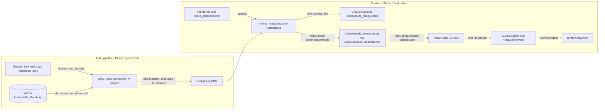

# Plan 12 - Fang (`NimbyFang`, `NimbyFangScripts`)

Draft v0.1, November 1, 2026 (evening, America/Chicago). Owner: Jeff Fabish. Implementer: a Claude session in worktree `D:\GitHub\nimby-badlands-server-wt\fang` on branch `feat/fang`, cut from `origin/main` at `faaeedf` (the merge of PR #18, the study), coordinated by the orchestrator. Status: Phase 0 not started. It opens when Jeff declares release 1 handed to Jay (FD11) and the prerequisites table below is green; nothing in this plan runs before that call.

Changes since the study: none of substance. This plan turns the study's Phases table into steps, gate rows, prerequisites with owners, and the shared-file edits Phase 0 needs. It reopens none of the twelve rulings. Where a ruling and a shared rule meet, the plan records the question under Open questions and waits.

Target: NIMBY | HARDCORE | BADLANDS | 1pp, HostHavoc, DayZ 1.30.164200 / Nasdara. Phase 0 runs only on the local replica (`D:\DayZServer`) and ships nothing to live.
Release: Phase 0 produces a test record and this plan's v0.2, not a release. Phase 1 ships as its own pull request and rides the next live patch per [shared rules, 9.2](2026-10-15-shared-rules.md); `NimbyFang` is a content addon under 6.1 (`NimbyAntivenom` persists), so its gate takes the two extra boots.
Origin: Jeff's twelve rulings of November 1, 2026 and the feasibility study `docs/design/fang-feasibility.md` v0.1, merged to `main` in PR #18 the same day.

Fang is a venomous snake in the Badlands wild: a real `AnimalBase` animal on the ambient-life template with a scripted strike, a `VENOM` agent with a 20-minute untreated clock and a 60% death roll, a `NimbyAntivenom` injector, clothing protection by class prefix, authored territories, and staged bite effects. The study carries the evidence; this plan carries the order of work.

## What this is not

- Not the study. Options, `file:line` evidence, the config schema, and the model shortlist stay in `docs/design/fang-feasibility.md`; this plan cites them and repeats nothing that would drift.
- Not a model purchase. No model is bought until Phase 0 exits (FD2). The placeholder is Claude-made and committable.
- Not a Phase 1 plan. Phase 1 and Phase 2 appear below as an outline so the Phase 0 placeholder carries what they need (the pin bones, the two-PBO split); their steps and gate rows arrive in v0.2 after the Phase 0 record.
- Not a change to live. Phase 0 edits `events.xml` and `cfgenvironment.xml` only in a replica-side override on `storage_997`; `server/mission-overrides/` is untouched.
- Not a Workshop dependency. Ambient Animals Pack is a fallback with a named trigger (two Phase 0 failures) and a Jeff ruling before use.

## Decisions

The twelve rulings and the three study defaults, by reference. Plan-level choices this document adds are P1 to P5 and are proposals until Jeff rules on them (see Open questions).

| # | Decision | Choice | Status |
| --- | --- | --- | --- |
| FD1-FD11 | Creature, model source, first loop, treatment, lethality, protection, AI base, spawning, bite feedback, name, sequencing | As recorded in the study's Decisions table | Ruled by Jeff, November 1, 2026 |
| FD12 | Model pick | Open until Phase 0 exits; recommendation #1 Boa (CGTrader, $59.99) | Open |
| FD13 | License read | Jeff reads CGTrader 21A and TurboSquid 7 on the live pages before purchase | Open; not a Phase 0 blocker |
| FD14 | Snake meat | Default: skinning yields two `NimbySnakeMeat` | Default; Phase 1 |
| FD15 | P: drive move | Default: Workbench source moves out of OneDrive before Phase 0 | Default; Phase 0 prerequisite |
| P1 | Branch and worktree | `feat/fang` in the existing `fang` worktree (cut from `origin/main` at `faaeedf`); the shared rules 2.1 table gains the row | Proposed |
| P2 | Test instance | `storage_997` on game port 2502 (RCON 2505), so Fang never shares a port or a storage folder with the Hands (`storage_998`, 2302) or boot-check (`storage_999`, 2402) servers | Proposed; needs the orchestrator edits in Phase 0 step 0 |
| P3 | Placeholder source in git | The Blender file, the `.txa` clips, the skeleton definition and the Workbench project text files commit under `mods/own/nimby-pack/NimbyFang/src/`; the compiled `.p3d`, `.xob`, `.anm`, `.asi` and `.paa` are built locally and are gitignored until Jeff rules on binary assets in the public repo | Proposed |
| P4 | Graph binding order | Try the vanilla `AmbientLife_Graph.agr` first (the monitor's way); on refusal, copy it into `NimbyFang` as `NimbySnake_Graph.agr` (the bear's way); record which one loaded | Proposed; matches the study's risk 1 |
| P5 | Phase 0 scope freeze | Two clips (idle, crawl), one test zone, one debug action; no strike, no venom, no antivenom, no sounds in Phase 0 | Proposed |

## Architecture

The pipeline is the thing Phase 0 proves; the runtime is what Phase 1 builds on it.

Two PBOs per the study's Addon split: `NimbyFang` (content: config, model, clips, instance, textures) and `NimbyFangScripts` (3_Game, 4_World, 5_Mission). Phase 0 fills `NimbyFang` and creates `NimbyFangScripts` with only the debug action and the self-test stub.

## Prerequisites

Every row must read Done before Phase 0 step 1 starts. Owner Jeff rows are outside the repository; owner orchestrator rows are shared-file edits (shared rules, section 3) and travel in the kickoff pull request of step 0.

| # | Prerequisite | Owner | State | Evidence when done |
| --- | --- | --- | --- | --- |
| PR1 | Release 1 handed to Jay (FD11) | Jeff | Open | Jeff's word in the session that opens Phase 0; the Notion hub Now-and-next bullet moves Fang to "Phase 0 in progress" |
| PR2 | Workbench source out of OneDrive: `WorkDrive.exe /ExtractGameData` re-run into a local, non-synced folder (for example `D:\DayZProjects`), about 12 minutes (FD15) | Jeff | Open | The folder exists with `DZ\animals\` and `DZ\animals_takistan\`; P: maps to it |
| PR3 | Graph files in the repo: `DZ\animals\animations\!graph_files\AmbientLife\` and `DZ\animals_takistan\animations\!graph_files\AmbientLife\` (including `Varanus_Griseus_Skeleton.asi`) copied to `D:\GitHub\nimby-badlands-server\vendor\dayz-1.30-anim-graphs\` | Jeff | Open (the folder does not exist as of November 1, 2026) | `vendor/dayz-1.30-anim-graphs/` lists `AmbientLife_Graph.agr` and the monitor `.asi`; `vendor/` is gitignored, so nothing commits |
| PR4 | Blender 3.6.8 or later with the DayZ Animation Tools add-on installed and enabled | Jeff | Open | Add-on listed under Edit > Preferences > Add-ons; a `.txa` export menu entry exists |
| PR5 | DayZ Tools present on `F:` (Workbench, Addon Builder, the P: drive mapping) | Jeff | Done per the study (`F:\SteamLibrary\steamapps\common\DayZ Tools`) | Workbench opens a P: project |
| PR6 | Test instance 997 allowed by the tooling (P2): `Test-TestInstanceId` in `scripts/modules/NimbyCommon.psm1`, the `ValidateSet` in `scripts/Start-NimbyTestServer.ps1`, and the storage-separation row in shared rules section 8 gain 997. The script also gains a `-Port` override (today the game port comes only from `pack.json testServer.port`, 2302; RCON is derived as port + 3, so 2502 gives 2505) and a refusal when the chosen port is already listening (no such check exists as of November 1, 2026) | Orchestrator | Open | The kickoff pull request merged; `Start-NimbyTestServer.ps1 -InstanceId 997 -Port 2502` writes `storage_997` and nothing else |
| PR7 | `pack.json` rows for `NimbyFang` and `NimbyFangScripts` (stub addons that pass the self-test gate, the NimbyShared kickoff pattern) | Orchestrator | Open | Kickoff pull request merged; `Build-NimbyPack.ps1` boot check green with both stubs |
| PR8 | Shared rules 2.1 worktree row and 4.1 identifier row for Fang (`65512xx` is already reserved) | Orchestrator | Open | Kickoff pull request merged |

Not prerequisites, recorded so nobody waits on them: the Steam-authenticated read of Ambient Animals Pack's October 22 note (fallback only), the store license read (FD13, before purchase, after Phase 0), the model pick (FD12, after Phase 0).

## Phase 0 - pipeline proof

Half a day of recon, then one to three sessions of pipeline work. Steps are in order; a step with a question in it stops and asks before the next.

0. Kickoff pull request (orchestrator, docs branch): PR6, PR7, PR8, plus this plan at v0.1. Merged before step 1.
1. Recon (worktree `fang`, read-only): read `AmbientLife_Graph.agr` and `Varanus_Griseus_Skeleton.asi` from `vendor/dayz-1.30-anim-graphs/`, and the hare and fox `.asi` beside them. Produce `docs/plans/<date>-fang-recon.md` with: the graph's slot list (every animation slot the instance must bind, with which are mandatory), the bone names the template reads (`HeadLookBoneName`, the `CommandLookAtSettings` bones, the `Bite` damage bone), the skeleton file format the `.asi` references, and the three questions below with a recommendation each. Stop and wait for the go.
2. Placeholder skeleton and mesh (Blender): a box-and-tube snake, three bones (`root`, `spine1`, `head`) plus the pin bones the recon names, 200 triangles or fewer, one flat texture. Two clips: `idle` (60 frames, head sway) and `crawl` (60 frames, lateral spine wave, root translation). Export the skeleton and both clips as `.txa` through the add-on. Commit the `.blend` and `.txa` under `mods/own/nimby-pack/NimbyFang/src/` (P3).
3. Workbench import (P: project `NimbyFang`): import the skeleton to `.xob`, the clips to `.anm`, author `NimbySnake_Skeleton.asi` binding the vanilla graph's slots (P4, first attempt). Bind every mandatory slot to one of the two clips; log which slots got `idle`, which got `crawl`. If the editor refuses the vanilla graph, copy it as `NimbySnake_Graph.agr` into the addon and bind that; record the refusal text.
4. Content addon: `NimbyFang/config.cpp` with `CfgPatches` (`requiredAddons[] = { "DZ_Data", "DZ_Animals", "DZ_AI" }` plus the Nasdara animal addon the recon names), `Animal_NimbySnake : AnimalBase` cloned from `Animal_VaranusGriseus` (`DZ/animals_takistan/varanus_griseus/config.cpp:20-114`) with the placeholder `.p3d`, `.xob`, `.asi`, and `aiAgentTemplate = "AmbientLife_NimbySnake"`; `CfgAIBehaviours AmbientLife_NimbySnake` copied from `AmbientLife_Varanus_Griseus` (`DZ/AI_takistan/config.cpp:2010-2028`) unchanged; `NOTICE`. Script side: `NimbyFangScripts` with `Animal_NimbySnake` in 4_World (empty override), the self-test (config classes resolve, the instance file is present in the PBO), and one debug action on the player (`ActionNimbyFangIdle`, server-side, calls `StartCommand_ScriptInst` with the idle clip on the nearest `Animal_NimbySnake` within 10 m; present only when `$profile:NimbyFang\debug` exists).
5. Build: `Build-NimbyPack.ps1` exits 0 (build, sign, verify, boot check on `storage_999`, self-test). Zero `SCRIPT (E)`, zero `[NIMBY][Fang]` errors.
6. Spawn on the replica: a replica-only override of `db/events.xml` (one `AnimalSnake` event, `nominal 2`, `min 1`, `max 2`, child `Animal_NimbySnake`, `active 1`) and `cfgenvironment.xml` plus `env/snake_territories.xml` with one `Zone_Snake` 150 m across a flat test area near the spawn the session picks. Start `Start-NimbyTestServer.ps1 -InstanceId 997 -Port 2502` with the exact build. Jeff joins with `Start-NimbyTestClient.ps1 -Connect 127.0.0.1 -Port 2502`.
7. Observe for 30 minutes: the snake wanders (crawl clip, root moves), flees when approached inside the template's alert range (the `BehaviourGoToTarget` slot), returns to idle; the debug action plays `idle` on demand; the server log shows the spawn and no errors. Jeff pastes the lines; screenshots at 1920x1080.
8. Record: `docs/testing/<date>-fang-phase0.md` with rows F0-01 to F0-08 and the exact artifact name; this plan to v0.2 (Phase 1 steps and gate rows, the model purchase go, FD12 recommendation confirmed or changed by what the pipeline accepted); the Notion hub row.

Exit: rows F0-01 to F0-08 green on one artifact. The model purchase (FD2, FD12) happens after this exit and only then.

Fallback ladder, each rung a Jeff ruling: (a) step 3 refuses the vanilla graph, bind a copied graph (P4, inside Phase 0, no ruling needed); (b) a second distinct failure of steps 3 to 5 that the session cannot explain from the recon, stop and bring the evidence; (c) Jeff may then order the Ambient Animals Pack evaluation (study option M3) or a hands-on Workbench session with the orchestrator watching.

Questions the recon answers before step 2:

1. Does the `.asi` reference the skeleton by file or by bone list, and do the hare, fox and monitor instances bind the same slot set?
2. Which graph slots are mandatory for `Master_SM` to enter, and can `idle` fill every one of them without the graph erroring at load?
3. Which bones does the ambient template and the monitor's `Bite` event read by name, so the placeholder carries them from the start?

## Phase 1 - the live snake (outline, v0.2 fills it)

Purchased model retargeted to the Phase 0 skeleton layout; the scripted strike; `MeleeSnake` and the `EEHitBy` branch; the `VENOM` agent and `NimbyVenomMdfr`; `NimbyAntivenom`; the protection table; territories from the monitor set; sounds; the content-addon boots of shared rules 6.1. Gate table in the study's Phases row. One question is already visible and sits under Open questions (Q3).

## Phase 2 - the boot check (outline)

Snake-in-the-boot roll, `Check boots` action, equip-unchecked bite; its own feasibility addendum first (FD3).

## Tests

Phase 0 rows. Every client row needs `$profile:NimbyFang\debug` in the client profile; server rows read the RPT and the script log of the `storage_997` instance.

| Id | Scenario | Required result | Evidence |
| --- | --- | --- | --- |
| F0-01 | Build and boot check | `Build-NimbyPack.ps1` exits 0 with both Fang rows | Build log; `[NIMBY][Fang][SelfTest] PASS`; 0 `SCRIPT (E)` |
| F0-02 | Instance separation | The test server writes `storage_997` and nothing else | Manifest `STORAGE instanceId=997`; `storage_998`, `storage_999` and `storage_1` unchanged by file set and modification time |
| F0-03 | Spawn | At least one `Animal_NimbySnake` exists in the test zone within 10 minutes of boot | Server log spawn line; Central Scrutinizer's entity count if Plan 3 Phase 2 has shipped, else `#monitor` and a screenshot |
| F0-04 | Mesh and skeleton load | The placeholder renders at the snake's position with no missing-model box | Screenshot at 1920x1080; no `Cannot open file` or skeleton warning in the RPT |
| F0-05 | Crawl | The snake moves across the ground with the crawl clip playing | 30-second video or three timed screenshots showing root translation |
| F0-06 | Flee | Approaching inside the template's alert range starts a flee away from the player | Screenshots; the engine's behaviour slot change if the debug log exposes it, else the observed movement |
| F0-07 | Scripted command | The debug action plays `idle` on the nearest snake and returns control to the template afterwards | `[NIMBY][Fang][Debug] StartCommand_ScriptInst clip=idle target=<id>` then the snake resumes wandering |
| F0-08 | 30-minute soak | No `[NIMBY][Fang]` error line and no engine error naming Fang over 30 minutes with the snake in view | RPT and script log excerpt; count of `[NIMBY][Fang]` lines by level |

## Open questions for Jeff

None of these reopens a ruling. Q1 and Q2 gate the kickoff pull request; Q3 and Q4 gate nothing in Phase 0 and are recorded now so Phase 1 planning does not rediscover them.

| # | Question | Recommendation |
| --- | --- | --- |
| Q1 | P2: instance 997, port 2502, RCON 2505 for the Fang test server? | Yes. The next free pair below the existing two, and the tooling change is three lines plus one rules row |
| Q2 | P3: Claude-made placeholder source committed; compiled binaries gitignored for now? | Yes. The `.blend` and `.txa` are text-like and small; a binary-asset rule for the public repo can wait for the purchased model, which never commits either way |
| Q3 | Shared rules 6.1 says player state must not be persisted by any mechanism, including a `ModifierBase` with `IsPersistent()` true. The study's venom design relies on the vanilla agent pool and a persistent modifier so the clock survives a relog. Phase 1 needs a ruling: an exception for Fang (vanilla's own save path carries the agent count; the addon writes no store method), or a non-persisted course that resets on relog | Decide at Phase 1 planning, with the evidence of how `PlayerAgentPool` serializes in 1.30. Recorded now because it changes the modifier's shape |
| Q4 | Ordering against the October 21 board ruling that the next build slot after the first Workshop release is Central Scrutinizer alone. FD11 places Phase 0 after release 1 reaches Jay. Does Fang Phase 0 wait for the Central Scrutinizer slot to close, or may it run as recon and Blender work (no build slot) alongside it? | Steps 1 and 2 (recon, placeholder in Blender) touch no shared file and no server and may run alongside; steps 3 to 8 take a build slot and wait their turn behind Central Scrutinizer unless Jeff says otherwise |

## Risks

Phase 0 risks only; the study's Risks table covers the mod.

| Risk | Effect | Mitigation |
| --- | --- | --- |
| The 1.30 Workbench Animation Editor will not open or save a text `.agr` from a mod project | Step 3 cannot bind any instance | Recon reads the shipped text format first; P4's copied-graph rung; the fallback ladder's rung (b) |
| The add-on's `.txa` export targets a pre-1.30 import path | Clips import but play wrong or not at all | Step 2 exports one 10-frame test clip first and imports it before building the real two |
| OneDrive still holds the P: source (PR2 skipped) | Workbench file locks and sync churn mid-import, a corrupted project | PR2 is a hard prerequisite; the session checks the P: mapping target before step 3 |
| A second test server on 2502 collides with a Hands or Central Scrutinizer session on the same machine | Port in use, or BattlEye config overwritten | PR6 adds the `-Port` override and the already-listening refusal; the Fang profile name is distinct (`-ProfileName fang`) so `BEServer_x64.cfg` and the RPT never share a folder with another session |
| The placeholder teaches the wrong skeleton layout and the purchased model will not retarget to it | Phase 1 redoes the import | Recon question 3 names the bones first; the placeholder carries the pin bones; the Phase 0 record lists the final bone set the purchased model must map to |
| The snake spawns but the template's vision and alert ranges, tuned for the monitor, look wrong on a 1 m snake | Misread as a pipeline failure | Phase 0 judges load, animate, wander, flee only (P5); range tuning is Phase 1 |

## Files this plan touches

| File | Phase | Owner |
| --- | --- | --- |
| `docs/plans/2026-11-01-fang-plan.md` (this file) | 0 | Fang session |
| `docs/plans/<date>-fang-recon.md` | 0 step 1 | Fang session |
| `mods/own/nimby-pack/NimbyFang/` and `NimbyFangScripts/` | 0 steps 2 to 4 | Fang session |
| `docs/testing/<date>-fang-phase0.md` | 0 step 8 | Fang session |
| `mods/own/nimby-pack/pack.json`, `scripts/modules/NimbyCommon.psm1`, `scripts/Start-NimbyTestServer.ps1`, `docs/plans/2026-10-15-shared-rules.md` | 0 step 0 | Orchestrator (kickoff pull request) |
| `D:\DayZServer\mpmissions\dayzOffline.nasdara\db\events.xml`, `cfgenvironment.xml`, `env\snake_territories.xml` | 0 step 6 | Replica-only override; never `server/mission-overrides/` in Phase 0 |
