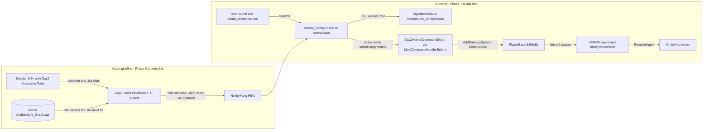

# Plan 12 - Fang (`NimbyFang`, `NimbyFangScripts`)

Draft v0.2, November 2, 2026 (v0.1 November 1, 2026, merged in PR #19). Owner: Jeff Fabish. Implementer: a Claude session in worktree `D:\GitHub\nimby-badlands-server-wt\fang` on branch `feat/fang`, cut from `origin/main` at `faaeedf` (the merge of PR #18, the study), coordinated by the orchestrator. Status: Phase 0 open for steps 1 and 2 (recon, Blender placeholder); steps 3 to 8 wait for the Central Scrutinizer build slot to close (P8).

Changes since v0.1 (Jeff's rulings of November 2, 2026, in a `/decide` pass): the Phase 0 gate is release 1 live, which it is (PR1 done); recon and Blender work run now, the build steps wait for Central Scrutinizer (P8); `storage_997` for the Fang test world with the game port unchanged, because one DayZ server runs at a time (P2 amended); placeholder source commits, binaries are gitignored (P3); the `pack.json` rows arrive at Phase 0 step 4 with the first real content, not in the kickoff, so no empty Fang PBO rides a live patch (P7); the venom course persists under a recorded exception to shared rules 6.1 (P6). PR2 to PR4 were completed the same day. The kickoff pull request carries this version with shared rules v1.11 and the tooling change. The Open questions section is replaced by the rulings above.

Target: NIMBY | HARDCORE | BADLANDS | 1pp, HostHavoc, DayZ 1.30.164200 / Nasdara. Phase 0 runs only on the local replica (`D:\DayZServer`) and ships nothing to live.
Release: Phase 0 produces a test record and this plan's v0.2, not a release. Phase 1 ships as its own pull request and rides the next live patch per [shared rules, 9.2](2026-10-15-shared-rules.md); `NimbyFang` is a content addon under 6.1 (`NimbyAntivenom` persists), so its gate takes the two extra boots.
Origin: Jeff's twelve rulings of November 1, 2026 and the feasibility study `docs/design/fang-feasibility.md` v0.1, merged to `main` in PR #18 the same day.

Fang is a venomous snake in the Badlands wild: a real `AnimalBase` animal on the ambient-life template with a scripted strike, a `VENOM` agent with a 20-minute untreated clock and a 60% death roll, a `NimbyAntivenom` injector, clothing protection by class prefix, authored territories, and staged bite effects. The study carries the evidence; this plan carries the order of work.

## What this is not

- Not the study. Options, `file:line` evidence, the config schema, and the model shortlist stay in `docs/design/fang-feasibility.md`; this plan cites them and repeats nothing that would drift.
- Not a model purchase. No model is bought until Phase 0 exits (FD2). The placeholder is Claude-made and committable.
- Not a Phase 1 plan. Phase 1 and Phase 2 appear below as an outline so the Phase 0 placeholder carries what they need (the pin bones, the two-PBO split); their steps and gate rows arrive in v0.2 after the Phase 0 record.
- Not a change to live. Phase 0 edits `events.xml` and `cfgenvironment.xml` only in a replica-side override on `storage_997`; `server/mission-overrides/` is untouched.
- Not a Workshop dependency. Ambient Animals Pack is a fallback with a named trigger (two Phase 0 failures) and a Jeff ruling before use.

## Decisions

The twelve rulings and the three study defaults, by reference. Plan-level choices this document adds are P1 to P8; P4 and P5 are defaults, the rest are Jeff's rulings of November 2, 2026.

| # | Decision | Choice | Status |
| --- | --- | --- | --- |
| FD1-FD11 | Creature, model source, first loop, treatment, lethality, protection, AI base, spawning, bite feedback, name, sequencing | As recorded in the study's Decisions table | Ruled by Jeff, November 1, 2026 |
| FD12 | Model pick | Open until Phase 0 exits; recommendation #1 Boa (CGTrader, $59.99) | Open |
| FD13 | License read | Jeff reads CGTrader 21A and TurboSquid 7 on the live pages before purchase | Open; not a Phase 0 blocker |
| FD14 | Snake meat | Default: skinning yields two `NimbySnakeMeat` | Default; Phase 1 |
| FD15 | P: drive move | Default: Workbench source moves out of OneDrive before Phase 0 | Default; Phase 0 prerequisite |
| P1 | Branch and worktree | `feat/fang` in the existing `fang` worktree (cut from `origin/main` at `faaeedf`); shared rules 2.1 gains the row (v1.11) | Ruled by Jeff, November 2, 2026 |
| P2 | Test instance | `storage_997`, a fresh world the server creates on first boot, so Fang's persistence never shares a folder with the Hands (`storage_998`) or boot-check (`storage_999`) worlds. The game port stays 2302: `Get-RunningServerMessage` allows one DayZ server at a time, so a second port has nothing to separate; a `-Port` override comes only if that guard is ever relaxed | Ruled by Jeff, November 2, 2026 (997 and port 2502); port amended to "unchanged" by the orchestrator the same day on reading the one-server guard, for Jeff's review in the kickoff pull request |
| P3 | Placeholder source in git | The Blender file, the `.txa` clips, the skeleton definition and the Workbench project text files commit under `mods/own/nimby-pack/NimbyFang/src/`; the compiled `.p3d`, `.xob`, `.anm`, `.asi` and `.paa` are built locally and are gitignored until Jeff rules on binary assets in the public repo | Ruled by Jeff, November 2, 2026 |
| P4 | Graph binding order | Try the vanilla `AmbientLife_Graph.agr` first (the monitor's way); on refusal, copy it into `NimbyFang` as `NimbySnake_Graph.agr` (the bear's way); record which one loaded | Default; matches the study's risk 1 |
| P5 | Phase 0 scope freeze | Two clips (idle, crawl), one test zone, one debug action; no strike, no venom, no antivenom, no sounds in Phase 0 | Default |
| P6 | Shared rules 6.1 and the venom course | Fang exception: the `VENOM` agent count rides vanilla's own `PlayerBase` agent-pool save path and `NimbyVenomMdfr` persists through `ModifiersManager`, so the 20-minute clock survives a relog. The addon overrides no store method on any vanilla class. Fang's removal procedure states that a stale `VENOM` bit remains in saved players. Recorded in shared rules 6.1 (v1.11) | Ruled by Jeff, November 2, 2026 |
| P7 | `pack.json` rows | `NimbyFang` and `NimbyFangScripts` enter `pack.json` at Phase 0 step 4 with the first real content on `feat/fang`, not in the kickoff: `pack.json` has no per-addon release flag, so a stub row would ship two empty PBOs with the next live patch | Ruled by Jeff, November 2, 2026 |
| P8 | Ordering against the Central Scrutinizer build slot | Steps 1 and 2 (recon, Blender) run whenever a session is free; steps 3 to 8 wait until the Central Scrutinizer slot (board ruling of October 21, 2026) closes. The October 21 ruling stands | Ruled by Jeff, November 2, 2026 |

## Architecture

The pipeline is the thing Phase 0 proves; the runtime is what Phase 1 builds on it.

Two PBOs per the study's Addon split: `NimbyFang` (content: config, model, clips, instance, textures) and `NimbyFangScripts` (3_Game, 4_World, 5_Mission). Phase 0 fills `NimbyFang` and creates `NimbyFangScripts` with only the debug action and the self-test stub.

## Prerequisites

PR1 to PR5 must read Done before step 1 (they do, as of November 2, 2026); PR6 and PR8 before step 3; PR7 is part of step 4. Owner Jeff rows are outside the repository; owner orchestrator rows are shared-file edits (shared rules, section 3).

| # | Prerequisite | Owner | State | Evidence when done |
| --- | --- | --- | --- | --- |
| PR1 | Release 1 live on the server (FD11; the v0.1 wording "reaches Jay" meant this, ruled November 2, 2026) | Jeff | Done (live since October 26, 2026) | `STATUS.md` Live section |
| PR2 | Workbench source out of OneDrive (FD15) | Jeff | Done November 2, 2026: the existing extract was copied with robocopy to `D:\DayZProjects` (no re-extract; `WorkDrive /ExtractGameData` only refreshes the extract it already knows), the WorkDrive setting "Path to the Project Drive" reads `D:\DayZProjects`, and P: was remapped by hand for the session | `subst` from the context Workbench runs in reads `P:\: => D:\DayZProjects` (confirm at step 3); `P:\DZ\animals\animations` exists |
| PR3 | Graph files in the repo | Jeff | Done November 2, 2026 | `vendor/dayz-1.30-anim-graphs/animals/AmbientLife/` holds `ambientlife_graph.agr`, `ambientlife_maingraph.agr`, `ambientlife_maingraph.agf`, `ambientlife.ast`, `.ae`, `.aw`, and the hen (two), hare and fox `.asi`; `animals_takistan/AmbientLife/varanus_griseus_skeleton.asi` beside it (the Nasdara PBO prefix is `animals_takistan`). All text. `vendor/` is gitignored |
| PR4 | Blender 3.6.8 or later with the DayZ Animation Tools add-on installed and enabled | Jeff | Done November 2, 2026: Dayz Animation Tools 1.0.0 (Mrtea101) enabled in Blender 5.2 as a Legacy (User) add-on, no error on enable; the folder `BlenderPlugin\DayzAnimationTools` from the repo zip is what goes in `scripts\addons` (the zip itself installs nothing) | Preferences > Add-ons shows it ticked; step 2 confirms the `.txa` export entry |
| PR5 | DayZ Tools present on `F:` (Workbench, Addon Builder, the P: drive mapping) | Jeff | Done (`F:\SteamLibrary\steamapps\common\DayZ Tools`, WorkDrive 1.2.142.6803) | Workbench opens a P: project (step 3) |
| PR6 | Test instance 997 allowed by the tooling (P2): `Test-TestInstanceId` in `scripts/modules/NimbyCommon.psm1`, the `ValidateSet` in `scripts/Start-NimbyTestServer.ps1`, their Pester rows, and the storage-separation row in shared rules section 8 | Orchestrator | In the kickoff pull request (November 2, 2026) | Kickoff merged; `Start-NimbyTestServer.ps1 -InstanceId 997` writes `storage_997` and nothing else (F0-02) |
| PR7 | `pack.json` rows for `NimbyFang` and `NimbyFangScripts` | Orchestrator, at Phase 0 step 4 (P7) | Not before step 4 | The rows land with the first real content on `feat/fang`; `Build-NimbyPack.ps1` boot check green with both (F0-01) |
| PR8 | Shared rules v1.11: 2.1 worktree row, 4.1 identifier row (`65512xx`), 6.1 Fang named a content addon and the P6 exception, section 8 storage row | Orchestrator | In the kickoff pull request (November 2, 2026) | Kickoff merged |

Not prerequisites, recorded so nobody waits on them: the Steam-authenticated read of Ambient Animals Pack's October 22 note (fallback only), the store license read (FD13, before purchase, after Phase 0), the model pick (FD12, after Phase 0), and the removal of the leftover OneDrive extract once a Workbench session on P: has worked.

## Phase 0 - pipeline proof

Half a day of recon, then one to three sessions of pipeline work. Steps are in order; a step with a question in it stops and asks before the next. Steps 1 and 2 run now; steps 3 to 8 wait for the Central Scrutinizer build slot to close (P8).

0. Kickoff pull request (orchestrator, branch `docs/fang-kickoff`): PR6, PR8, and this plan at v0.2. Opened November 2, 2026; merged before step 3.
1. Recon (worktree `fang`, read-only): read `AmbientLife_Graph.agr` and `Varanus_Griseus_Skeleton.asi` from `vendor/dayz-1.30-anim-graphs/`, and the hare and fox `.asi` beside them. Produce `docs/plans/<date>-fang-recon.md` with: the graph's slot list (every animation slot the instance must bind, with which are mandatory), the bone names the template reads (`HeadLookBoneName`, the `CommandLookAtSettings` bones, the `Bite` damage bone), the skeleton file format the `.asi` references, and the three questions below with a recommendation each. Stop and wait for the go.
2. Placeholder skeleton and mesh (Blender): a box-and-tube snake, three bones (`root`, `spine1`, `head`) plus the pin bones the recon names, 200 triangles or fewer, one flat texture. Two clips: `idle` (60 frames, head sway) and `crawl` (60 frames, lateral spine wave, root translation). Export the skeleton and both clips as `.txa` through the add-on. Commit the `.blend` and `.txa` under `mods/own/nimby-pack/NimbyFang/src/` (P3).
3. Workbench import (P: project `NimbyFang`): import the skeleton to `.xob`, the clips to `.anm`, author `NimbySnake_Skeleton.asi` binding the vanilla graph's slots (P4, first attempt). Bind every mandatory slot to one of the two clips; log which slots got `idle`, which got `crawl`. If the editor refuses the vanilla graph, copy it as `NimbySnake_Graph.agr` into the addon and bind that; record the refusal text.
4. Content addon (this step adds the two `pack.json` rows, P7): `NimbyFang/config.cpp` with `CfgPatches` (`requiredAddons[] = { "DZ_Data", "DZ_Animals", "DZ_AI" }` plus the Nasdara animal addon the recon names), `Animal_NimbySnake : AnimalBase` cloned from `Animal_VaranusGriseus` (`DZ/animals_takistan/varanus_griseus/config.cpp:20-114`) with the placeholder `.p3d`, `.xob`, `.asi`, and `aiAgentTemplate = "AmbientLife_NimbySnake"`; `CfgAIBehaviours AmbientLife_NimbySnake` copied from `AmbientLife_Varanus_Griseus` (`DZ/AI_takistan/config.cpp:2010-2028`) unchanged; `NOTICE`. Script side: `NimbyFangScripts` with `Animal_NimbySnake` in 4_World (empty override), the self-test (config classes resolve, the instance file is present in the PBO), and one debug action on the player (`ActionNimbyFangIdle`, server-side, calls `StartCommand_ScriptInst` with the idle clip on the nearest `Animal_NimbySnake` within 10 m; present only when `$profile:NimbyFang\debug` exists).
5. Build: `Build-NimbyPack.ps1` exits 0 (build, sign, verify, boot check on `storage_999`, self-test). Zero `SCRIPT (E)`, zero `[NIMBY][Fang]` errors.
6. Spawn on the replica: a replica-only override of `db/events.xml` (one `AnimalSnake` event, `nominal 2`, `min 1`, `max 2`, child `Animal_NimbySnake`, `active 1`) and `cfgenvironment.xml` plus `env/snake_territories.xml` with one `Zone_Snake` 150 m across a flat test area near the spawn the session picks. Start `Start-NimbyTestServer.ps1 -InstanceId 997 -ProfileName fang` with the exact build (port 2302, the one-server rule). Jeff joins with `Start-NimbyTestClient.ps1 -Connect 127.0.0.1 -Port 2302`.
7. Observe for 30 minutes: the snake wanders (crawl clip, root moves), flees when approached inside the template's alert range (the `BehaviourGoToTarget` slot), returns to idle; the debug action plays `idle` on demand; the server log shows the spawn and no errors. Jeff pastes the lines; screenshots at 1920x1080.
8. Record: `docs/testing/<date>-fang-phase0.md` with rows F0-01 to F0-08 and the exact artifact name; this plan to v0.3 (Phase 1 steps and gate rows, the model purchase go, FD12 recommendation confirmed or changed by what the pipeline accepted); the Notion hub row.

Exit: rows F0-01 to F0-08 green on one artifact. The model purchase (FD2, FD12) happens after this exit and only then.

Fallback ladder, each rung a Jeff ruling: (a) step 3 refuses the vanilla graph, bind a copied graph (P4, inside Phase 0, no ruling needed); (b) a second distinct failure of steps 3 to 5 that the session cannot explain from the recon, stop and bring the evidence; (c) Jeff may then order the Ambient Animals Pack evaluation (study option M3) or a hands-on Workbench session with the orchestrator watching.

Questions the recon answers before step 2:

1. Does the `.asi` reference the skeleton by file or by bone list, and do the hare, fox and monitor instances bind the same slot set?
2. Which graph slots are mandatory for `Master_SM` to enter, and can `idle` fill every one of them without the graph erroring at load?
3. Which bones does the ambient template and the monitor's `Bite` event read by name, so the placeholder carries them from the start?

## Phase 1 - the live snake (outline; the Phase 0 record fills it)

Purchased model retargeted to the Phase 0 skeleton layout; the scripted strike; `MeleeSnake` and the `EEHitBy` branch; the `VENOM` agent and `NimbyVenomMdfr`; `NimbyAntivenom`; the protection table; territories from the monitor set; sounds; the content-addon boots of shared rules 6.1. Gate table in the study's Phases row. The persistence shape is settled (P6).

## Phase 2 - the boot check (outline)

Snake-in-the-boot roll, `Check boots` action, equip-unchecked bite; its own feasibility addendum first (FD3).

## Tests

Phase 0 rows. Every client row needs `$profile:NimbyFang\debug` in the client profile; server rows read the RPT and the script log of the `storage_997` instance.

| Id | Scenario | Required result | Evidence |
| --- | --- | --- | --- |
| F0-01 | Build and boot check | `Build-NimbyPack.ps1` exits 0 with both Fang rows | Build log; `[NIMBY][Fang][SelfTest] PASS`; 0 `SCRIPT (E)` |
| F0-02 | Instance separation | The test server writes `storage_997` and nothing else | Manifest `INSTANCE override=997` and `STORAGE instanceId=997`; `storage_998`, `storage_999` and `storage_1` unchanged by file set and modification time |
| F0-03 | Spawn | At least one `Animal_NimbySnake` exists in the test zone within 10 minutes of boot | Server log spawn line; Central Scrutinizer's entity count if Plan 3 Phase 2 has shipped, else `#monitor` and a screenshot |
| F0-04 | Mesh and skeleton load | The placeholder renders at the snake's position with no missing-model box | Screenshot at 1920x1080; no `Cannot open file` or skeleton warning in the RPT |
| F0-05 | Crawl | The snake moves across the ground with the crawl clip playing | 30-second video or three timed screenshots showing root translation |
| F0-06 | Flee | Approaching inside the template's alert range starts a flee away from the player | Screenshots; the engine's behaviour slot change if the debug log exposes it, else the observed movement |
| F0-07 | Scripted command | The debug action plays `idle` on the nearest snake and returns control to the template afterwards | `[NIMBY][Fang][Debug] StartCommand_ScriptInst clip=idle target=<id>` then the snake resumes wandering |
| F0-08 | 30-minute soak | No `[NIMBY][Fang]` error line and no engine error naming Fang over 30 minutes with the snake in view | RPT and script log excerpt; count of `[NIMBY][Fang]` lines by level |

## Rulings of November 2, 2026

The four open questions of v0.1 are closed; the answers live in the Decisions table (P2, P3, P6, P8) and in the PR1 row. Nothing is open for Phase 0 steps 1 and 2. Steps 3 to 8 open when the Central Scrutinizer slot closes, which Jeff calls.

## Risks

Phase 0 risks only; the study's Risks table covers the mod.

| Risk | Effect | Mitigation |
| --- | --- | --- |
| The 1.30 Workbench Animation Editor will not open or save a text `.agr` from a mod project | Step 3 cannot bind any instance | Recon reads the shipped text format first; P4's copied-graph rung; the fallback ladder's rung (b) |
| The add-on's `.txa` export targets a pre-1.30 import path | Clips import but play wrong or not at all | Step 2 exports one 10-frame test clip first and imports it before building the real two |
| OneDrive still holds the P: source (PR2 skipped) | Workbench file locks and sync churn mid-import, a corrupted project | PR2 is a hard prerequisite; the session checks the P: mapping target before step 3 |
| A Fang test server starts while a Hands or Central Scrutinizer server is up | Two servers on one port and one replica install | `Get-RunningServerMessage` refuses the second start; P8 keeps Fang's server steps out of the Central Scrutinizer slot anyway. `-ProfileName fang` keeps `BEServer_x64.cfg`, the RPT and `$profile:` state out of any other session's folder |
| The placeholder teaches the wrong skeleton layout and the purchased model will not retarget to it | Phase 1 redoes the import | Recon question 3 names the bones first; the placeholder carries the pin bones; the Phase 0 record lists the final bone set the purchased model must map to |
| The snake spawns but the template's vision and alert ranges, tuned for the monitor, look wrong on a 1 m snake | Misread as a pipeline failure | Phase 0 judges load, animate, wander, flee only (P5); range tuning is Phase 1 |

## Files this plan touches

| File | Phase | Owner |
| --- | --- | --- |
| `docs/plans/2026-11-01-fang-plan.md` (this file) | 0 (v0.1 PR #19; v0.2 kickoff) | Fang session, orchestrator |
| `docs/plans/<date>-fang-recon.md` | 0 step 1 | Fang session |
| `mods/own/nimby-pack/NimbyFang/` and `NimbyFangScripts/` | 0 steps 2 to 4 | Fang session |
| `docs/testing/<date>-fang-phase0.md` | 0 step 8 | Fang session |
| `scripts/modules/NimbyCommon.psm1`, `scripts/Start-NimbyTestServer.ps1`, their Pester files, `docs/plans/2026-10-15-shared-rules.md` (v1.11) | 0 step 0 | Orchestrator (kickoff pull request) |
| `mods/own/nimby-pack/pack.json` (two rows) | 0 step 4 | Orchestrator, on `feat/fang` with the content (P7) |
| `D:\DayZServer\mpmissions\dayzOffline.nasdara\db\events.xml`, `cfgenvironment.xml`, `env\snake_territories.xml` | 0 step 6 | Replica-only override; never `server/mission-overrides/` in Phase 0 |
