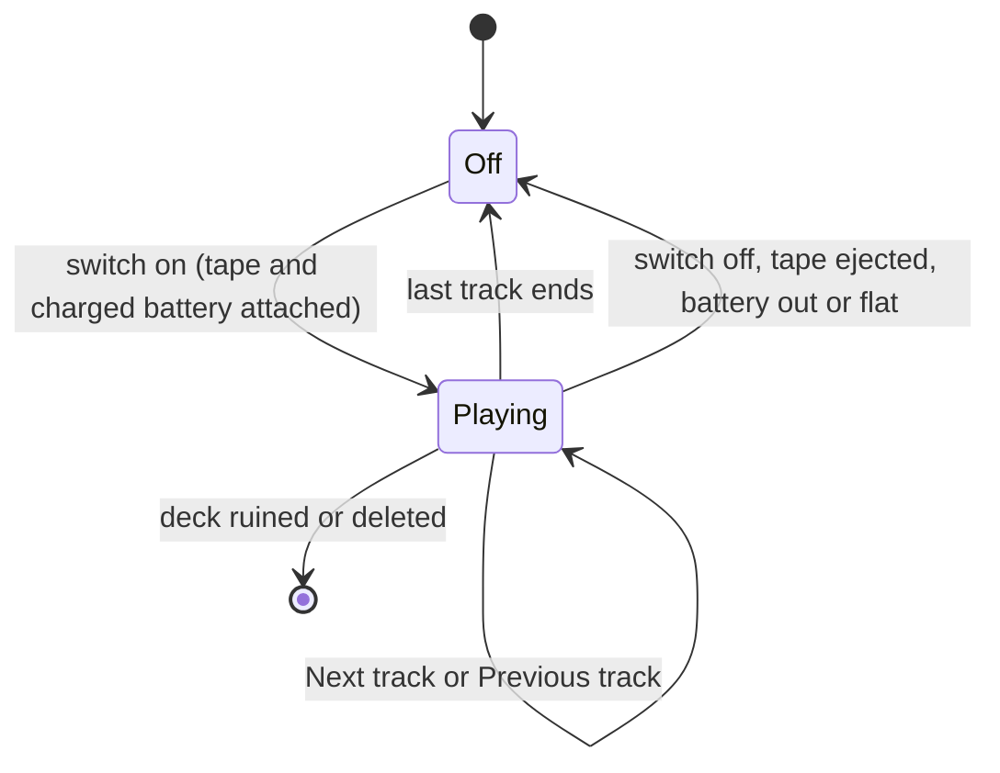

# Plan 13 - Music (`NimbyTapes`, `NimbyTapesAudio`, `NimbyTapesAudioX`)

Draft v0.1, November 9, 2026 (late evening, America/Chicago). Owner: Jeff Fabish. Implementer: a Claude session in worktree `D:\GitHub\nimby-badlands-server-wt\nimby-music` on branch `feat/nimby-music`, cut from `main` at `9454b13`, coordinated by the orchestrator. Status: Phase 0 not started. It opens when the prerequisites table is green. Jeff approved the start on November 9, 2026 as an exception to the one-Phase-0 rule beside Central Scrutinizer (study, M-8).

Target: NIMBY | HARDCORE | BADLANDS | 1pp, HostHavoc, DayZ 1.30 / Nasdara. Phase 0 runs only on the local replica (`D:\DayZServer`) and ships nothing to live.
Release: Phase 0 produces a test record and this plan's v0.2, not a release. Phase 1 ships as its own pull request under [shared rules, 9.2](2026-10-15-shared-rules.md). Music is a content addon under 6.1 (the deck and tapes persist), so its gate takes the two extra boots.
Origin: the feasibility study `docs/design/music-feasibility.md` v0.7 (pull request #28, open as of this draft), its rulings M-1 to M-14, and the four plan-interview rulings T-1 to T-4 below.

Music is a cassette deck, tapes, and a 9V battery. A switched-on deck plays its tape as positional sound that nearby players hear, in step with each other, wherever the deck is carried. A tape holds one or more tracks and the player skips between them. The study carries the evidence; this plan carries the order of work. Every `file:line` is relative to `D:\GitHub\nimby-badlands-server\vendor\dayz-1.30-scripts\` unless it starts with `ZenMusic:` (the ZenMusic repository at commit `3de1452`).

## What this is not

- Not a Zens Music repack and not a Community Framework consumer (M-1). Zen's sync method is reused with credit; none of his files ship in Phase 0.
- Not voice recording, not streaming, not a radio (study, What this is not).
- Not player-made tapes. Mixtapes and submissions are set aside until after Phase 2 (M-5).
- Not a key-binding mod. Controls are action-menu entries only (T-3); no `Inputs.xml`.
- Not a loot change in Phase 0. No `types.xml` row, no live file, no second Workshop item until Phase 1.
- Not an edit to any vanilla class's saved data. The three vanilla classes it mods gain methods only (Architecture).

## Changes since the study

| Topic | Study v0.7 | This plan |
| --- | --- | --- |
| Identifiers | Proposed `NimbyMusic`, `NimbyMusicTapes`, `NimbyMusicTapesX`, `[NIMBY][Music]` | Ruled T-1: `NimbyTapes`, `NimbyTapesAudio`, `NimbyTapesAudioX`, `[NIMBY][Tapes]`. The display name stays Music. The study keeps its old names until its next revision |
| Vanilla classes modded | One (`EffectSound`) | Three: `EffectSound` (wave accessor), `ActionConstructor` (register two actions), `ModItemRegisterCallbacks` (hand pose for the own classes). The study undercounted |
| Play and Stop | Two new actions | The vanilla switch actions (`ActionTurnOnWhileInHands`, `ActionTurnOnWhileOnGround`, and their Off pairs) drive the deck's energy manager; only Next track and Previous track are new |
| Audio PBO in Phase 0 | Separate audio PBO from the start | Phase 0 keeps its one fixture inside `NimbyTapes`; the audio PBOs arrive in Phase 1 (P3) |
| Sync tick | Not stated | Server advances elapsed seconds every 1 second (Zen uses 5); a Phase 0 tuning value |

## Decisions

Study rulings by reference, then the plan interview, then proposals. P rows are proposals until Jeff rules (Open questions).

| # | Decision | Choice | Status |
| --- | --- | --- | --- |
| M-1 to M-14 | Build path, media, handheld, boombox model, player tapes, audio packaging, music sources, build slot, infected, multi-track, track display, flagged default, Phase 1 scope, tape labels | As recorded in the study's Decisions table | Ruled by Jeff, November 9, 2026 |
| T-1 | Identifiers | Code PBO `NimbyTapes`; audio PBOs `NimbyTapesAudio` (in `@NIMBY`) and `NimbyTapesAudioX` (second Workshop item); log prefix `[NIMBY][Tapes]`; classes `NimbyTapes_Deck`, `NimbyTapes_Tape_Base`, `NimbyTapes_Tape_<Id>`; slot `NimbyTape` | Ruled by Jeff, November 9, 2026, after 23:05 Central |
| T-2 | Where a deck plays | Anywhere it is carried: in hands, on the ground, in a backpack or clothing, and in a vehicle's cargo | Ruled, same round |
| T-3 | Controls | Action-menu entries only, with the deck in hands or looked at on the ground. A deck in cargo keeps playing but is taken out to be controlled | Ruled, same round |
| T-4 | Phase 0 audio | A synthesized timing track: mono, 4 minutes, a beep every 5 seconds and a distinct tone pattern every 30 | Ruled, same round |
| P1 | Plan number, branch, worktree | Plan 13; `feat/nimby-music` in the existing `nimby-music` worktree; shared rules 2.1 gains the row | Proposed |
| P2 | Phase 0 scope freeze | One deck class, one test tape with two tracks (timing track A and a shorter timing track B at another pitch), switch on and off, Next and Previous, synced playback, battery drain. No volume steps, no infected noise, no track display, no labels, no flagged audio, no prompt, no loot rows | Proposed |
| P3 | Phase 0 packaging | One `pack.json` row, `NimbyTapes`, holding code and the two fixture files. `NimbyTapesAudio` and `NimbyTapesAudioX` are Phase 1 rows, after the orchestrator rules how a PBO with no script meets the self-test gate | Proposed |
| P4 | Fixtures and git | The timing tracks are generated by `mods/own/nimby-pack/NimbyTapes/tools/New-TimingTrack.ps1` (needs `ffmpeg`) into `NimbyTapes/sound/`, which a `.gitignore` line keeps out of git. No audio file is ever committed | Proposed |
| P5 | Generator home (Phase 1) | `NimbyTapes/tools/New-TapesConfig.ps1` reads `NimbyTapes/tapes.json`, copies audio from the library folder named in `scripts\testserver.local.json`, measures lengths with `ffprobe`, and writes the whole of `NimbyTapesAudio/config.cpp` and `NimbyTapesAudioX/config.cpp`. `Build-NimbyPack.ps1` is not edited | Proposed |
| P6 | Test instances | `storage_999` for every Phase 0 row; `storage_998` only for the Phase 1 release gate. No new instance id | Proposed |
| P7 | Battery life | Start at the vanilla Wilga rate (`energyUsagePerSecond = 0.02`, about 41 minutes on a full 9V); tune after Phase 0 | Proposed |
| P8 | End of tape | The deck switches off after the last track. No repeat | Proposed |
| P9 | RPC | None in Phase 0 or Phase 1: state travels on net-synced variables and the action framework. The 4.1 row still reserves a block | Proposed; the block number is Jeff's (Q1) |

## Architecture

| Piece | Where | Design |
| --- | --- | --- |
| Config | `NimbyTapes/config.cpp` | `CfgPatches` with `requiredAddons[] = { "DZ_Data", "DZ_Radio", "DZ_Gear_Tools", "DZ_Gear_Consumables" }`; `CfgMods` with `gameScriptModule` and `worldScriptModule`; `CfgSlots.Slot_NimbyTape`; `CfgVehicles`; the fixture's `CfgSoundShaders` and `CfgSoundSets` |
| Deck | `NimbyTapes_Deck : Inventory_Base` | Model `\dz\gear\radio\unitra_wilga.p3d`, 2x3, `attachments[] = { "BatteryD", "NimbyTape" }`, `EnergyManager` copied from vanilla `Radio` (`DZ/gear/radio/config.cpp:275-281`). Not derived from `Radio`, whose `ItemRadio` simulation is a tuner |
| Tape | `NimbyTapes_Tape_Base : Inventory_Base` | Model `\dz\gear\tools\cassette.p3d`, 2x1, `inventorySlot[] = { "NimbyTape" }`, config arrays `tracks[]` (sound set names) and `trackSeconds[]`. Phase 0 defines one child, `NimbyTapes_Tape_Test` |
| Rules | `Scripts/3_Game/nimbytapes_rules.c` | Engine-free functions the self-test covers: start fraction from elapsed and length, next and previous index, end-of-track and end-of-tape tests, config array validation |
| Wave accessor | `Scripts/3_Game/nimbytapes_effectsound.c` | `modded class EffectSound` with one getter for the protected wave, as Zen does (`ZenMusic:ZenMusicBase/scripts/3_Game/ZenMusicBase/Effects/EffectSound.c:1-13`) |
| Deck entity | `Scripts/4_World/nimbytapes_deck.c` | Server: on `OnWorkStart` set track 0 and elapsed 0, run a 1-second timer that advances elapsed, moves to the next track at `trackSeconds`, and calls `GetCompEM().SwitchOff()` after the last. `OnWorkStop`, `EEItemDetached` of tape or battery, and `EEDelete` stop it. Client: `OnVariablesSynchronized` starts, restarts, or stops one `EffectSound` |
| Synced state | Deck | `m_Track` (int, -1 when stopped) and `m_Elapsed` (int seconds), registered with `RegisterNetSyncVariableInt` (`scripts/3_Game/DayZ/Entities/EntityAI.c:2850`). Nothing else. Not persisted: a deck is off after a restart |
| Playback | Client | `SEffectManager.CreateSound` on the current track's sound set, `SetParent` to the deck's `GetHierarchyRoot()` (`EntityAI.c:879`), `SoundPlay`, then `SetStartOffset(m_Elapsed / length)` on the wave when elapsed is above zero. `EEItemLocationChanged` (`EntityAI.c:976`) re-parents when the deck changes hands, cargo, or vehicle |
| Actions | `Scripts/4_World/nimbytapes_actions.c` | `NimbyTapesActionNextTrack` and `NimbyTapesActionPrevTrack`, each in an in-hands and an on-ground form, registered through `modded class ActionConstructor`. On and off reuse the vanilla switch actions, which test `HasEnergyManager()` and `CanSwitchOn()` (`.../Actions/Interact/ActionTurnOnWhileOnGround.c:17`) |
| Hand pose | `Scripts/4_World/nimbytapes_register.c` | `modded class ModItemRegisterCallbacks` gives the deck the vanilla Radio profile and the tape the vanilla Cassette profile (`.../ManBase/DayZPlayer/DayZPlayerCfgBase.c:1304,738`) |
| Self-test | `Scripts/4_World/nimbytapes_selftest.c` | Runs when `$profile:NimbyTapes\selftest` exists; prints `[NIMBY][Tapes][SelfTest] PASS|FAIL <case>` and `[NIMBY][Tapes] selftest complete; cases=N failures=M` |
| Debug lines | Deck | Written only while `$profile:NimbyTapes\debug` exists: `[NIMBY][Tapes][Debug] start|advance|stop|sync deck=<net id> track=<i> elapsed=<s>`. Lines that name a player carry `GetId()` and the Steam64 id (shared rules 4.2) |

Save footprint: `NimbyTapes_Deck` and `NimbyTapes_Tape_*` persist the vanilla way (attachments, battery charge, health). No `OnStoreSave` or `OnStoreLoad` override in Phase 0 or Phase 1. Removing the addon removes the decks and tapes and nothing else; rows T0-20 and T0-21 prove it.

## Prerequisites

Every row reads Done before Phase 0 step 1 starts.

| # | Prerequisite | Owner | State | Evidence when done |
| --- | --- | --- | --- | --- |
| PR1 | Pull request #28 (study, and this plan once added) merged to `main` | Jeff | Open | Merge commit on `main` |
| PR2 | Kickoff pull request: `pack.json` row `NimbyTapes` (log prefix `Tapes`) with a stub addon that passes the self-test gate; `*.ogg` added to `includePatterns`; `.gitignore` line for `mods/own/nimby-pack/NimbyTapes/sound/*.ogg`; shared rules 2.1 worktree row and 4.1 identifier row with Music's RPC block | Orchestrator | Open | Merged; `Build-NimbyPack.ps1` boot check green with the stub |
| PR3 | `ffmpeg` and `ffprobe` on Jeff's desktop | Jeff | Unknown | `ffmpeg -version` prints a version |
| PR4 | Zen reference clones at the study's commits under `D:\GitHub\nimby-badlands-server\vendor\` (git-ignored) | Jeff | Open | `vendor\ZenMusic` at `3de1452`, `vendor\ZenModCore` at `5a64e36` |
| PR5 | `feat/nimby-music` holds `main` after PR1 and PR2 | Jeff | Open | `git -C D:\GitHub\nimby-badlands-server-wt\nimby-music merge main` is clean |
| PR6 | Second client (the G15, second Steam account) for rows T0-12 to T0-17 | Jeff | Available per the October ruling | Both clients join the test server |

Not prerequisites: the shared rules 9.3 amendment, the second Workshop item, the first tape list, the label font, and the cassette texture as a PNG. All are Phase 1.

## Phase 0 - pipeline proof

Steps are in order. A step with a question in it stops and asks before the next.

0. Kickoff pull request (orchestrator, `docs/*` branch): PR2. Merged before step 1.
1. Recon (worktree `nimby-music`, read-only). Produce `docs/plans/<date>-music-recon.md` answering the seven questions at the end of this section, each with a `file:line`.
2. Fixtures: write `NimbyTapes/tools/New-TimingTrack.ps1` and generate `timing_a.ogg` (240 seconds) and `timing_b.ogg` (60 seconds, different pitch) into `NimbyTapes/sound/`. Record both lengths from `ffprobe`.
3. Config: `CfgPatches`, `CfgMods`, the slot, the deck, the tape base, `NimbyTapes_Tape_Test` with both tracks, and one shader and one sound set per track (mono, `spatial = 1`, `loop = 0`, starting `range = 25`).
4. Script: rules, wave accessor, deck entity, the two actions, hand-pose registration, self-test, debug lines.
5. Build: `Build-NimbyPack.ps1` exits 0. Zero `SCRIPT (E)`; the self-test gate reports `Tapes ran=yes`.
6. Solo rows on `storage_999`: T0-01 to T0-11, T0-18 to T0-24. Jeff plays; each row is given to him one at a time with the server and client start commands.
7. Two-client rows with the G15: T0-12 to T0-17.
8. Record: `docs/testing/<date>-music-phase0.md` with every row and the exact artifact; this plan to v0.2 (Phase 1 steps and gate rows, tuned range, tick, and drain values); the Notion hub row.

Exit: every T0 row green on one artifact, or a row closed by a recorded Jeff ruling.

Fallback ladder, each rung a Jeff ruling except (a):

- (a) `SetStartOffset` is ignored or drifts beyond 2 seconds: try `Skip(seconds)` on the wave, then a 5-second tick with restart-from-top for late joiners (study R1). Inside Phase 0.
- (b) Sound does not follow a deck in cargo: parent to the root player or vehicle by entity instead of by hierarchy root; if that fails, T-2 narrows to hands and ground and Jeff rules.
- (c) A second failure the session cannot explain from the recon: stop and bring the evidence.

Questions the recon answers before step 2:

1. Which `EnergyManager` config values let `Battery9V` power an own class through `BatteryD` (the vanilla `Radio` block has no `plugType`; `PersonalRadio` has `plugType = 1`)?
2. Do the vanilla switch actions appear for an own `Inventory_Base` class with an energy manager, in hands and on the ground, or do they test for a vanilla type?
3. Which wave kind does `SEffectManager.CreateSound` use, and is that the channel Ears scales?
4. Is `SetStartOffset` applied before or after `SoundPlay`, and does a streamed sample honor it? Zen calls it after (`ZenMusic:.../Devices/Zen_MusicDeviceBase.c:337-344`).
5. Which `sound3DProcessingType` and `volumeCurve` suit a non-looping music sample? `ChristmasMusic_SoundSet` uses `smallItem3DProcessingType` and `LinearCurve` (`DZ/sounds/hpp/config.cpp:194396-194407`).
6. Does `EEItemLocationChanged` fire on the client for every move T-2 allows, including into a vehicle's cargo?
7. Does the hosted static gate's pack check (`scripts/Test-NimbyRepo.ps1:142`) pass for an addon whose `.ogg` files are absent from the checkout?

## Phase 1 - deck and tapes (outline, v0.2 fills it)

Tuned values from Phase 0; volume steps and infected attraction through `NoiseSystem.AddNoiseTarget` (`scripts/3_Game/DayZ/Noise.c:10`), scaled by volume (M-9); track display in the action prompt and inspect window (M-11); `tapes.json` and the generator (P5); `NimbyTapesAudio` and `NimbyTapesAudioX` with the second Workshop item (M-6, M-13); the first-play prompt for flagged tracks and the Greet line (M-12); generated handwriting labels through the cassette's `zbytek` selection (M-14); 10 to 15 tapes; loot rows drafted in `server/` and logged in `LOOT-CHANGELOG.md`; the content-addon boots of 6.1 on `storage_998`; the shared rules 9.3 amendment.

## Phase 2 - boombox (outline)

Claude-made boombox model first (M-4), two 9V batteries, longer range, placeable; tape case; DPV mount slot.

## Tests

Phase 0 rows. Client rows need `$profile:NimbyTapes\debug` in the client profile. Distances are paced or read from a rangefinder; no row depends on a map coordinate.

| Id | Scenario | Required result | Evidence |
| --- | --- | --- | --- |
| T0-01 | Build and boot check | `Build-NimbyPack.ps1` exits 0 with the `NimbyTapes` row | Build log; `SELFTEST Tapes ran=yes`; 0 `SCRIPT (E)` |
| T0-02 | Self-test | Every rules case passes: start fraction at 0, mid, and past the end; next at last track; previous at track 0; empty and mismatched arrays refused | `[NIMBY][Tapes] selftest complete; cases=N failures=0` |
| T0-03 | Attach | A 9V and the test tape attach to the deck and show in its slots; a second tape is refused | Screenshot; inventory state |
| T0-04 | Switch on in hands | Track A is audible to the holder from the first beep | Debug `start track=0`; heard |
| T0-05 | Switch off in hands | Sound stops within one second | Debug `stop`; heard |
| T0-06 | Switch on and off on the ground | Same as T0-04 and T0-05 with the deck on the ground | Debug lines; heard |
| T0-07 | Auto-advance | Track B starts within 2 seconds of track A's recorded length | Debug `advance track=1 elapsed=0`; timestamps |
| T0-08 | End of tape | The deck switches itself off after track B | Debug `stop`; the switch action reads on again |
| T0-09 | Next and Previous | Each action changes the track and restarts from its start; Next on the last track and Previous on the first behave as the rules define | Debug lines; heard |
| T0-10 | Battery | Removing the battery stops the sound; a flat battery stops it and the deck will not switch on | Debug `stop`; heard |
| T0-11 | Eject while playing | Removing the tape stops the sound and switches the deck off | Debug `stop`; heard |
| T0-12 | Carried in a backpack | With the deck playing in the first client's pack, the second client hears the sound move with that player | Second client's account; debug `sync` on both |
| T0-13 | Vehicle cargo | The same with the deck in a moving vehicle's cargo | Second client's account |
| T0-14 | Walk-in sync | The second client walks into range mid-track; beeps on both clients land within about one second | Both clients' recordings side by side |
| T0-15 | Relog sync | The second client relogs mid-track and hears the same point | As T0-14 |
| T0-16 | Falloff | Clear at 5 m, faint near the shader range, silent beyond it, indoors and outdoors; values recorded for tuning | Tester's notes; final `range` and `volume` |
| T0-17 | Two decks | Two decks in range play different tracks without cutting each other | Heard on both clients |
| T0-18 | Earplugs | Ears in: the music is muffled as other effects are | Heard; Ears state line |
| T0-19 | Ruined and deleted | A ruined deck stops; a deck deleted while playing leaves no sound on any client | Heard; no orphan effect after 30 seconds |
| T0-20 | Save and reload | After a save and a restart, the deck returns with its tape and battery, switched off | Inventory state; RPT with 0 "Scripted variables corrupted" |
| T0-21 | Boot without the addon | Booting that saved storage with `NimbyTapes` removed shows only its items missing and 0 "Scripted variables corrupted" | RPT excerpt |
| T0-22 | 30-minute soak | No `[NIMBY][Tapes]` error line and no `SCRIPT (E)` over 30 minutes of play, skip, and carry | RPT and script log excerpt |
| T0-23 | Size | PBO size with both fixtures, and build time, recorded | Build log; file sizes |
| T0-24 | Model look | Screenshots answer two questions: does the Wilga show a tape door, and which faces does the cassette's `zbytek` selection cover (one flat test texture) | Screenshots at 1920x1080 |

## Open questions for Jeff

| # | Question | Default if not ruled | Needed by |
| --- | --- | --- | --- |
| Q1 | Music's RPC block in shared rules 4.1 (`65512xx` is claimed three times; the Shoulder study names `65513xx`) | Orchestrator assigns the next free block | PR2 |
| Q2 | P2: is the Phase 0 scope freeze right, with two tracks in | As proposed | Step 2 |
| Q3 | P3 and P4: one PBO in Phase 0, fixtures generated and git-ignored | As proposed | PR2 |
| Q4 | In-game names: the deck ("Cassette Player") and the test tape ("Test Tape") | As written | Step 3 |
| Q5 | P7 and P8: battery life near 41 minutes, and the deck switching off at the end of a tape | As proposed; tune in v0.2 | Phase 1 |
| Q6 | The second Workshop item's name | `@NIMBY-Tapes` | Phase 1 |
| Q7 | Volume steps: how many, and the default | Four steps, default the second | Phase 1 |

## Risks

| # | Risk | Effect | Mitigation |
| --- | --- | --- | --- |
| K1 | Start offset does not hold on 1.30 | Late joiners out of step | T0-14, T0-15; fallback (a) |
| K2 | Sound does not follow a deck in cargo | T-2 cannot be met as ruled | T0-12, T0-13; fallback (b) |
| K3 | Vanilla switch actions do not show for an own class | On and off need own actions | Recon question 2; two more small actions |
| K4 | The self-test gate rejects a PBO with no script | Phase 1 audio rows fail the build | P3 keeps Phase 0 clear; orchestrator rules before Phase 1 |
| K5 | A once-a-second sync per playing deck costs more than expected | Server load with many decks | T0-22 measures; the tick can rise to 5 seconds |
| K6 | Three seats share one test server | A boot refused while another seat's server runs | The running-server guard already refuses; rows run when the server is free |
| K7 | `ffmpeg` is missing on a build machine | Fixtures cannot be generated | PR3; the script fails with the install command |
| K8 | Study and plan disagree on names until the study's next revision | A reader follows the wrong prefix | Changes since the study; this plan wins |

## Second opinion

Jeff runs this plan past a second model before Phase 0. The reviewer needs a local checkout, because `vendor/` is git-ignored and every citation points into it. The review brief is `logs\brief-music-plan-review.md` (git-ignored). Findings come back as plan v0.2 changes or as Open questions; none is applied without Jeff's ruling where it touches a ruled decision.

## Files this plan touches

| File | Phase | Owner |
| --- | --- | --- |
| `docs/plans/2026-11-09-music-plan.md` (this file) | 0 | Music session |
| `docs/plans/<date>-music-recon.md` | 0 step 1 | Music session |
| `mods/own/nimby-pack/NimbyTapes/` | 0 steps 2 to 4 | Music session |
| `docs/testing/<date>-music-phase0.md` | 0 step 8 | Music session |
| `mods/own/nimby-pack/pack.json`, `.gitignore`, `docs/plans/2026-10-15-shared-rules.md` | 0 step 0 | Orchestrator (kickoff pull request) |
| `docs/design/music-feasibility.md` | Next revision: names per T-1 | Music session |
| `mods/own/nimby-pack/NimbyTapesAudio/`, `NimbyTapesAudioX/`, `server/` loot drafts | 1 | Music session; loot applied by Jeff |
