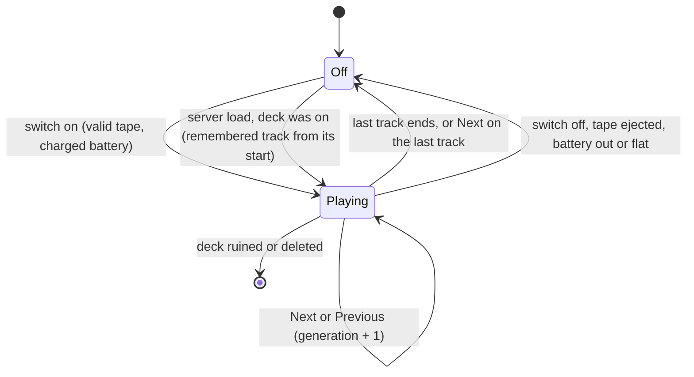

# Plan 13 - Music (`NimbyTapes`, `NimbyTapesAudio`, `NimbyTapesAudioX`)

Draft v0.3, November 9, 2026 (late evening, America/Chicago). Owner: Jeff Fabish. Implementer: a Claude session in worktree `D:\GitHub\nimby-badlands-server-wt\nimby-music` on branch `feat/nimby-music`, cut from `main` at `9454b13`, coordinated by the orchestrator. Status: Phase 0 not started. It opens when the prerequisites table is green. Jeff approved the start on November 9, 2026 as an exception to the one-Phase-0 rule beside Central Scrutinizer (study, M-8).

Changes since v0.2: Jeff's six rulings of November 9, 2026, after 23:46 Central (T-9 to T-14). A deck that was playing resumes after a restart, which replaces v0.2's switch-off after load; the packed state and the test-kit flag are ruled; tape memory moves into Phase 0; the deck is named Cassette Player; volume has four steps.

Changes since v0.1: a second-opinion review (Codex, `gpt-6-astra`, reasoning high, read-only; `logs\second-opinion-music-plan-20261109-232224.md`) returned NOT READY with 2 blockers and 26 should-fix findings. Every finding was checked against the source and stands. Version 0.2 folded them in and recorded Jeff's four rulings from the review (T-5 to T-8). The section Review record lists each change.

Target: NIMBY | HARDCORE | BADLANDS | 1pp, HostHavoc, DayZ 1.30 / Nasdara. Phase 0 runs only on the local replica (`D:\DayZServer`) and ships nothing to live.
Release: Phase 0 produces a test record and this plan's v0.4, not a release. Phase 1 ships as its own pull request under [shared rules, 9.2](2026-10-15-shared-rules.md). Music is a content addon under 6.1 (the deck and tapes persist), so its gate takes the two extra boots.
Origin: the feasibility study `docs/design/music-feasibility.md` v0.7 (pull request #28), its rulings M-1 to M-14, and the plan rulings T-1 to T-14 below.

Music is a cassette deck, tapes, and a 9V battery. A switched-on deck plays its tape as positional sound that nearby players hear, in step with each other, wherever the deck is carried. A tape holds one or more tracks and the player skips between them. The study carries the evidence; this plan carries the order of work. Every `file:line` is relative to `D:\GitHub\nimby-badlands-server\vendor\dayz-1.30-scripts\` unless it starts with `ZenMusic:` (`vendor\ZenMusic` at commit `3de1452`). A native declaration cited here is evidence that an API exists, not proof of how it behaves at run time; where behavior matters, a test row is named.

## What this is not

- Not a Zens Music repack and not a Community Framework consumer (M-1). Zen's sync method is reused with credit; none of his files ship in Phase 0.
- Not voice recording, not streaming, not a radio (study, What this is not).
- Not player-made tapes. Mixtapes and submissions are set aside until after Phase 2 (M-5).
- Not a key-binding mod. Controls are action-menu entries only (T-3); no `Inputs.xml`.
- Not a loot change in Phase 0. No `types.xml` row, no live file, no second Workshop item until Phase 1.
- Not an edit to any vanilla class's saved data. The four vanilla classes it mods gain methods only (Architecture).

## Changes since the study

| Topic | Study v0.7 | This plan |
| --- | --- | --- |
| Identifiers | Proposed `NimbyMusic`, `NimbyMusicTapes`, `NimbyMusicTapesX`, `[NIMBY][Music]` | Ruled T-1: `NimbyTapes`, `NimbyTapesAudio`, `NimbyTapesAudioX`, `[NIMBY][Tapes]`. The display name stays Music. The study keeps its old names until its next revision |
| Vanilla classes modded | One (`EffectSound`) | Four: `EffectSound` (wave accessor), `ActionConstructor` (register the skip actions), `ModItemRegisterCallbacks` (hand pose for the own classes), `MissionBaseWorld` (self-test and flag hook at mission start, as Tack does). The study undercounted |
| On and off | Two new actions | The vanilla switch actions drive the deck's energy manager; the deck's own `SetActions()` adds them. Only Next track and Previous track are new |
| A deck after a restart | "A deck is stopped after a restart", stated as a consequence of not persisting | Wrong as a consequence: vanilla saves and restores the energy manager's switch state (`scripts/3_Game/DayZ/Entities/EntityAI.c:2926,3047-3049`). Ruled T-9: a deck that was playing resumes, from the start of the tape's remembered track |
| Synced state | Track index plus elapsed seconds, two variables | One packed integer carrying generation, track, and elapsed, so a client never sees half an update (T-10) |
| Elapsed time | A counter advanced by a timer | Derived from the server clock (`GetTickTime`, `scripts/3_Game/DayZ/Global/Game.c:914`); the 1-second timer only publishes and checks it |
| Tape position memory | Kept on the tape in a net-synced variable, this session only | Ruled T-5 and T-12: the tape keeps its track across restarts, one saved integer on the own tape class, built in Phase 0 |
| Multi-track proof | Phase 1 | Phase 0, with two fixture tracks (P2) |
| Persistence instance | Phase 0 on 997 or 999 (corrected in v0.6 to 998 and 999) | Phase 0 on `storage_999` only, labelled preliminary; the 6.1 boots on the `storage_998` live copy are Phase 1 |
| Generator | Inside `Build-NimbyPack.ps1`, writing config, a `types.xml` draft, and the attribution list | Its own script in the addon's `tools\` folder (P5); it still writes the `types.xml` draft and the attribution list. Phase 1 |
| Size measurement | One track, then a second, by Workshop update size | Phase 0 records PBO size with one fixture and with two (T0-23). Workshop update size is measured at the Phase 1 release, because Phase 0 publishes nothing |
| Audio PBO in Phase 0 | Separate audio PBO from the start | Phase 0 keeps its fixtures inside `NimbyTapes`; the audio PBOs arrive in Phase 1 (P3) |

## Decisions

Study rulings by reference, then the plan rulings, then proposals. P rows not yet ruled are adopted defaults: Jeff saw each in the November 9 decide rounds and ruled on the ones that shape code; the rest stand unless he objects. P7 is a provisional value for Phase 0.

| # | Decision | Choice | Status |
| --- | --- | --- | --- |
| M-1 to M-14 | Build path, media, handheld, boombox model, player tapes, audio packaging, music sources, build slot, infected, multi-track, track display, flagged default, Phase 1 scope, tape labels | As recorded in the study's Decisions table | Ruled by Jeff, November 9, 2026 |
| T-1 | Identifiers | Code PBO `NimbyTapes`; audio PBOs `NimbyTapesAudio` (in `@NIMBY`) and `NimbyTapesAudioX` (second Workshop item); log prefix `[NIMBY][Tapes]`; classes `NimbyTapes_Deck`, `NimbyTapes_Tape_Base`, `NimbyTapes_Tape_<Id>`; slot `NimbyTape` | Ruled by Jeff, November 9, 2026, after 23:05 Central |
| T-2 | Where a deck plays | Anywhere it is carried: in hands, on the ground, in a backpack or clothing, and in a vehicle's cargo | Ruled, same round |
| T-3 | Controls | Action-menu entries only, with the deck in hands or looked at on the ground. A deck in cargo keeps playing but is taken out to be controlled | Ruled, same round |
| T-4 | Phase 0 audio | A synthesized timing track: mono, 4 minutes, a beep every 5 seconds and a distinct tone pattern every 30 | Ruled, same round |
| T-5 | Tape memory | A tape keeps its track across ejects and across restarts: one saved integer on `NimbyTapes_Tape_Base`, version guarded. It resumes at the start of that track. When a tape plays to its end, or Next is used on its last track, the memory returns to track 1. Phase 0 (T-12) | Ruled by Jeff, November 9, 2026, after 23:31 Central |
| T-6 | Skip rules | Like a tape deck. Next on the last track ends the tape and switches the deck off. Previous restarts the current track when more than 3 seconds in, otherwise goes back one; at the start of track 1 it restarts track 1. Both do nothing while the deck is off. The deck switches off after the last track; no repeat | Ruled, same round |
| T-7 | Sync | Required. A player who arrives mid-track lands within 2 seconds of the others, measured from one recording that captures both clients. The session may try `Skip()` when `SetStartOffset` fails. Restart-from-top is never substituted without Jeff's ruling, and a waived row is recorded as a waiver, not a pass | Ruled, same round |
| T-8 | RPC block | `65514xx`, reserved. `65513xx` stays where the Shoulder study put it. Fang and Tweaker both name `65512xx`, which is the DPV's; that cleanup is Jeff's and is not part of Music | Ruled, same round |
| T-9 | After a restart | A deck that was switched on resumes playing, from the start of the tape's remembered track. A deck that was off stays off. Accepted consequence: a deck left on plays to an empty world after a restart until its tape ends or its battery is flat | Ruled by Jeff, November 9, 2026, after 23:46 Central |
| T-10 | Synced state | One packed integer (was P10): generation 8 bits, track 6 bits (63 means stopped), elapsed seconds 16 bits | Ruled, same round |
| T-11 | Test kit | The flag file (was P11): while `$profile:NimbyTapes\spawn-testkit` exists on the server, each connecting player receives a deck, the test tape, the probe tape, a full 9V, and a nearly flat 9V, and the deck gains two debug actions, Ruin and Delete. Modeled on `$profile:NimbyDpv\spawn-testcar` (`mods/own/nimby-pack/NimbyDpv/Scripts/5_Mission/nimbydpv_missionserver.c`). The flag never exists on live; without it the code is silent | Ruled, same round |
| T-12 | Phase 0 scope | The P2 scope plus tape memory, in one PBO (P3): one deck class, one test tape with two tracks, one texture-probe tape, switch on and off, Next and Previous per T-6, synced playback, battery drain, resume after restart, the tape's saved track. No volume steps, no infected noise, no track display, no labels, no flagged audio, no prompt, no loot rows | Ruled, same round |
| T-13 | Names | The deck is "Cassette Player" in game. The Phase 0 tapes are "Test Tape" and "Probe Tape" | Ruled, same round |
| T-14 | Volume | Four steps (low, medium, loud, full) through Volume up and Volume down actions; a deck starts at medium. Volume scales the infected attraction (M-9). It travels in its own synced variable, is not saved, and returns to medium after a restart. Phase 1 | Ruled, same round |
| P1 | Plan number, branch, worktree | Plan 13; `feat/nimby-music` in the existing `nimby-music` worktree; shared rules 2.1 gains the row | Adopted default |
| P2 | Phase 0 scope freeze | Superseded by T-12 | Ruled |
| P3 | Phase 0 packaging | One `pack.json` row, `NimbyTapes`, holding code and the fixtures. `NimbyTapesAudio` and `NimbyTapesAudioX` are Phase 1 rows | Ruled as part of T-12 |
| P4 | Fixtures and git | The two timing tracks are generated by `mods/own/nimby-pack/NimbyTapes/tools/New-TimingTrack.ps1` into `NimbyTapes/sound/`, which a `.gitignore` line keeps out of git. No audio file is ever committed. The flat probe texture is a small own `.paa` and is committed | Adopted default |
| P5 | Generator home (Phase 1) | `NimbyTapes/tools/New-TapesConfig.ps1` reads `NimbyTapes/tapes.json`, copies audio from the library folder named in `scripts\testserver.local.json`, measures lengths with `ffprobe`, and writes `NimbyTapesAudio/config.cpp`, `NimbyTapesAudioX/config.cpp`, a `types.xml` draft, and the attribution list. `Build-NimbyPack.ps1` is not edited | Adopted default |
| P6 | Test instances | `storage_999` for every Phase 0 row; `storage_998` only for the Phase 1 release gate. No new instance id | Adopted default |
| P7 | Battery life | The vanilla Wilga rate (`energyUsagePerSecond = 0.02` against a 50-unit 9V, about 41 minutes; `DZ/gear/radio/config.cpp:279`, `DZ/gear/consumables/config.cpp:593-594`) | Provisional for Phase 0; tune in v0.4 |
| P8 | End of tape | The deck switches off after the last track | Ruled as part of T-6 |
| P9 | RPC | None in Phase 0 or Phase 1: state travels on net-synced variables and the action framework | Adopted default; the block is T-8 |
| P10 | Packed state | Superseded by T-10 | Ruled |
| P11 | Test kit | Superseded by T-11 | Ruled |

## Architecture

| Piece | Where | Design |
| --- | --- | --- |
| Config | `NimbyTapes/config.cpp` | `CfgPatches` with `requiredAddons[] = { "DZ_Data", "DZ_Radio", "DZ_Gear_Tools", "DZ_Gear_Consumables" }`; `CfgMods` with `gameScriptModule` and `worldScriptModule`; `CfgSlots.Slot_NimbyTape`; `CfgVehicles`; the fixtures' `CfgSoundShaders` and `CfgSoundSets` |
| `NOTICE` | `NimbyTapes/NOTICE` | Present from the kickoff stub (the static gate refuses an addon without one, `scripts/Test-NimbyRepo.ps1:115`). Credits Zenarchist for the sync method, names the ZenMusic commit, and lists any method or file taken, as the study's M-1 requires |
| Deck | `NimbyTapes_Deck : Inventory_Base` | Model `\dz\gear\radio\unitra_wilga.p3d`, 2x3, `attachments[] = { "BatteryD", "NimbyTape" }`, `EnergyManager` copied from vanilla `Radio` (`DZ/gear/radio/config.cpp:275-281`). No `plugType`; the energy manager treats an undefined plug as compatible (`scripts/3_Game/DayZ/tools/Component/ComponentEnergyManager.c:972-977`). Not derived from `Radio`, whose `ItemRadio` simulation is a tuner |
| Tape | `NimbyTapes_Tape_Base : Inventory_Base` | Model `\dz\gear\tools\cassette.p3d`, 2x1, `inventorySlot[] = { "NimbyTape" }`, config arrays `tracks[]` (sound set names) and `trackSeconds[]`. Holds the remembered track, `m_NimbyTapesTrack`, server-side and saved (Save footprint). Phase 0 defines `NimbyTapes_Tape_Test` ("Test Tape") and `NimbyTapes_Tape_Probe` ("Probe Tape", the flat texture on `zbytek`) |
| Rules | `Scripts/3_Game/nimbytapes_rules.c` | Engine-free functions the self-test covers. Expected outputs are in Rules cases |
| Wave accessor | `Scripts/3_Game/nimbytapes_effectsound.c` | `modded class EffectSound` with one getter for the protected wave, as Zen does (`ZenMusic:ZenMusicBase/scripts/3_Game/ZenMusicBase/Effects/EffectSound.c:1-13`) |
| Deck, server | `Scripts/4_World/nimbytapes_deck.c` | `OnWorkStart`: validate the tape and its config arrays; on failure switch off and log; otherwise read the tape's remembered track, record the track's start as a `GetTickTime` value, publish state, start a 1-second timer. Each tick: elapsed is now minus start; publish; when elapsed reaches `trackSeconds`, advance and write the new track to the tape or, after the last track, reset the tape's memory to track 1 and `GetCompEM().SwitchOff()`. `OnWorkStop`, `EEItemDetached` of tape or battery, ruin, and `EEDelete` stop the timer and publish stopped. Every mutation ends in one `SetSynchDirty()` |
| After load | Deck, server | Vanilla switches a saved-on device back on while it loads (`EntityAI.c:3047-3049`), which can run before the deck's tape and battery attachments exist. The deck therefore does not start playback from `OnWorkStart` while loading; its own `AfterStoreLoad()` (`EntityAI.c:1419`) calls `super`, then, when the energy manager is on, validates the tape and starts the remembered track from its beginning, or switches off when the tape or power is missing (T-9). No store-format override on the deck. T0-20 |
| Synced state | Deck | One packed `int` (T-10), registered with `RegisterNetSyncVariableInt` (`EntityAI.c:2850`). Generation increments on every start, track change, and restart of a track |
| Deck, client | Same file | `OnVariablesSynchronized` calls `super`, unpacks, bounds-checks, and reconciles (table below). One `EffectSound` at most per deck |
| Playback | Client | `SEffectManager.CreateSound` on the track's sound set, `SetParent` to the deck's `GetHierarchyRoot()` (`EntityAI.c:879`), `SetSoundAutodestroy(true)`, `SoundPlay`, then `SetStartOffset(elapsed / length)` on the wave when elapsed is above zero. The fraction unit is supported by Zen's usage (`ZenMusic:.../Devices/Zen_MusicDeviceBase.c:337-344`) and by vanilla calling it after `Play` (`scripts/3_Game/DayZ/Sound.c:175-179`); it is not documented, and T0-14 and T0-15 verify it. A null effect or null wave is logged and retried on the next sync |
| Following the carrier | Client | Re-parent on the deck's `EEItemLocationChanged` (`EntityAI.c:976`), and, because a parent container can move without the deck's own location changing, a 0.5-second client check while playing compares `GetHierarchyRoot()` with the current parent and re-parents on a difference |
| Effect lifetime | Client | One teardown function, safe to call twice: `SoundStop`, `SEffectManager.DestroyEffect`, clear the reference. Called on stop, on a generation change, on the wave's end event, in `EEDelete`, and when the deck leaves the client's bubble. The manager keeps a reference to every effect it plays (`scripts/3_Game/DayZ/EffectManager.c:3,40-42`) and autodestroy is off by default (`scripts/3_Game/DayZ/Effects/EffectSound.c:68`). A debug counter tracks created minus destroyed |
| Actions | `Scripts/4_World/nimbytapes_actions.c` | The deck's `SetActions()` adds the four vanilla switch actions (`ActionTurnOnWhileInHands`, `ActionTurnOffWhileInHands`, `ActionTurnOnWhileOnGround`, `ActionTurnOffWhileOnGround`), which a plain `ItemBase` does not have (`scripts/4_World/DayZ/Entities/ItemBase.c:246-253`), and four own classes: Next and Previous, each in an in-hands and an on-ground form, registered through `modded class ActionConstructor`. The vanilla switch-on test checks power, not a tape (`.../SingleUse/ActionTurnOnWhileInHands.c:52`), so the server validates the tape in `OnWorkStart`. Each own action re-validates on the server at execution: deck alive, switched on, tape present |
| Hand pose | `Scripts/4_World/nimbytapes_register.c` | `modded class ModItemRegisterCallbacks` gives the deck the vanilla Radio profile and the tapes the vanilla Cassette profile (`.../ManBase/DayZPlayer/DayZPlayerCfgBase.c:1304,738`) |
| Mission hook | `Scripts/4_World/nimbytapes_selftest.c` | `modded class MissionBaseWorld`, `OnInit`: read the debug and test-kit flags, and on the server run the self-test when `$profile:NimbyTapes\selftest` exists, as Tack does (`mods/own/nimby-pack/NimbyTack/Scripts/4_World/nimbytack_selftest.c:8-29`). Prints one `[NIMBY][Tapes][SelfTest] PASS|FAIL <case>` per case and `[NIMBY][Tapes] selftest complete; cases=N failures=M` |
| Debug lines | Both sides | Only while `$profile:NimbyTapes\debug` exists. Server: `[NIMBY][Tapes][Debug] start|advance|stop|publish deck=<net id> gen=<g> track=<i> elapsed=<s>`. Client: `client play|seek|stop|reparent|create|delete deck=<net id> gen=<g> track=<i> offset=<s> effects=<count>`. Lines that name a player carry `GetId()` and the Steam64 id (shared rules 4.2) |

Client reconciliation, keyed on the unpacked state against what the client is playing:

| Incoming | Local | Client does |
| --- | --- | --- |
| Stopped | Anything | Teardown |
| Playing, same generation | Playing that generation | Nothing. Progress updates never restart a wave |
| Playing, same generation | Nothing playing (wave ended early, or start failed) | Start at the published elapsed, unless elapsed is at or past the track length |
| Playing, new generation | Anything | Teardown, then start the published track at the published elapsed |
| Playing, any | Tape attachment or its config not yet present on the client | Hold the state and retry on the next sync, and on a 0.5-second check for up to 5 seconds; then log and stay silent |
| Out of range values | Anything | Log and teardown |

Rules cases. The self-test prints each by name, and T0-02 checks the list, not only the count.

| Case | Input | Expected |
| --- | --- | --- |
| `pack-roundtrip` | generation 0, 1, 255; track 0, 62, 63; elapsed 0, 1, 65535 | Unpack returns the same three values |
| `pack-generation-wrap` | generation 255 plus 1 | 0 |
| `fraction-start` | elapsed 0, length 240 | 0 |
| `fraction-mid` | elapsed 120, length 240 | 0.5 |
| `fraction-past-end` | elapsed 300, length 240 | Refused (no start) |
| `fraction-bad-length` | length 0 or negative | Refused |
| `next-middle` | track 0 of 2 | Track 1 |
| `next-last` | track 1 of 2 | End of tape (deck off) |
| `previous-late` | track 1, elapsed 10 | Track 1, elapsed 0 |
| `previous-early` | track 1, elapsed 2 | Track 0 |
| `previous-first` | track 0, elapsed 2 | Track 0, elapsed 0 |
| `skip-while-off` | stopped, Next or Previous | No change |
| `config-empty` | `tracks[]` empty | Refused |
| `config-mismatch` | 2 tracks, 1 length | Refused |
| `config-missing-name` | an empty sound set name | Refused |
| `config-too-many` | 64 or more tracks (index 63 means stopped) | Refused |
| `memory-in-range` | remembered track 1 on a 2-track tape | Track 1 |
| `memory-out-of-range` | remembered track 5 on a 2-track tape, or a negative value | Track 0 |

Save footprint: `NimbyTapes_Deck` and `NimbyTapes_Tape_*` persist the vanilla way (attachments, battery charge, health, and the energy manager's own fields). One store override exists, from Phase 0, on `NimbyTapes_Tape_Base` only (T-5, T-12): field list `int m_NimbyTapesTrack`, save version 1, written after `super` and read behind a version guard, as rule 6.1 requires. A value outside the tape's track count loads as track 1. The deck has no store override. No vanilla class gains saved data in any phase. This is the plan's one saved field, and `storage_999` is the only world that holds it until the Phase 1 gate.

## Prerequisites

Every row reads Done before Phase 0 step 1 starts.

| # | Prerequisite | Owner | State | Evidence when done |
| --- | --- | --- | --- | --- |
| PR1 | Pull request #28 (study and this plan) merged to `main` | Jeff | Open | Merge commit on `main` |
| PR2 | Kickoff pull request: `pack.json` row `NimbyTapes` (log prefix `Tapes`) with a stub addon that has a `NOTICE`, a `CfgMods` script folder, and one real self-test case invoked from `MissionBaseWorld.OnInit`; `*.ogg` added to `includePatterns`; `.gitignore` line for `mods/own/nimby-pack/NimbyTapes/sound/*.ogg`; shared rules 2.1 worktree row and 4.1 identifier row with RPC block `65514xx` | Orchestrator | Open | Merged; `Build-NimbyPack.ps1` boot check green with `SELFTEST Tapes ran=yes` |
| PR3 | `ffmpeg` and `ffprobe` on Jeff's desktop | Jeff | `ffmpeg` 9.0.2 with `libvorbis` verified November 9, 2026; `ffprobe` installed by the same package, not yet run | `ffmpeg -version` and `ffprobe -version` both print a version |
| PR4 | Zen reference clones under `D:\GitHub\nimby-badlands-server\vendor\` (git-ignored) | Jeff | Done November 9, 2026 | `vendor\ZenMusic` at `3de1452`, `vendor\ZenModCore` at `5a64e36` |
| PR5 | `feat/nimby-music` holds `main` after PR1 and PR2 | Jeff | Open | `git -C D:\GitHub\nimby-badlands-server-wt\nimby-music merge main` is clean |
| PR6 | Second client (the G15, second Steam account) | Jeff | Available per the October ruling | Both clients join the test server |
| PR7 | Script reference is current: the `dta\scripts.pbo` hash of the server the replica mirrors matches the newest baseline, `docs/baselines/2026-10-31-dayz-1.30-164200-scripts-reference.md` (shared rules, section 7). On a mismatch the orchestrator re-extracts before step 1 | Music session checks; orchestrator re-extracts | Open | Hash line in the recon document |
| PR8 | DayZ Tools `ImageToPAA` for the probe texture (`F:\SteamLibrary\steamapps\common\DayZ Tools\Bin\ImageToPAA\ImageToPAA.exe`, the path the Greet Phase 0 record used) | Jeff | Present per the Greet record | The probe `.paa` exists |

Not prerequisites: the shared rules 9.3 amendment, the second Workshop item, the first tape list, the label font, and the cassette texture as a PNG. All are Phase 1.

## Phase 0 - pipeline proof

Steps are in order. A step with a question in it stops and asks before the next.

0. Kickoff pull request (orchestrator, `docs/*` branch): PR2. Merged before step 1.
1. Recon (worktree `nimby-music`, read-only). Check PR7 first. Produce `docs/plans/<date>-music-recon.md` answering the questions at the end of this section. Each answer is marked supported (with a `file:line`), contradicted, or unresolved; an unresolved answer names the test row that settles it. Recon does not have to reach certainty on run-time behavior before step 2.
2. Fixtures: write `NimbyTapes/tools/New-TimingTrack.ps1` (Windows PowerShell 5.1 and PowerShell 7, a log file, a failure message that carries the `ffmpeg` install command) and generate `timing_a.ogg` (240 seconds) and `timing_b.ogg` (60 seconds, different pitch) into `NimbyTapes/sound/`. Write `NimbyTapes/tools/Test-TapesAssets.ps1`: both files exist, `ffprobe` reports Vorbis, mono, 44,100 Hz, and each length matches `trackSeconds` in the config within 1 second. Make the flat probe texture and convert it with `ImageToPAA`.
3. Config: `CfgPatches`, `CfgMods`, the slot, the deck, the tape base, `NimbyTapes_Tape_Test` with both tracks, `NimbyTapes_Tape_Probe`, and one shader and one sound set per track (mono, `spatial = 1`, `loop = 0`, starting `range = 25`).
4. Script: rules, wave accessor, deck (server and client), tape with its saved track, actions, hand-pose registration, mission hook and self-test, test kit (T-11), debug lines. Keep `NOTICE` current.
5. Build: `Test-TapesAssets.ps1` passes, then `Build-NimbyPack.ps1` exits 0. Zero `SCRIPT (E)`; `SELFTEST Tapes ran=yes`; both `.ogg` files are listed inside the built PBO. A hosted static-gate PASS is not evidence that the audio is present: the pack check compares against the files that exist in the checkout (`scripts/Test-NimbyRepo.ps1:159`).
6. Solo rows on `storage_999`: T0-01 to T0-09, T0-18, T0-20, T0-21, T0-23 to T0-26. The session gives Jeff one row at a time, each with the server and client start commands. Server: `Start-NimbyTestServer.ps1 -ServerPath D:\DayZServer -InstanceId 999 -BuildPath <the artifact>`; `pack.json` defaults to instance 998 and, without `-ServerPath`, the script can pick the Steam install. Client: `Start-NimbyTestClient.ps1` with the same artifact. The server profile holds `NimbyTapes\debug` and `NimbyTapes\spawn-testkit`; the client profile holds `NimbyTapes\debug`.
7. Two-client rows with the G15: T0-10 to T0-17, T0-19, T0-22.
8. Record: `docs/testing/<date>-music-phase0.md` with every row, the exact artifact, both fixtures' hashes, and the proposed Notion hub text. This plan goes to v0.4 (Phase 1 steps and gate rows, tuned range, tick, and drain values). The hub itself is updated after Jeff merges the Phase 0 pull request, not before: nothing on a `feat/*` branch is referenced in the hub until then (shared rules, 2.2).

Exit: every behavior row green on one artifact, or a row closed by a recorded Jeff ruling and marked waived. T0-23 and T0-25 are informational: they pass when their evidence is recorded.

Fallback ladder:

- (a) `SetStartOffset` is ignored, or a late joiner lands more than 2 seconds out: try `Skip(seconds)` on the wave, then a finer published clock. Inside Phase 0, no ruling needed. If neither meets T-7, stop and bring the evidence; restart-from-top is Jeff's to accept or refuse.
- (b) Sound does not follow a deck in cargo: move the effect each client tick to the root's position instead of parenting it, with the same teardown. If that fails, stop; narrowing T-2 to hands and ground is Jeff's ruling.
- (c) The vanilla switch actions do not appear for the own class: write own on and off actions (two more small classes). Inside Phase 0.
- (d) A second failure the session cannot explain from the recon: stop and bring the evidence.

Questions for the recon:

1. Do the vanilla switch actions show for an own `Inventory_Base` class once `SetActions()` adds them, and can the switch-on prompt be hidden for a deck with no tape (an override the energy manager consults), or does the server-side refusal in `OnWorkStart` stand alone?
2. Which wave kind does the effect use (`WAVEEFFECTEX`, `EffectSound.c:65`), and does `SetSoundVolume` on the sound scene, which Ears calls (`mods/own/nimby-pack/NimbyEarplugs/Scripts/5_Mission/nimbyearplugs_missiongameplay.c:238`), scale it? Source may not settle this; T0-18 does.
3. Does a streamed sample honor `SetStartOffset`, and what happens when the header has not loaded yet (`EffectSound.c:177-181`)? T0-14, T0-15.
4. Which `sound3DProcessingType` and `volumeCurve` suit a non-looping music sample? `ChristmasMusic_SoundSet` uses `smallItem3DProcessingType` and `LinearCurve`, but loops (`DZ/sounds/hpp/config.cpp:194396-194407`). T0-16.
5. Does `EEItemLocationChanged` fire on the client for the deck's own moves, and is any callback raised on a descendant when an ancestor container moves? The 0.5-second root check covers the second case either way. T0-12, T0-13.
6. Is a net-synced `int` delivered whole, and in what order do the deck's variable, its tape attachment, and the energy manager's state reach a client that is receiving the deck for the first time? T0-14, T0-15.
7. What does the engine do with an attached vanilla battery when its parent's class no longer resolves (T0-21)?
8. During a storage load, in what order do the energy manager's `SwitchOn`, the deck's attachments, and `AfterStoreLoad` happen, and does `OnWorkStart` fire before the tape exists? The After load design assumes it can; T0-20 settles it.

## Phase 1 - deck and tapes (outline, v0.3 fills it)

Tuned values from Phase 0; four volume steps (T-14) and infected attraction through `NoiseSystem.AddNoiseTarget` (`scripts/3_Game/DayZ/Noise.c:10`, a positional target with a strength multiplier; the attraction radius is measured, not assumed), scaled by volume (M-9); track display in the action prompt and inspect window (M-11); `tapes.json` and the generator (P5); `NimbyTapesAudio` and `NimbyTapesAudioX` with the second Workshop item (M-6, M-13); the first-play prompt for flagged tracks (M-12); generated handwriting labels through the cassette's `zbytek` selection (M-14); 10 to 15 tapes; loot rows drafted in `server/` and logged in `LOOT-CHANGELOG.md`; the content-addon boots of 6.1 on `storage_998`.

Phase 1 work that is not the Music session's to do, with owners:

| Item | Why | Owner |
| --- | --- | --- |
| Static gate and boot gate treatment of an audio PBO with no script | The static check requires a `CfgMods` script folder (`scripts/Test-NimbyRepo.ps1:133`) and the boot gate requires a self-test line per `logPrefix` | Orchestrator |
| A second package output | `Build-NimbyPack.ps1` writes every selected client row into one output (`:776-777`); `NimbyTapesAudioX` needs its own folder, `meta.cpp`, and Workshop id | Orchestrator |
| Release gate for the second item | Boot with `NimbyTapesAudioX` removed: only flagged tapes missing | Orchestrator runs; Music session writes the row |
| Shared rules 9.3 amendment (two Workshop items) | Reserved to Jeff by M-6 | Jeff |
| The Greet line for the flagged-tape option (M-12) | Greet text is another addon's file | Greet's own session and pull request |
| Workshop update size with one tape added | Phase 0 publishes nothing | Measured at the Phase 1 release |

## Phase 2 - boombox (outline)

Claude-made boombox model first (M-4), two 9V batteries, longer range, placeable; tape case; DPV mount slot.

## Tests

Phase 0 rows. Distances are paced or read from a rangefinder; no row depends on a map coordinate. "Recording" means one device (a phone, or one PC capturing its own output) recording sound; for two-client rows it sits where it hears both clients' speakers, so one file holds both and skew is read from the waveform. Each row names what would make it fail.

| Id | Scenario | Required result | Evidence |
| --- | --- | --- | --- |
| T0-01 | Assets, build, boot check | `Test-TapesAssets.ps1` passes; `Build-NimbyPack.ps1` exits 0 with the `NimbyTapes` row; both `.ogg` files are inside the PBO | Asset log; build log; `SELFTEST Tapes ran=yes`; 0 `SCRIPT (E)`; PBO file list |
| T0-02 | Self-test | All 18 named Rules cases print PASS; none is missing | The 18 `[SelfTest] PASS <case>` lines by name; `cases=18 failures=0` |
| T0-03 | Attach and refuse | A 9V and the test tape attach and show in the deck's slots; a second tape is refused; a deck with no tape, switched on, switches itself off and logs why | Screenshot; debug `stop reason=no-tape` |
| T0-04 | Switch on in hands | Track A plays from its first beep through at least 30 seconds without restarting | Server `start`; client `play offset=0`; recording |
| T0-05 | Switch off in hands | Silence within 1 second of the action | Recording that includes the click of the action and the silence; client `stop` |
| T0-06 | On and off on the ground | T0-04 and T0-05 with the deck on the ground and the player looking at it | As T0-04 and T0-05 |
| T0-07 | Auto-advance | Track A plays to its end without looping; track B's first beep is heard within 2 seconds after A's recorded length | Recording across the boundary; server `advance`; client `play track=1 offset=0` |
| T0-08 | End of tape | After track B the deck is off: silence, and the prompt offers switch on | Server `stop reason=end-of-tape`; screenshot of the prompt |
| T0-09 | Skip rules | Each T-6 case on the live deck: Next mid-tape; Next on the last track (deck off); Previous after 10 seconds (same track from its start); Previous within 3 seconds on track B (track A); Previous within 3 seconds on track A (track A from its start); three rapid Next or Previous presses leave one track playing, not two | Server and client lines per press; recording; `effects=1` after the rapid presses |
| T0-10 | Battery, both clients | With client 2 listening: removing the battery silences both within 1 second. Separately, the nearly flat 9V runs down while playing, both go silent, and the deck will not switch on; the time and the charge before and after are recorded | Recording; server `stop reason=power`; charge readings and elapsed time |
| T0-11 | Eject, both clients | Removing the tape while playing silences both clients and the deck is off | Recording; server `stop reason=no-tape` |
| T0-12 | Carried, both clients | The deck plays from client 1's backpack and from a clothing pocket; client 2 hears it move with client 1. Then client 1 drops the backpack with the deck inside and walks away: the sound stays with the backpack. Client 1 picks it up again: the sound follows again | Client 2 recording; client `reparent` lines |
| T0-13 | Vehicle, both clients | The deck plays in a vehicle's cargo while it drives past client 2; then in the driver's backpack while they get in, drive, and get out | Client 2 recording; `reparent` lines |
| T0-14 | Sync, entering the sound's range | Client 2, already near enough to have the deck replicated, walks into hearing range mid-track, once with the deck on the ground and once with it in client 1's backpack. Skew is 2 seconds or less at three points, including within 10 seconds of a track's start and of its end | One recording holding both clients; the 30-second tone pattern identifies the absolute position, not only beep alignment |
| T0-15 | Sync, first replication | Client 2 gets the deck fresh, three ways: connects for the first time while it plays; relogs while it plays; leaves far enough for the client `delete` line to appear and returns for `create`. Skew is 2 seconds or less each time | As T0-14, plus the client `create` and `play offset=` lines |
| T0-16 | Falloff (tuning) | Clear at 5 m, faint near the shader range, silent beyond it, indoors and outdoors | Tester's notes; the final `range`, `volume`, and curve are recorded for v0.3 |
| T0-17 | Two decks | Two decks in range playing different tracks, then the same track, do not cut each other | Recording; `effects=2` |
| T0-18 | Earplugs | Ears in: the music is muffled as other effects are; Ears out: restored | Recording across the toggle; Ears state line |
| T0-19 | Ruined and deleted, both clients | The debug Ruin action stops the deck; the debug Delete action on a playing deck leaves no sound on either client | Recording; `effects=0` on both clients 30 seconds later |
| T0-20 | Restart while playing | Save and restart with one deck playing track B and a second deck off. After the restart the first deck is on and plays track B from its first beep; the second is still off; both keep tape, battery, and a charge no higher than before | Recording after the restart; server `start reason=after-load track=1`; charge before and after; RPT with 0 "Scripted variables corrupted" |
| T0-21 | Boot without the addon (preliminary) | Before the last save, record the inventory: a loose deck, a loose tape, a deck holding a tape and a 9V, a backpack holding a deck, and a loose control 9V and control backpack. Keep a copy of the saved storage. Boot it with `NimbyTapes` removed: the decks and tapes are gone, the controls and the enclosing backpack remain, 0 "Scripted variables corrupted". What became of the attached 9V is recorded either way. This row is preliminary: the gate's version runs on the `storage_998` live copy in Phase 1 | Before and after inventories; RPT; the storage copy's path |
| T0-22 | 30-minute soak | Four decks playing, skipped and carried through the half hour: no `[NIMBY][Tapes]` error and no `SCRIPT (E)` in the whole interval; the client's `effects=` count never exceeds the number of decks in its bubble and returns to 0 after all stop; skew at minute 29 is 2 seconds or less; publish lines arrive once a second per deck with no gap above 3 seconds | `Read-NimbyTestRun.ps1` verdict over the full run folder; full timestamped logs kept; recordings at minute 1 and minute 29 |
| T0-23 | Size (informational) | PBO size and build time with one fixture and with two | Build logs; file sizes |
| T0-24 | Hand pose | The deck and a tape in hands sit in the hand as the vanilla Radio and Cassette do, standing, crouched, and prone, with no item floating or clipping through the arm | Screenshots beside the vanilla items |
| T0-26 | Tape memory | Eject the test tape while track B plays, put it in another deck, switch on: track B from its start. Leave that tape loose through a save and restart, then play it: still track B. Let it play to the end, switch on again: track A | Server `start track=` lines; recording |
| T0-25 | Model look (informational) | Does the Wilga show a tape door, and which faces does the cassette's `zbytek` selection cover (the probe tape) | Screenshots at 1920x1080 |

No row covers server load in numbers beyond the publish cadence in T0-22; if the soak shows gaps, v0.4 adds a measured row.

## Open questions for Jeff

Nothing here blocks Phase 0.

| # | Question | Default if not ruled | Needed by |
| --- | --- | --- | --- |
| Q1 | The second Workshop item's name | `@NIMBY-Tapes` | Phase 1 |
| Q2 | Registry cleanup: Fang and Tweaker both name `65512xx`, the DPV's block | Jeff assigns when those plans are next opened | Not Music |
| Q3 | Battery life (P7): about 41 minutes on a full 9V | Tune after Phase 0 | v0.4 |

## Risks

| # | Risk | Effect | Mitigation |
| --- | --- | --- | --- |
| K1 | Start offset does not hold on 1.30, or its unit is not a fraction | Late joiners out of step | T0-14, T0-15; fallback (a); T-7 forbids a silent downgrade |
| K2 | Sound does not follow a deck in cargo or a moved container | T-2 cannot be met as ruled | Root check every 0.5 seconds; T0-12, T0-13; fallback (b) |
| K3 | Vanilla switch actions do not show for an own class | On and off need own actions | Recon question 1; fallback (c) |
| K4 | Effects leak without a sound | Client memory grows over a session | One teardown path; the `effects=` counter; T0-19, T0-22 |
| K5 | A once-a-second publish per playing deck costs more than expected | Server load with many decks | T0-22 records cadence with four decks; the publish interval can rise because elapsed comes from the clock, not the tick count |
| K6 | Variable, attachment, and power state reach a new client in an unexpected order | A silent or wrong start | Packed state; hold-and-retry in the reconciliation table; T0-15 |
| K7 | Three seats share one test server | A boot refused while another seat's server runs | The running-server guard already refuses; rows run when the server is free |
| K8 | The static gate passes with the audio missing | A build with silent tapes looks green | `Test-TapesAssets.ps1` before every build; T0-01 lists the PBO contents |
| K9 | An attached vanilla battery is lost when the addon is removed | A removal costs players batteries | T0-21 records it; Phase 1 decides whether the release note says so |
| K10 | Study and plan disagree on names until the study's next revision | A reader follows the wrong prefix | Changes since the study; this plan wins |
| K11 | `OnWorkStart` fires during a storage load before the tape attachment exists | A resumed deck switches itself off, or starts the wrong track | The After load design defers the start; recon question 8; T0-20 |
| K12 | A deck left on drains its battery after each restart with nobody near | Players find flat batteries | Accepted by T-9; the Greet text can say to switch off before logging out |
| K13 | The tape's saved field is the addon's first save-format commitment | A later change needs a version bump and a guard | Version guard from the start; T0-21 on test storage before any live world holds a tape |

## Review record

Second opinion, November 9, 2026: Codex CLI 0.163.0, `gpt-6-astra`, reasoning effort high, read-only sandbox, 143,230 tokens; the working tree was clean afterwards. Verdict NOT READY. The reviewer found no cited `file:line` wrong or moved.

| Finding | Check | Change in v0.2 |
| --- | --- | --- |
| BLOCKER: the energy manager's switch state is saved and restored, so a deck saved while playing restarts | Confirmed, `EntityAI.c:2926,3047-3049` | v0.2 switched the deck off after load. v0.3 replaces that with Jeff's ruling T-9: it resumes on purpose, with the start deferred until its attachments have loaded; T0-20 saves while playing |
| BLOCKER: step 8 updated the Notion hub from a `feat/*` branch | Confirmed, shared rules 2.2 | Hub text is prepared in the test record; the hub changes after Jeff's merge |
| Client transition algorithm unspecified | Agreed | Reconciliation table; generation counter; T0-09 rapid presses |
| Two synced integers assumed atomic | Not determinable from source | One packed integer (T-10); hold-and-retry; recon question 6 |
| Tick count is not a clock | Agreed | Elapsed from `GetTickTime`; the timer publishes |
| Offset unit and streamed accuracy unproven | Agreed | Labelled as supported by Zen's usage; null-wave handling; T0-14 and T0-15 at boundaries |
| Re-parenting misses ancestor moves | Agreed, `EntityAI.c:878-879` | 0.5-second root check; T0-12 and T0-13 extended |
| Fallback (b) repeated the design | Agreed | Replaced with position following |
| Effect ownership missing | Confirmed, `EffectManager.c:3,40-42`, `EffectSound.c:68` | One teardown path, autodestroy, counter |
| Switch actions not attached; no tape check | Confirmed, `ItemBase.c:246-253`, `ActionTurnOnWhileInHands.c:52` | `SetActions()`; server validation; T0-03 empty deck |
| No mission-start hook; class count wrong | Confirmed against Tack | `MissionBaseWorld` hook; four modded classes |
| `NOTICE` omitted | Confirmed, `Test-NimbyRepo.ps1:115` | In PR2 and step 4 |
| Removal guarantee stronger than its evidence | Agreed | T0-21 inventories and a kept snapshot; labelled preliminary |
| Script-reference hash check missing; recon over-asked | Confirmed, shared rules section 7 | PR7; recon may answer "unresolved" with a row |
| Test setup incomplete | Confirmed, `pack.json` `testServer.instanceId` is 998 | The test kit (T-11); exact server parameters in step 6 |
| `ffprobe` and probe texture not covered | Agreed | PR3, PR8, step 2 |
| P7 and P8 needed before Phase 1 | Agreed | P7 provisional for Phase 0; P8 ruled in T-6 |
| Evidence mixed server intent with sound | Agreed | Client debug lines and recordings |
| Boundary acceptance circular | Agreed | T-6 and the Rules cases table |
| Stop rows ran solo | Agreed | T0-10, T0-11, T0-19 moved to both clients; drain measured |
| Audible range is not replication range | Agreed | T0-14 and T0-15 split; one recording for both clients |
| Sound, Ears, and pose claims narrower than success | Agreed | T0-17 same track; T0-24 pose; recon questions 2 and 4 |
| Soak measured nothing | Agreed | T0-22 thresholds |
| Static pack check passes without audio | Confirmed, `Test-NimbyRepo.ps1:159` | `Test-TapesAssets.ps1`; K8 |
| Fallback (a) changed the promise | Agreed | T-7; fallback (a) rewritten |
| Unrecorded study differences | Confirmed, study line 223 and others | Changes since the study extended; T-5, built in Phase 0 by T-12 |
| Phase 1 owners missing | Confirmed, `Test-NimbyRepo.ps1:133`, `Build-NimbyPack.ps1:776-777` | Owners table under Phase 1 |
| NIT: evidence rows are not gates; counts in wording | Agreed | T0-23 and T0-25 informational; wording corrected |

## Files this plan touches

| File | Phase | Owner |
| --- | --- | --- |
| `docs/plans/2026-11-09-music-plan.md` (this file) | 0 | Music session |
| `docs/plans/<date>-music-recon.md` | 0 step 1 | Music session |
| `mods/own/nimby-pack/NimbyTapes/` (config, `NOTICE`, `Scripts/`, `tools/`, the probe texture) | 0 steps 2 to 4 | Music session |
| `docs/testing/<date>-music-phase0.md` | 0 step 8 | Music session |
| `mods/own/nimby-pack/pack.json`, `.gitignore`, `docs/plans/2026-10-15-shared-rules.md` | 0 step 0 | Orchestrator (kickoff pull request) |
| `docs/design/music-feasibility.md` | Next revision: names per T-1, resume after restart per T-9, tape memory per T-5 | Music session |
| `mods/own/nimby-pack/NimbyTapesAudio/`, `NimbyTapesAudioX/`, `server/` loot drafts | 1 | Music session; loot applied by Jeff |
| `scripts/Build-NimbyPack.ps1`, `scripts/Test-NimbyRepo.ps1` (second package, audio PBO gate treatment) | 1 | Orchestrator |
